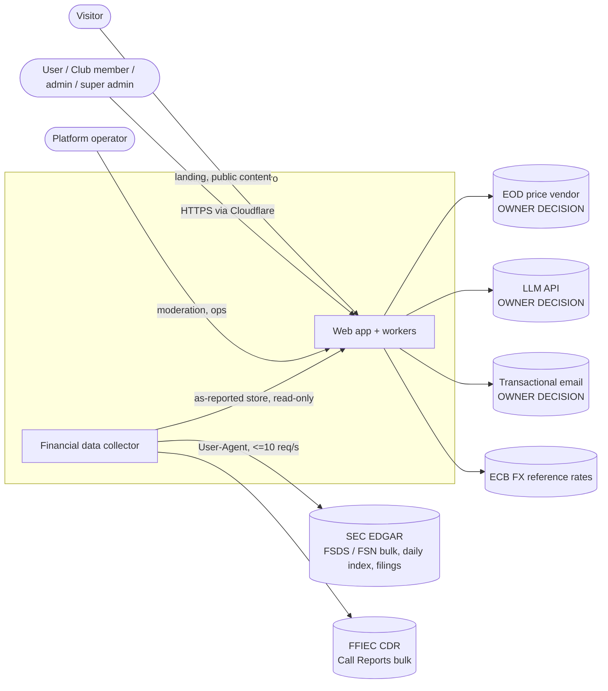
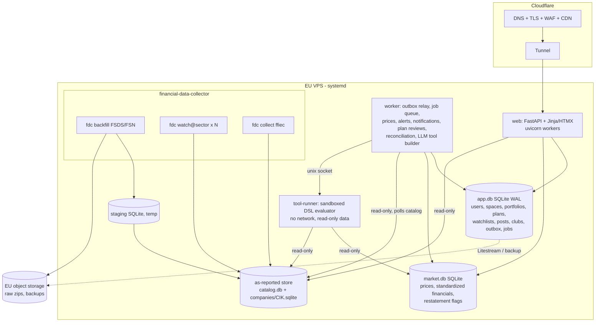

# 00 — Overview: Intelligent Investor Pro (V1)

Status: **design v0.1 (2026-11-06)**, architect design mode. Input: `claude/01-requirements.md` (requirements v0.1) and `claude/02-architect-brief-system-design.md` (coordinator). Requirements are owned by the coordinator; this document does not add or change any. Anything not stated there is marked **ASSUMPTION** and listed in §6.

## Document map

| Doc | Content |
|---|---|
| `00-overview.md` (this) | goals, scope, constraints, C4 context/container, requirement traceability, assumptions, risks, owner questions |
| `01-domain.md` | ubiquitous language, subdomains, bounded contexts, context map, aggregates/invariants/events |
| `02-implementation.md` | architecture style, module layout (hexagonal), patterns, APIs, data stores, authN/Z, cross-cutting, guidelines checklist `G-xx` |
| `03-deployment.md` | hosting, environments, scaling, HA/DR, observability, CI/CD, cost, DevOps handoff checklist |
| `04-testing.md` | test strategy, BR coverage matrix, NFR tests, regression, QA handoff checklist |
| `05-data-collector.md` | collector/watcher design (T2), as-reported store (T3), sizing test (milestone M0) |
| `06-security-authz-sandbox.md` | authorization model (T6), user-built tool sandbox and conversational builder (T4), GDPR |
| `07-roadmap.md` | phased implementation plan, milestone M0 acceptance criteria |
| `adr/ADR-NNN-*.md` | one ADR per key decision (index below) |
| `architect.config.md` | settings for architect impl mode |

## 1. Goals

1. A social, long-term-investing portfolio manager that **records decisions and never trades or holds money** (BR-14).
2. A trustworthy **as-reported** financial data asset from SEC (and bank regulator) filings, 12 years deep, incrementally maintained (BR-02..05, BR-15, BR-16).
3. Reuse the owner's proven screener logic (`the_intelligent_investor`) as built-in tools (FR-10).
4. Run on a **low budget**, operated by **one owner-developer plus AI agents** (NFR-10, NFR-12), scaling from a ≤100-user beta to ~10,000 users without re-architecture (NFR-01).

## 2. Scope

**In scope (V1):** everything in requirements §1 "V1 in scope". **Out of scope:** trading/brokerage, custody/pooling of money, streaming prices, mobile apps, non-SEC foreign filers (except 20-F/40-F), club portfolios that hold money.

## 3. Constraints

| # | Constraint | Source |
|---|---|---|
| C-1 | Python 3.12+, `uv`, ruff, mypy strict, pytest — same conventions as `the_intelligent_investor` | NFR-12, existing repo |
| C-2 | SQLite, systemd timers, Cloudflare (Pages/Tunnel) preferred where adequate | brief, NFR-12 |
| C-3 | SEC fair access: declared `EDGAR_USER_AGENT`, ≤ 10 req/s | NFR-07 |
| C-4 | Raw SEC zips never committed to GitHub | brief / research |
| C-5 | Bulk loads must stream (current server has 1 GB RAM) | research |
| C-6 | Personal data hosted in the EU (owner in NL, GDPR) | NFR-08 |
| C-7 | `intelligent_investor_social` and `financial-data-collector` are **public** repos; `the_intelligent_investor` is **private** | GitHub (checked 2026-11-06) |
| C-8 | Data jobs run on the server, never on GitHub Actions (data sites block shared IPs) | existing repo rule |

## 4. Architecture at a glance

- **Style:** modular monolith (Python, FastAPI, server-rendered Jinja + HTMX) with one hexagonal module per bounded context, run as a few **processes** from one codebase: `web`, `worker`, `tool-runner` (sandboxed). [ADR-001, ADR-014]
- **Collector:** separate repo/package `financial-data-collector` (`fdc`), its own processes (backfill, per-sector watchers, FFIEC collector). It publishes an **as-reported store** (one SQLite file per company + a catalog DB) whose schema is the published language consumed read-only by the app. [ADR-002, ADR-003, ADR-004, ADR-005, ADR-006]
- **App data:** one transactional SQLite DB (WAL) behind SQLAlchemy Core repositories + Alembic, Postgres-ready with defined switch criteria. [ADR-007]
- **Reconciliation:** an anti-corruption layer turns as-reported facts into standardized annual financials (the screener's `AnnualFinancials`), with lineage; the screener's pure modules are reused as a library. [ADR-008]
- **User tools:** declarative ToolSpec DSL produced by an LLM from conversation, executed by an isolated, resource-limited `tool-runner` with read-only public data. No arbitrary user code in V1. [ADR-009, ADR-010]
- **AuthZ:** resource-based policies in the application layer; "spaces" (private space, club space) with roles; per-item shares. [ADR-011]
- **Async:** transactional outbox + DB-backed job queue + polling of the collector catalog. No message broker. [ADR-013]
- **Prices:** EOD bulk prices via a vendor-agnostic `PriceProvider` port; vendor is an owner decision. [ADR-012]
- **Hosting:** one dedicated EU VPS, systemd + uv, Cloudflare DNS/WAF/Tunnel, continuous encrypted backups to EU object storage. [ADR-015, ADR-018]
- **Identity:** self-managed accounts (email + password, argon2id, email verification), server-side sessions. [ADR-016] **Notifications:** in-app + email via an EU transactional email provider. [ADR-017]

### C4 — System context

### C4 — Containers

## 5. Requirement traceability

Every BR/FR/NFR maps to design elements (doc §) and ADRs. Tests per BR: `04-testing.md` §4.

### Business rules

| Req | Design element | Docs / ADR |
|---|---|---|
| BR-01 | `Portfolio` aggregate rejects any `PortfolioChange` without a non-blank `Reason` (domain invariant, also DB `CHECK`) | 01 §5.4; 02 §6; ADR-007 |
| BR-02 | As-reported store keeps `sub/num/tag/pre/txt` verbatim incl. extension tags, filer labels, line order, units, segments; standardization only in the separate Reconciliation context | 05 §3–4; ADR-003, ADR-008 |
| BR-03 | Facts keyed by accession (`adsh`); amendments are separate filings; no cross-filing upsert; `fact_revision` table | 05 §5; ADR-004 |
| BR-04 | Backfill window = 12 years (config `history_years: 12`), quarters from 2014q4 onward at 2026-11 | 05 §4; ADR-004 |
| BR-05 | `collector_run` + `collected_item(source, item_key)`; loads idempotent per item and per `adsh`; incremental by default | 05 §6; ADR-005 |
| BR-06 | Private space, owner-only `SpacePolicy`; repositories always filter by viewer | 06 §2; ADR-011 |
| BR-07 | `Share` grants (community or user) with `read`/`run`; recipients can copy (ASSUMPTION A-07) | 06 §2.3; ADR-011 |
| BR-08 | `Club` aggregate: exactly one super admin; role transitions guarded in domain | 01 §5.6; 06 §2.4; ADR-011 |
| BR-09 | Club space policy: every member may read all club documents and comment | 06 §2.4 |
| BR-10 | `ImportToolToClub` copies a `Tool` version into the club space with provenance | 01 §5.3; 06 §2.4 |
| BR-11 | `MarkAsBought` application service: one DB transaction creating a position (with reason) + copies of club plan/analysis into private space | 01 §5.6; 02 §6 |
| BR-12 | `InvestmentPlan` requires horizon + ≥1 measurable `Expectation` (metric, comparator, target, evaluation date) | 01 §5.4 |
| BR-13 | EOD price job; pages show latest stored price; no streaming | 02 §8; ADR-012 |
| BR-14 | No order/broker/payment adapters exist; guideline G-20 forbids them; disclaimer in UI | 02 §13; ADR-001 |
| BR-15 | One watcher instance per sector (`fdc-watch@<sector>`); SIC→sector map | 05 §7; ADR-006 |
| BR-16 | `SourceCollector` plug-ins; FFIEC call report collector; every row carries `source` | 05 §8; ADR-002 |

### Functional requirements

| Req | Design element | Docs / ADR |
|---|---|---|
| FR-01 | `fdc backfill` from SEC bulk data sets, form filter 10-K/10-Q/20-F/40-F (+/A), streaming staging loads | 05 §4; ADR-004 |
| FR-02 | Notes from Financial Statement **and Notes** data sets (`num` notes facts + `txt` text facts); scope gated by M0 sizing | 05 §4.2; ADR-004 |
| FR-03 | Sector watchers poll EDGAR current feed + nightly daily-index reconcile; per-filing XBRL loads marked `provisional`, superseded by bulk | 05 §7; ADR-006 |
| FR-04 | `SourceCollector` port with one output contract (`FilingRecord`, `FactRecord`, `PresentationRecord`, `TagRecord`, `TextRecord`) | 05 §2; ADR-002 |
| FR-05 | Store is a portable file set (catalog + per-company SQLite); `fdc export --companies ... --out` produces seed bundles | 05 §9; ADR-003 |
| FR-06 | Restatement detection on load; `fact_revision` + `RestatementDetected` event | 05 §5 |
| FR-07 | `collector_run` history, `fdc status`, healthchecks pings, `/health` JSON | 05 §6; 03 §7 |
| FR-08 | Statement views from `pre` (statement as presented), filters annual (`fp=FY`/`qtrs=4`) and consolidated (no segments) | 05 §10; 02 §8 |
| FR-09 | Daily EOD bulk prices into `market.db.prices_daily`, history retained | 02 §8; ADR-012 |
| FR-10 | Screener core reused as library over standardized financials (rules, guardrail, ranking, PE watch, peers, targets, MA alerts) | 02 §9; ADR-008 |
| FR-11 | Conversational builder → ToolSpec DSL → sandboxed runner; tool versions saved in private space | 06 §3; ADR-009, ADR-010 |
| FR-12 | ToolSpec `output: watchlist` → worker applies result to a watchlist owned by the caller's space | 06 §3.4 |
| FR-13 | `Portfolio` with append-only `PortfolioChange` ledger; positions derived | 01 §5.4 |
| FR-14 | `InvestmentPlan` (portfolio- or company-scoped): horizon, thesis, expectations, review date | 01 §5.4 |
| FR-15 | `PlanReview` job at review date: evaluates machine-measurable expectations, user completes manual ones, stores accuracy | 01 §5.4; 02 §6 |
| FR-16 | `Watchlist` entries with `origin` (manual / tool:<id>@version / club) | 01 §5.5 |
| FR-17 | `AlertRule` types: price move, MA/value signal, new filing, restatement; evaluated after price refresh / on collector events | 01 §5.5; ADR-013 |
| FR-18 | Notifications context: in-app inbox + email (outbox, retries, preferences) | 01 §5.8; ADR-017 |
| FR-19 | `Share` / `RevokeShare` commands | 06 §2.3 |
| FR-20 | `Post` + `Comment` with embeds (`portfolio:`, `tool:`, `company:`) that respect embed authorization | 01 §5.7 |
| FR-21 | `Report` + operator `HideContent` | 01 §5.7 |
| FR-22 | `CreateClub` → creator becomes super admin | 01 §5.6 |
| FR-23 | Invite / request / accept / eject / grant / revoke admin per BR-08 | 01 §5.6; 06 §2.4 |
| FR-24 | Club space documents: watchlist, plan, analyses, documents, tools; comments | 01 §5.6 |
| FR-25 | `ImportToolToClub` | 01 §5.3 |
| FR-26 | `MarkAsBought` | 01 §5.6 |
| FR-27 | Identity context: sign-up/in, profile, export, delete (GDPR) | 06 §4; ADR-016 |
| FR-28 | Server-rendered web UI (Jinja + HTMX) | 02 §3; ADR-014 |

### Non-functional requirements

| Req | Design element | Docs / ADR |
|---|---|---|
| NFR-01 | Stateless web, single VPS vertical scaling; Postgres switch criteria; per-company store shards | 03 §4; ADR-001, ADR-007 |
| NFR-02 | Streaming staging loader, per-company shards, raw zips in object storage, **M0 sizing test** before full backfill | 05 §11; 07 M0; ADR-003, ADR-018 |
| NFR-03 | Server-side rendering, per-company small DBs, indexes, in-process caches; p95 budget per page | 02 §12; 04 §6 |
| NFR-04 | Watchers poll current feed every 15 min (configurable) + nightly reconcile → visible < 24 h | 05 §7; ADR-006 |
| NFR-05 | EOD job after US close + alert evaluation on `PricesRefreshed` | 02 §8; ADR-012, ADR-013 |
| NFR-06 | systemd restart, Cloudflare health checks, resumable collector, backups; error budget 7.3 h/month | 03 §5–6 |
| NFR-07 | Host-wide token-bucket limiter (default 8 req/s) shared by all `fdc` processes; UA mandatory | 05 §6.3; ADR-005 |
| NFR-08 | EU hosting, EU sub-processors where possible, export/delete, private-by-default policies | 06 §4; ADR-011, ADR-015, ADR-016 |
| NFR-09 | Declarative DSL, separate `tool-runner` with systemd sandbox, no network, no app DB access, quotas | 06 §3; ADR-009 |
| NFR-10 | Single VPS, no broker, no managed DB, free tiers where adequate; cost table | 03 §10; questions Q-02 |
| NFR-11 | Price vendor must license multi-user display; Yahoo not used in Pro; SEC/FFIEC public | ADR-012; Q-03 |
| NFR-12 | Python/uv/SQLite/systemd/Cloudflare; modular monolith; guidelines checklist | ADR-001, ADR-014, ADR-015 |

## 6. Assumptions (design proceeds on these; owner/coordinator to confirm)

From requirements (kept as-is): A-R1 ≤100-user beta, design for 10k (NFR-01) · A-R2 p95 < 2 s (NFR-03) · A-R3 new filings visible within 24 h (NFR-04) · A-R4 EOD prices (NFR-05) · A-R5 99 % monthly availability (NFR-06) · A-R6 low budget (NFR-10) · A-R7 alerts in-app + email (FR-18) · A-R8 basic moderation (FR-21) · A-R9 recipients copy shared tools, not edit (BR-07) · A-R10 record-only, no advice (BR-14) · A-R11 posts public vs members-only undecided.

Added by the architect:

| ID | Assumption | Where it matters |
|---|---|---|
| A-01 | "Company" = SEC registrant identified by CIK; banks without SEC filings identified by FFIEC RSSD ID. A listed **instrument** (ticker) links to a company via SEC `company_tickers.json` | 01, 05 |
| A-02 | Sectors for BR-15 derive from SEC SIC codes mapped to ~11 economic sectors (configurable map, `sectors.yaml`) | 05 §7 |
| A-03 | Backfill covers all filers of the listed forms in the window (not only index members); "active filers" in NFR-02 is a size estimate, not a filter | 05 §4 |
| A-04 | When SEC re-publishes a bulk data set for a filing already loaded (e.g. reprocess), the newer copy of the **same** `adsh` replaces the older one (same filing, not a restatement); the event is logged | 05 §5 |
| A-05 | A user may hold several portfolios; positions are per instrument with their own currency; portfolio value in a user-chosen base currency via ECB rates | 01 §5.4 |
| A-06 | Plan accuracy = share of expectations met (each expectation met/not met/not evaluable); refinable later | 01 §5.4 |
| A-07 | Clubs have no portfolio of their own in V1 (requirements list watchlist, plan, analyses, documents, tools) | 01 §5.6 |
| A-08 | RPO ≤ 15 min and RTO ≤ 4 h for the app DB; as-reported store is re-derivable from raw zips (RPO 24 h, RTO ≤ 2 days) | 03 §6 |
| A-09 | Tool quotas and LLM budgets are configuration values; defaults to be set by owner (Q-02) | 06 §3.6 |
| A-10 | Platform operator is a role on a normal account (no separate admin app); moderation UI inside the web app | 06 §2 |
| A-11 | Pro runs on its own VPS, not the existing 1 GB server hosting The Trader/screener | 03 §2 |
| A-12 | Developer/DevOps/QA skills named `developer`, `devops`, `qa` exist in the owner's agentic-team repo (not installed in this session) | architect.config.md |
| A-13 | FFIEC collector covers banks **without** an SEC-filing parent; bank → holding company link from FFIEC NIC data | 05 §8 |
| A-14 | Tool run results retained 90 days (latest run per tool kept indefinitely) | 02 §11 |
| A-15 | V1 UI in English only, i18n-ready | 02 §15 |
| A-16 | Recipients of a shared portfolio/analysis/tool may comment on it | 06 §2.2 |
| A-17 | All club members may run club tools (running is read-like; editing stays admin-only) | 06 §2.2 |
| A-18 | Sharing a portfolio shows weights by default; owner may opt to show amounts | 06 §2.3 |
| A-19 | After deletion a salted hash of the email is kept 30 days to deter abuse | 06 §4.2 |
| A-20 | Staging shares the prod VPS (separate users/DBs/hostname) | 03 §2 |
| A-21 | Peak load at 10k users ≤ 50 req/s (long-term investing, low-frequency use) | 03 §4 |

## 7. Risks

| ID | Risk | Impact | Mitigation |
|---|---|---|---|
| R-01 | Notes data sets (FSN) far larger than estimated; disk/time blow up | cost, schedule | M0 sizing test with go/no-go thresholds before full backfill; FSDS-only fallback with notes on demand (05 §11) |
| R-02 | Per-filing XBRL parsing for gap fill does not reproduce FSDS semantics (segments, labels, line order) | data inconsistency until bulk arrives | loads marked `provisional`, replaced by bulk; spike in M2; Arelle fallback (05 §7) |
| R-03 | Price vendor licence for multi-user display costs more than budget | blocks public launch | vendor-agnostic port; private beta may run on a cheaper licence if the vendor allows; Q-03 |
| R-04 | Reconciliation mapping (as-reported → standardized) wrong for many filers; built-in tools mislead | user trust | lineage per field, coverage metrics, overlap checks against the screener's existing EDGAR output, "data coverage" shown with results (ADR-008) |
| R-05 | Sandbox escape or resource exhaustion by user tools | security | no arbitrary code; DSL interpreter in separate sandboxed process; quotas; fuzz tests (06 §3) |
| R-06 | LLM cost overrun | budget | per-user quotas, small model by default, caching, kill switch flag (ADR-010) |
| R-07 | Screener core licensing/IP: private code consumed by a public repo | IP leak | consume as a private package dependency, never vendored (ADR-008; Q-06) |
| R-08 | SQLite write contention at 10k users | latency | short transactions, single-writer worker design, measured switch criteria to Postgres (ADR-007) |
| R-09 | Club features read as a regulated activity (pooled money / advice) | legal | record-only enforced by design (BR-14, G-20); legal check before any pooled-money feature (Q-04) |
| R-10 | Single VPS = single point of failure | availability | 99 % SLO tolerates it; tested restore runbook; IaC-like install script for rebuild (03 §6) |

## 8. Questions for the owner

Options and the architect's recommendation: `07-roadmap.md` "Owner questions". Short list: Q-01 scale/beta, Q-02 monthly cost ceiling (hosting + LLM), Q-03 price vendor, Q-04 record-only clubs + no-advice, Q-05 LLM vendor, Q-06 how the public product consumes the private screener code, Q-07 email provider, Q-08 sign-in method, Q-09 posts visibility, Q-10 GDPR deletion of social content and of a super admin's club, Q-11 object storage for raw zips/backups, Q-12 task source for impl mode.

## ADR index

| ADR | Title | Status |
|---|---|---|
| ADR-001 | Modular monolith with hexagonal modules, multiple processes | Accepted |
| ADR-002 | Collector in its own repo with a pluggable source contract | Accepted |
| ADR-003 | As-reported store: catalog + one SQLite file per company | Accepted, validated by M0 |
| ADR-004 | SEC bulk sources and per-accession loading policy | Accepted, scope gated by M0 |
| ADR-005 | Incremental runs, run tracking, idempotency, SEC rate limit | Accepted |
| ADR-006 | Per-sector watchers and per-filing gap fill | Accepted |
| ADR-007 | Application database: SQLite WAL, Postgres-ready | Accepted |
| ADR-008 | Reconciliation layer and reuse of the screener core | Accepted (packaging per Q-06) |
| ADR-009 | User-built tools: declarative DSL + sandboxed runner | Accepted |
| ADR-010 | LLM for the conversational tool builder | Proposed (owner: Q-05, Q-02) |
| ADR-011 | Authorization: spaces, roles, per-item shares | Accepted |
| ADR-012 | EOD price source behind a port | Proposed (owner: Q-03) |
| ADR-013 | Async without a broker: outbox, DB job queue, catalog polling | Accepted |
| ADR-014 | Web stack: FastAPI + Jinja/HTMX | Accepted |
| ADR-015 | Hosting: EU VPS, systemd, Cloudflare, continuous backups | Proposed (owner: Q-02, Q-11) |
| ADR-016 | Identity: self-managed accounts and sessions | Proposed (owner: Q-08) |
| ADR-017 | Notifications: in-app + email via EU provider | Proposed (owner: Q-07) |
| ADR-018 | Raw data retention in object storage, not GitHub | Accepted (provider per Q-11) |
