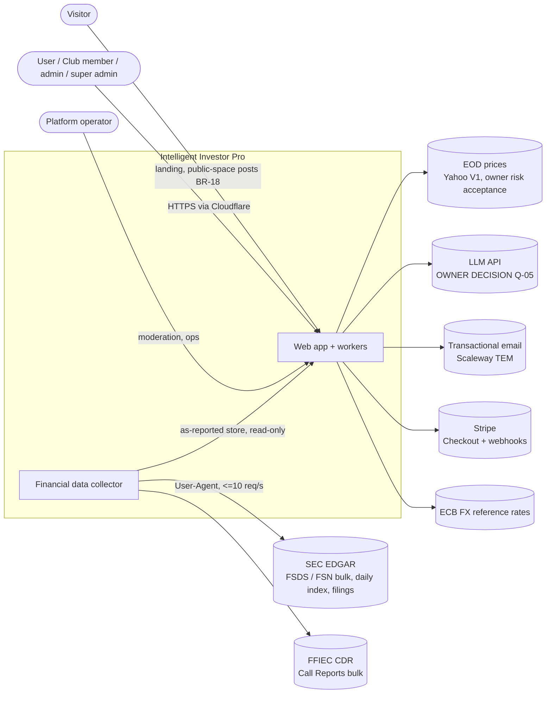
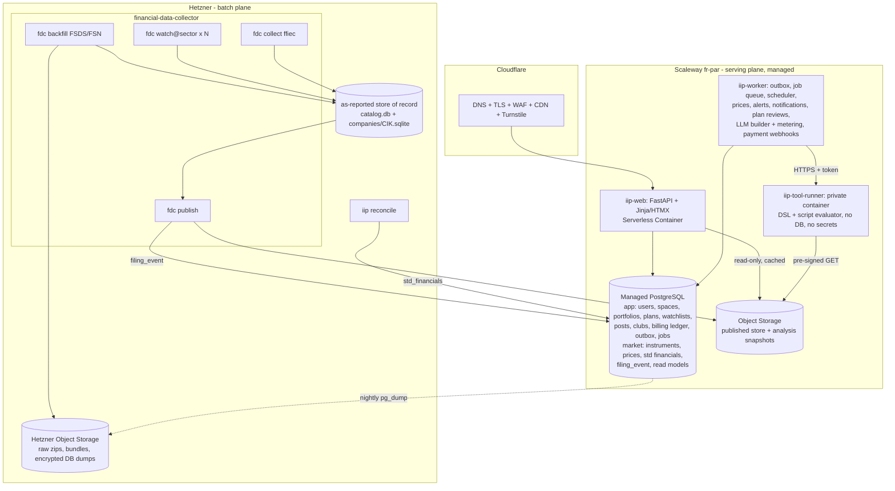

# 00 — Overview: Intelligent Investor Pro (V1)

Status: **design v0.7 (2026-11-07)**, architect design mode. Input: `claude/01-requirements.md` (requirements **v0.6**: adds BR-20..BR-25 and FR-31..FR-34, scripts; v0.5: adds FR-30, extends BR-19; v0.4 added BR-19, NFR-06 standby; v0.3 added BR-18 and changed BR-08, FR-23, FR-27; v0.2 added BR-17/FR-29) `claude/02-architect-brief-system-design.md` and `claude/04-architect-brief-scripts.md` (coordinator). Requirements are owned by the coordinator; this document does not add or change any. Anything not stated there is marked **ASSUMPTION** and listed in §6.

## What changed in v0.7

Owner 2026-11-07 (requirements v0.6): **scripts**, which are pure, versioned calculations over report figures and price information (BR-20..BR-25, FR-31..FR-34). New document **`08-scripts.md`** and ADR-021..ADR-024:
- **ADR-021:** a script is its own versioned artefact inside BC-4 Tools (`tools/scripts`). It shares one expression core with the ToolSpec DSL (ADR-009), which may reference scripts by pinned version from `dsl_version 2`. One result model: `ok` / `undefined` + reason / `missing_input` + parameters, with a full trace. Evaluation is in-process for built-in-only closures and in the sandboxed runner for anything that contains a user script.
- **ADR-022:** an own small formula grammar (Lark) with a typed, dimensional type checker and a `Decimal` interpreter, fixed function whitelist (series `sum/avg/median/min/max/count/streak/…`, `if`, `coalesce`, `undefined`) and hard limits. No arbitrary code.
- **ADR-023:** a concept vocabulary v1 and a point-in-time **binder** in BC-3 Reconciliation. The default basis is as-known (Q-16). It assembles TTM/Q4 and series, normalises units, scale, splits and currency (one evaluation currency, ECB), and reads per-company concept-fact files with every vintage (published like ADR-019).
- **ADR-024:** immutable, content-hashed versions, exact pins, input unification by concept, DAG checks, and **vendored closures**, so revoking or deleting a source never changes dependents (BR-22, BR-07).
- Built-in catalogue v1 ported from `the_intelligent_investor` (08 §7). FR-10 built-in tools stay wrappers with golden parity (Q-18). The script builder uses the same premium gate and metering as tools; running scripts is free (ADR-010/020 notes).
- Roadmap: binder in M3, new milestone **M5a Scripts**, script sharing and embeds in M6. Guidelines G-27..G-30. Assumptions A-44..A-56, risks R-18..R-23, owner questions Q-16..Q-21.
- Naming: the collector's watchers are now always "**filing watchers**". The proposed name for the owner's future analysis watchers is **monitor** (Q-21, 08 §10). Requirement texts are unchanged.
- No accepted owner decision of v0.6 is changed.

## What changed in v0.6

Owner 2026-11-07 (requirements v0.5): **FR-30 "Delete all my content"** on the settings page, available at any time.
- It permanently deletes all of the user's posts and comments, in the public space and in every club, after an explicit confirmation.
- The account and private space are untouched.
- BR-19 anonymisation applies only to what remains. This is now the main mitigation for R-17.
- Design: the `DeleteAllMyContent` command runs as a background `ContentPurge` job with a cut-off timestamp (01 §5.7, 02 §6, 06 §2/§4.2, 04 tests).
- Coordinator assumptions are listed as A-38..A-41.

## What changed in v0.5

Owner 2026-11-06 (requirements v0.4):
- **Q-10a → BR-19**: when an account is deleted, its posts and comments are **kept**, shown to their original audience, and attributed to an anonymous "deleted user" with no link back to the account. Private-space items are deleted. This replaces the v0.4 recommendation (A-35 removed). The GDPR note is in R-17 and 06 §4.2.
- **NFR-06 / R-14**: managed Postgres **standby node accepted** (≈ +€9.9/month) and now part of the planned set-up (ADR-007, ADR-015, 03 §5/§10). The planned total becomes ≈ €108/month with Yahoo prices.
- Q-03c, Q-07, Q-11, Q-15 moved to the owner's Todo list and stay open.

## What changed in v0.4

Owner answers 2026-11-06 (requirements v0.3):
- **Q-08** sign-in: email + password with verification, magic link optional (ADR-016 Accepted).
- **Q-09 → BR-18**: post visibility follows the space. Public-space posts are visible to everyone, visitors included; club-space posts to members only (ADR-011, 01 §5.7, 06 §2).
- **Q-10 → BR-08/FR-23/FR-27**: the super admin can transfer ownership to any member, must transfer or delete the club before leaving, and account deletion is blocked until that choice is made for each owned club (01 §5.6, 06 §2.2/§4.2). This replaces v0.3's auto-transfer recommendation.
- **Q-06**: all repos become private; the screener is consumed as a pinned **private git dependency**, with no core extraction (C-7, ADR-008, R-07 reduced).
- **Q-05**: Anthropic Claude, Haiku-class default and Sonnet-class for repairs (ADR-010 Accepted).
- **Q-12**: tasks are GitHub issues in `intelligent_investor_social` (architect.config.md); M0 issues created (07).
- **Q-14b**: €10/25/50, 20 % margin, 12-month expiry confirmed (ADR-020).

## What changed in v0.3

Owner decisions 2026-11-06 (via coordinator): **Q-02b** hosting option A accepted (ADR-015 Accepted; AWS added as option E, estimate ≈ €180–200) · **Q-03b** prices from **Yahoo for V1** under owner risk acceptance, licensed switch date open (ADR-012) · **Q-13** payment provider **Stripe** (owner handles VAT/OSS; ADR-020) · **Q-14** **prepaid top-ups** (amounts/margin/expiry still to confirm, Q-14b). Planned platform cost drops to ≈ €98/month (no price-vendor fee).

## What changed in v0.2

| Owner answer / new requirement | Design change | ADR |
|---|---|---|
| Q-01: private beta ≤100 users, design for ~10k | sizing in 03 §3–4 for beta; 10k path unchanged | — |
| Q-02 / NFR-10: €50–200/month excl. LLM, managed preferred, Hetzner for heavy batch | **two planes**: managed serving plane on Scaleway (containers, Postgres, object storage, email, logs) + Hetzner batch VM for the collector; costed options A–D, recommended A ≈ €141/month incl. price vendor | ADR-015 (rewritten), ADR-007 (SQLite → managed Postgres), ADR-013, ADR-018, **ADR-019 (new)** |
| BR-17 / FR-29: builder is premium, users pay tokens | **BC-11 Billing & Entitlements**: prepaid credit ledger, reserve→call→settle metering per LLM call, payment provider behind a port (MoR recommended) | ADR-010 (updated), **ADR-020 (new)** |
| Q-03 / NFR-11: architect proposes the EOD vendor | **marketstack Professional** (≈ €43/month), gated on written display-licence confirmation; Tiingo Start-up Redistribution ($250) fallback | ADR-012 (Accepted — pending owner) |
| Q-04: record-only clubs, no advice confirmed | BR-14 now confirmed; G-20 narrowed to allow only BC-11 platform-fee payments | ADR-020 |

## Document map

| Doc | Content |
|---|---|
| `00-overview.md` (this) | goals, scope, constraints, C4 context/container, requirement traceability, assumptions, risks, owner questions |
| `01-domain.md` | ubiquitous language, subdomains, bounded contexts, context map, aggregates/invariants/events |
| `02-implementation.md` | architecture style, module layout (hexagonal), patterns, APIs, data stores, authN/Z, cross-cutting, guidelines checklist `G-xx` |
| `03-deployment.md` | hosting, environments, scaling, HA/DR, observability, CI/CD, cost, DevOps handoff checklist |
| `04-testing.md` | test strategy, BR coverage matrix, NFR tests, regression, QA handoff checklist |
| `05-data-collector.md` | collector/watcher design (T2), as-reported store (T3), sizing test (milestone M0) |
| `06-security-authz-sandbox.md` | authorization model (T6), user-built tool sandbox and conversational builder (T4), GDPR |
| `07-roadmap.md` | phased implementation plan, milestone M0 acceptance criteria |
| `08-scripts.md` | scripts (v0.7): contract, formula language and evaluator, concept vocabulary and binder, versioning/composition, results/caching, port plan, builder/billing, worked examples, watcher naming |
| `adr/ADR-NNN-*.md` | one ADR per key decision (index below) |
| `architect.config.md` | settings for architect impl mode |

## 1. Goals

1. A social, long-term-investing portfolio manager that **records decisions and never trades or holds money** (BR-14).
2. A trustworthy **as-reported** financial data asset from SEC (and bank regulator) filings, 12 years deep, incrementally maintained (BR-02..05, BR-15, BR-16).
3. Reuse the owner's proven screener logic (`the_intelligent_investor`) as built-in tools (FR-10).
4. Run within **€50–200/month excluding LLM tokens**, on **managed EU services where the budget allows** plus Hetzner for heavy batch work (NFR-10), operated by **one owner-developer plus AI agents** (NFR-12), scaling from a ≤100-user private beta to ~10,000 users without re-architecture (NFR-01).
5. Make the conversational tool builder a **self-funding premium feature**: users pay the tokens they use (BR-17, FR-29).

## 2. Scope

**In scope (V1):** everything in requirements §1 "V1 in scope". **Out of scope:** trading/brokerage, custody/pooling of money, streaming prices, mobile apps, non-SEC foreign filers (except 20-F/40-F), club portfolios that hold money.

## 3. Constraints

| # | Constraint | Source |
|---|---|---|
| C-1 | Python 3.12+, `uv`, ruff, mypy strict, pytest — same conventions as `the_intelligent_investor` | NFR-12, existing repo |
| C-2 | Managed cloud services preferred where the budget allows; Hetzner for heavy batch; existing tech (Python, SQLite, systemd, Cloudflare) where adequate | NFR-10 (v0.2), NFR-12 |
| C-3 | SEC fair access: declared `EDGAR_USER_AGENT`, ≤ 10 req/s | NFR-07 |
| C-4 | Raw SEC zips never committed to GitHub | brief / research |
| C-5 | Bulk loads must stream (memory-bounded loaders; the 1 GB server is no longer the target, but streaming stays) | research |
| C-6 | Personal data hosted in the EU (owner in NL, GDPR) | NFR-08 |
| C-7 | All three repos (`intelligent_investor_social`, `financial-data-collector`, `the_intelligent_investor`) are **private** (owner decision 2026-11-06, Q-06; the two product repos are switched by the owner in GitHub settings). Private code is consumed directly via pinned git dependencies; CI needs read tokens | owner, Q-06 |
| C-8 | Data jobs run on the server (batch plane), never on GitHub Actions (data sites block shared IPs) | existing repo rule |
| C-9 | Platform cost €50–200/month incl. price vendor and email, excl. LLM tokens | NFR-10 |

## 4. Architecture at a glance

- **Style:** modular monolith (Python, FastAPI, server-rendered Jinja + HTMX) with one hexagonal module per bounded context, run as a few **processes** from one codebase: `web`, `worker`, `tool-runner` (sandboxed). [ADR-001, ADR-014]
- **Collector:** separate repo/package `financial-data-collector` (`fdc`) on the **Hetzner batch plane** (backfill, per-sector watchers, FFIEC collector). It keeps the **as-reported store** (one SQLite file per company + a catalog DB) and **publishes immutable copies** to object storage for the serving plane; the schema is the published language consumed read-only by the app. [ADR-002..006, ADR-019]
- **App data:** **managed PostgreSQL (EU)** with schemas `app` and `market`, SQLAlchemy Core + Alembic, least-privilege roles per process. [ADR-007]
- **Reconciliation:** an anti-corruption layer turns as-reported facts into standardized annual financials (the screener's `AnnualFinancials`), with lineage; the screener's pure modules are reused as a library. [ADR-008]
- **User tools:** declarative ToolSpec DSL produced by an LLM from conversation, executed by an isolated `tool-runner` (private container, no DB role, no secrets) on a read-only public analysis snapshot. No arbitrary user code in V1. [ADR-009, ADR-010]
- **Scripts (v0.7):** pure, versioned calculations (`ScriptSpec`) over named concepts. Built-ins may be Python that calls the screener core; user scripts are formulas only. A point-in-time binder in Reconciliation supplies normalised inputs for a company and as-of date. Results always carry a status and a trace. Closures with user scripts run in the sandboxed runner. [ADR-021..ADR-024, 08]
- **Premium & billing:** BC-11 Billing & Entitlements — prepaid credit ledger, per-call LLM metering (reserve → call → settle), **Stripe** Checkout + webhooks behind `PaymentGateway`, prepaid top-ups. Running tools stays free. [ADR-020, ADR-010]
- **AuthZ:** resource-based policies in the application layer; "spaces" (private space, club space) with roles; per-item shares. [ADR-011]
- **Async:** transactional outbox + Postgres job queue (`SKIP LOCKED`, `LISTEN/NOTIFY`) + `market.filing_event` feed from the batch plane. No message broker. [ADR-013]
- **Prices:** EOD prices via a vendor-agnostic `PriceProvider` port; **V1 adapter Yahoo** (owner risk acceptance, against NFR-11); licensed replacement path marketstack → Tiingo. Cached last price with staleness indicator and attribution. [ADR-012]
- **Hosting:** serving plane on **Scaleway (fr-par)** managed services; batch plane on **Hetzner** (VM + Object Storage); Cloudflare in front. ≈ €108/month planned incl. Postgres standby (Yahoo prices, no vendor fee). [ADR-015, ADR-018, ADR-019]
- **Identity:** self-managed accounts (email + password, argon2id, email verification), server-side sessions. [ADR-016] **Notifications:** in-app + email via Scaleway Transactional Email (recommended). [ADR-017]

### C4 — System context

### C4 — Containers

## 5. Requirement traceability

Every BR/FR/NFR maps to design elements (doc §) and ADRs. Tests per BR: `04-testing.md` §4.

### Business rules

| Req | Design element | Docs / ADR |
|---|---|---|
| BR-01 | `Portfolio` aggregate rejects any `PortfolioChange` without a non-blank `Reason` (domain invariant, also Postgres `CHECK`) | 01 §5.4; 02 §6; ADR-007 |
| BR-02 | v0.7: scripts never see as-reported data; the binder reads derived concept facts with lineage to filing/tag. As-reported store keeps `sub/num/tag/pre/txt` verbatim incl. extension tags, filer labels, line order, units, segments; standardization only in the separate Reconciliation context | 05 §3–4; ADR-003, ADR-008 |
| BR-03 | Facts keyed by accession (`adsh`); amendments are separate filings; no cross-filing upsert; `fact_revision` table. v0.7: concept-fact files keep every vintage; binder default **as-known** (filings accepted ≤ as-of), restated values flagged with prior value | 05 §5; 08 §4.3; ADR-004, ADR-023 |
| BR-04 | Backfill window = 12 years (config `history_years: 12`), quarters from 2014q4 onward at 2026-11 | 05 §4; ADR-004 |
| BR-05 | `collector_run` + `collected_item(source, item_key)`; loads idempotent per item and per `adsh`; incremental by default | 05 §6; ADR-005 |
| BR-06 | Private space, owner-only `SpacePolicy`; repositories always filter by viewer; v0.7: scripts and script runs are private-space items by default; run embeds never reveal a formula without `read` | 06 §2; 08 §5.3, §6.1; ADR-011 |
| BR-07 | `Share` grants (community or user) with `read`/`run`; recipients can copy (ASSUMPTION A-R9). v0.7: scripts are shareable items like tools; pinning another user's script requires `copy` (A-50); copies and vendored closures survive revoke | 06 §2.2–2.3; 08 §5.3; ADR-011, ADR-024 |
| BR-08 | `Club` aggregate: exactly one super admin (creator, then transferee); `TransferOwnership` to any member (former super admin becomes member); `Leave` by super admin refused unless transferred or club deleted; `DeleteClub` by super admin; role transitions guarded in domain | 01 §5.6; 06 §2.2; ADR-011 |
| BR-09 | Club space policy: every member may read all club documents and comment | 06 §2.4 |
| BR-10 | `ImportToolToClub` copies a `Tool` version into the club space with provenance | 01 §5.3; 06 §2.4 |
| BR-11 | `MarkAsBought` application service: one DB transaction creating a position (with reason) + copies of club plan/analysis into private space | 01 §5.6; 02 §6 |
| BR-12 | `InvestmentPlan` requires horizon + ≥1 measurable `Expectation` (metric, comparator, target, evaluation date) | 01 §5.4 |
| BR-13 | EOD price job; pages show latest stored price; no streaming | 02 §8; ADR-012 |
| BR-14 | Confirmed by owner 2026-11-06. No order/broker adapters; G-20 forbids moving investment money; the only payment integration is BC-11 for platform fees (FR-29); credits non-transferable, non-withdrawable; disclaimer in UI | 02 §16; ADR-001, ADR-020 |
| BR-15 | One watcher instance per sector (`fdc-watch@<sector>`); SIC→sector map | 05 §7; ADR-006 |
| BR-16 | `SourceCollector` plug-ins; FFIEC call report collector; every row carries `source` | 05 §8; ADR-002 |
| BR-19 | Deletion saga Social step **anonymises** instead of deleting: applies only to content not removed earlier with FR-30; posts/comments keep space, body, timestamps; `author_id` replaced by the platform's single `deleted_user` principal (no per-user pseudonym, no mapping kept); author profile link removed; embeds of the deleted user's private items render as placeholders (items deleted); private-space items deleted (FR-27) | 01 §5.7; 06 §4.2; 04 §4 |
| FR-31 | `ScriptSpec v1` JSON schema: name, assigned version, description, assigned author, typed inputs (concept + basis or parameter, type, currency, default, optional, series length), typed outputs, formula or built-in implementation ref, ordered `undefined_when` rules, pinned `uses` | 01 §5.3a; 08 §2; ADR-021 |
| FR-32 | Built-in catalogue v1: `market_cap`, **`enterprise_value`**, **`debt_to_ev`**, **`pe_ratio`** + the calculations behind FR-10 tools (net debt, EBITDA, owner earnings, FCF, margins, D/E, interest cover, ROIC/ROE, EV/EBIT and FCF yields, Graham number, EPV, intrinsic value, margin of safety, SMA, Beneish/Sloan/Montier/Piotroski/Altman, P/FFO, growth/dilution); golden parity vs the screener; frozen per version | 08 §7, §9; 02 §9.3; ADR-021, ADR-024 |
| FR-33 | Conversational script builder (same `BuilderSession`, structured output = ScriptSpec, validator + ≤ 3 repairs, dry run on 5 companies in the runner), formula-only user scripts (ADR-022), saved privately, shareable/copyable like tools; premium + metered (ASSUMPTION in reqs), running free with a run quota (A-52) | 06 §3.5a; 08 §3, §5, §8; ADR-010, ADR-020, ADR-022 |
| FR-34 | `RunScript(company, as_of = today, basis = as_known, currency)`: binder supplies inputs incl. price at the date; `ScriptRun` stores status, outputs and trace (values, periods, filing keys, form, acceptance time, tags, FX, splits, defaults, restatements, data versions); citable via `script_run:<id>` embed; memoised | 02 §6, §10; 08 §4, §6, §9; ADR-021, ADR-023 |
| FR-30 | `Social.DeleteAllMyContent(confirmation)` → `ContentPurge` job: hard-deletes every post/comment authored by the user up to a cut-off timestamp across the public space and all clubs (incl. clubs left), revokes shares of private items (items kept), leaves account/private space untouched; replies by others under deleted posts shown under a "post deleted" placeholder; idempotent, resumable | 01 §5.7; 02 §6; 06 §2.2, §4.2; 04 §4 |
| BR-18 | Post belongs to exactly one space (`public` or `club:<id>`); policy: public-space posts + comments readable by any principal incl. `anonymous` visitor; club-space posts only by members; no per-post visibility field; embeds still checked per viewer | 01 §5.7; 06 §2.2; ADR-011 |
| BR-17 | Builder sessions and every LLM call gated by `Entitlements.can_use` + credit `Reservation` (invariant: available ≥ 0); `RunTool` and (v0.7) `RunScript` have no billing check; script builder sessions gated and metered identically; club builds billed to acting admin (A-25) | 01 §5.3, §5.9; 06 §3.5, §3.5a; 08 §8; ADR-010, ADR-020; G-24 |
| BR-20 | `ScriptSpec` has no construct for data, storage, dates, clock or network; kernel is a pure domain service; as-of date and price are bound inputs supplied by the caller's binding; G-27 import contract forbids I/O in `tools/scripts`, `tools/expr` and built-ins | 01 §5.3a; 08 §1–3; ADR-021, ADR-022; G-27 |
| BR-21 | Inputs declare `concept` + `basis` from the versioned **concept vocabulary** (BC-3); storage tags rejected at save; tags only in MappingSets (G-28); binder `BindScriptInputs` resolves concepts per company/date | 01 §5.3b; 08 §4.1, §4.7; ADR-023; G-28 |
| BR-22 | Immutable, content-hashed `ScriptVersion` (no update path + DB trigger); `uses` pins exact published versions; DAG + depth/size checks; **vendored closure** per version; built-ins frozen by content hash and golden fixtures | 01 §5.3a; 08 §5; ADR-024; G-29 |
| BR-23 | Input `series {basis, length}`; binder returns oldest→newest contiguous periods with labels; fewer or gapped → `missing_input` naming parameter and gap; TTM = 4 discrete quarters (YTD differencing, Q4 = FY − 9M) else FY | 08 §3.2, §4.2; ADR-023 |
| BR-24 | Types money / per_share_money / share_count / ratio / number with dimensional type check at save; currency variable per closure; binder normalises units, scale, minor units, splits and converts to one evaluation currency (ECB, traced); kernel returns `undefined` "mixed currencies" instead of converting | 08 §2.2, §4.4–4.5; ADR-022, ADR-023 |
| BR-25 | `ScriptResult.status` ∈ ok / undefined + reason / missing_input + all missing parameters; `undefined_when` rules plus implicit runtime rules (division by zero, domain, overflow, limits); propagation with alias; kernel never raises (G-30); no NaN/∞/null-ok | 08 §2.3, §3.4; ADR-021, ADR-022; G-30 |

### Functional requirements

| Req | Design element | Docs / ADR |
|---|---|---|
| FR-01 | `fdc backfill` from SEC bulk data sets, form filter 10-K/10-Q/20-F/40-F (+/A), streaming staging loads | 05 §4; ADR-004 |
| FR-02 | Notes from Financial Statement **and Notes** data sets (`num` notes facts + `txt` text facts); scope gated by M0 sizing | 05 §4.2; ADR-004 |
| FR-03 | Sector watchers poll EDGAR current feed + nightly daily-index reconcile; per-filing XBRL loads marked `provisional`, superseded by bulk | 05 §7; ADR-006 |
| FR-04 | `SourceCollector` port with one output contract (`FilingRecord`, `FactRecord`, `PresentationRecord`, `TagRecord`, `TextRecord`) | 05 §2; ADR-002 |
| FR-05 | Store is a portable file set (catalog + per-company SQLite); `fdc export --companies ... --out` produces seed bundles | 05 §9; ADR-003 |
| FR-06 | Restatement detection on load; `fact_revision` + `RestatementDetected` event | 05 §5 |
| FR-07 | `collector_run` history, `fdc status`, healthchecks pings, `/health` JSON | 05 §6; 03 §7 |
| FR-08 | Statement views from `pre` (statement as presented), filters annual (`fp=FY`/`qtrs=4`) and consolidated (no segments) | 05 §10; 02 §8 |
| FR-09 | Daily EOD prices (Yahoo adapter in V1, ADR-012; tracked instruments daily, universe weekly A-22) into `market.prices_daily`, history retained | 02 §8; ADR-012 |
| FR-10 | Screener core reused as library over standardized financials (rules, guardrail, ranking, PE watch, peers, targets, MA alerts). v0.7: built-in tools stay wrappers (golden parity); their per-company calculations are also built-in scripts that call the screener or are parity-tested formulas, and tool figures link to them; re-expressing tools on scripts with the tool design (Q-18) | 02 §9.2–9.3; 08 §7; ADR-008 |
| FR-11 | Conversational builder (premium, BR-17) → ToolSpec DSL → sandboxed runner; tool versions saved in private space. v0.7: one builder session type with `artefact ∈ {tool, script}`; shared expression core; ToolSpec v2 may pin scripts | 06 §3, §3.5a; 08 §6.4; ADR-009, ADR-010, ADR-021 |
| FR-12 | ToolSpec `output: watchlist` → worker applies result to a watchlist owned by the caller's space | 06 §3.4 |
| FR-13 | `Portfolio` with append-only `PortfolioChange` ledger; positions derived | 01 §5.4 |
| FR-14 | `InvestmentPlan` (portfolio- or company-scoped): horizon, thesis, expectations, review date | 01 §5.4 |
| FR-15 | `PlanReview` job at review date: evaluates machine-measurable expectations, user completes manual ones, stores accuracy. v0.7: expectation metric may be `script:<ref>@<v>/<output>`, evaluated as-known at the evaluation date, ScriptRun kept as evidence; undefined/missing → `not_evaluable` | 01 §5.4; 02 §6; 08 §6.3 |
| FR-16 | `Watchlist` entries with `origin` (manual / tool:<id>@version / club) | 01 §5.5 |
| FR-17 | `AlertRule` types: price move, MA/value signal, new filing, restatement; evaluated after price refresh / on collector events | 01 §5.5; ADR-013 |
| FR-18 | Notifications context: in-app inbox + email (outbox, retries, preferences) | 01 §5.8; ADR-017 |
| FR-19 | `Share` / `RevokeShare` commands (v0.7: also for scripts) | 06 §2.2–2.3; 08 §5.3 |
| FR-20 | `Post` (in public or club space, BR-18) + `Comment` with embeds (`portfolio:`, `tool:`, `company:`, v0.7 `script:` and `script_run:`) that respect embed authorization; a run embed shows the frozen result + trace, the formula only with `read` (Q-17) | 01 §5.7; 08 §6.1 |
| FR-21 | `Report` + operator `HideContent` | 01 §5.7 |
| FR-22 | `CreateClub` → creator becomes super admin | 01 §5.6 |
| FR-23 | Invite / request / accept / eject / grant / revoke admin / **transfer super-admin ownership** / **delete club** per BR-08 | 01 §5.6; 06 §2.2; 04 §4 |
| FR-24 | Club space documents: watchlist, plan, analyses, documents, tools; comments | 01 §5.6 |
| FR-25 | `ImportToolToClub` | 01 §5.3 |
| FR-26 | `MarkAsBought` | 01 §5.6 |
| FR-27 | Identity: sign-up, email + password with verification, optional magic link, profile, export, delete (GDPR); `DeleteAccount` precondition: a transfer-or-delete decision recorded for every owned club, executed as the first saga step | 01 §5.8; 06 §4.2; ADR-016 |
| FR-28 | Server-rendered web UI (Jinja + HTMX) | 02 §3; ADR-014 |
| FR-29 | v0.7: script builder sessions metered identically, `UsageRecord.artefact_ref` (tool or script). BC-11: prepaid credit ledger, top-up via hosted checkout + verified idempotent webhooks, `UsageRecord` per LLM call (tokens, price-table version, margin), usage page per session/month, block at zero credit; Stripe Checkout + signature-verified webhooks; owner handles VAT/OSS | 01 §5.9; 02 §5–6; 03 §7 RB-09; ADR-020 |

### Non-functional requirements

| Req | Design element | Docs / ADR |
|---|---|---|
| NFR-01 | Beta ≤100 sized in 03 §3; stateless containers scale horizontally; managed Postgres scales vertically + read replica; per-company store shards | 03 §3–4; ADR-001, ADR-007, ADR-015 |
| NFR-02 | Streaming staging loader, per-company shards on the Hetzner batch VM (rescalable for backfill), raw zips in Hetzner Object Storage, **M0 sizing test** before full backfill | 05 §11; 07 M0; ADR-003, ADR-015, ADR-018 |
| NFR-03 | Server-side rendering, per-company small DBs cached from object storage, Postgres read models, connection pooling; p95 budget per page; S-1 measures cold-start and cache-miss latency. v0.7: script panels load after first paint (HTMX); binding + evaluation memo with content-addressed keys; built-in closures in-process | 02 §12; 03 §3; 04 §6; 08 §6.2; ADR-019, ADR-021 |
| NFR-04 | Watchers poll current feed every 15 min (configurable) + nightly reconcile → visible < 24 h | 05 §7; ADR-006 |
| NFR-05 | EOD job after US close + alert evaluation on `PricesRefreshed` | 02 §8; ADR-012, ADR-013 |
| NFR-06 | Managed container restarts, **managed Postgres with standby node (synchronous replica, automatic failover; owner-accepted +€9.9)**, serving independent of batch plane (published snapshots), resumable collector, backups on two providers; error budget 7.3 h/month | 03 §5–6; ADR-019 |
| NFR-07 | Host-wide token-bucket limiter (default 8 req/s) shared by all `fdc` processes; UA mandatory | 05 §6.3; ADR-005 |
| NFR-08 | EU hosting (Scaleway FR, Hetzner DE/FI), EU sub-processors where possible, encrypted off-provider dumps, export/delete with billing pseudonymisation, private-by-default policies | 06 §4; ADR-011, ADR-015, ADR-016, ADR-020 |
| NFR-09 | Declarative DSL, separate `tool-runner` with systemd sandbox, no network, no app DB access, quotas. v0.7: user scripts are formulas (own grammar, no eval); any closure with a user script runs only in the runner with pre-bound inputs (no data access), step/size/depth/exponent limits, fail-closed to `undefined`, hash-verified closures, fuzzing | 06 §3.3, §3.3a; 08 §3.6–3.7; ADR-009, ADR-022 |
| NFR-10 | Costed options A–E within €50–200 incl. price vendor and email, excl. LLM; **accepted A** ≈ €108/month with Yahoo and the Postgres standby (≈ €151 with marketstack later) (managed serving plane + Hetzner batch); LLM paid by users (BR-17); no broker; budget alerts at €150/€190 | 03 §10; ADR-015, ADR-012, ADR-020 |
| NFR-11 | **Not met in V1 by owner decision (2026-11-06, Q-03b):** Yahoo prices used knowingly against its terms (ADR-012 §2); requirement text unchanged. Mitigations: port swap, `source` per price row, attribution/disclaimer, no raw price export; licensed replacement path marketstack (pending written display confirmation) → Tiingo; review recommended before public launch or first paid top-up. SEC/FFIEC public domain | ADR-012; R-03 |
| NFR-12 | v0.7: scripts reuse the ToolSpec grammar, builder, runner and sharing (no new context, no new process); built-ins are Python calling the screener core. Python/uv; managed services reduce ops; SQLite/systemd kept for the collector; IaC (OpenTofu) for two providers; modular monolith; guidelines checklist | ADR-001, ADR-014, ADR-015 |

## 6. Assumptions (design proceeds on these; owner/coordinator to confirm)

From requirements v0.2: A-R1 design for ~10k users (NFR-01; ≤100 beta now confirmed) · A-R2 p95 < 2 s (NFR-03) · A-R3 new filings visible within 24 h (NFR-04) · A-R4 EOD prices (NFR-05) · A-R5 99 % monthly availability (NFR-06) · A-R7 alerts in-app + email (FR-18) · A-R8 basic moderation (FR-21) · A-R9 recipients copy shared tools, not edit (BR-07) · A-R12 running built-in and already-built tools stays free (BR-17). Confirmed and no longer assumptions: beta size (Q-01), budget (Q-02), record-only/no advice (Q-04).

Added by the architect:

| ID | Assumption | Where it matters |
|---|---|---|
| A-01 | "Company" = SEC registrant identified by CIK; banks without SEC filings identified by FFIEC RSSD ID. A listed **instrument** (ticker) links to a company via SEC `company_tickers.json` | 01, 05 |
| A-02 | Sectors for BR-15 derive from SEC SIC codes mapped to ~11 economic sectors (configurable map, `sectors.yaml`) | 05 §7 |
| A-03 | Backfill covers all filers of the listed forms in the window (not only index members); "active filers" in NFR-02 is a size estimate, not a filter | 05 §4 |
| A-04 | When SEC re-publishes a bulk data set for a filing already loaded (e.g. reprocess), the newer copy of the **same** `adsh` replaces the older one (same filing, not a restatement); the event is logged | 05 §5 |
| A-05 | A user may hold several portfolios; positions are per instrument with their own currency; portfolio value in a user-chosen base currency via ECB rates | 01 §5.4 |
| A-06 | Plan accuracy = share of expectations met (each expectation met/not met/not evaluable); refinable later | 01 §5.4 |
| A-07 | Clubs have no portfolio of their own in V1 (requirements list watchlist, plan, analyses, documents, tools) | 01 §5.6 |
| A-08 | RPO ≈ 0 for node failure (standby, NFR-06); for logical errors (bad migration, bug) RPO = provider PITR if available, else ≤ 24 h from dumps (R-14) and RTO ≤ 4 h for the app DB; as-reported store is re-derivable from raw zips (RPO 24 h, RTO ≤ 2 days) | 03 §6 |
| A-09 | Tool quotas and LLM budgets are configuration values; defaults to be set by owner (Q-02) | 06 §3.6 |
| A-10 | Platform operator is a role on a normal account (no separate admin app); moderation UI inside the web app | 06 §2 |
| A-11 | Pro runs on its own infrastructure (Scaleway + a new Hetzner batch VM), not the existing 1 GB server hosting The Trader/screener | 03 §2 |
| A-12 | Developer/DevOps/QA skills named `developer`, `devops`, `qa` exist in the owner's agentic-team repo (not installed in this session) | architect.config.md |
| A-13 | FFIEC collector covers banks **without** an SEC-filing parent; bank → holding company link from FFIEC NIC data | 05 §8 |
| A-14 | Tool run results retained 90 days (latest run per tool kept indefinitely) | 02 §11 |
| A-15 | V1 UI in English only, i18n-ready | 02 §15 |
| A-16 | Recipients of a shared portfolio/analysis/tool may comment on it | 06 §2.2 |
| A-17 | All club members may run club tools (running is read-like; editing stays admin-only) | 06 §2.2 |
| A-18 | Sharing a portfolio shows weights by default; owner may opt to show amounts | 06 §2.3 |
| A-19 | After deletion a salted hash of the email is kept 30 days to deter abuse | 06 §4.2 |
| A-20 | Staging shares the prod Postgres instance (separate database) and runs in its own container namespace scaled to zero | 03 §2 |
| A-21 | Peak load at 10k users ≤ 50 req/s (long-term investing, low-frequency use) | 03 §4 |
| A-22 | Tracked instruments (portfolio/watchlist/alert) need daily EOD; the rest of the universe may be refreshed weekly for screens | ADR-012 |
| A-23 | Beta usage: ≈ 1,000 tracked instruments, ≤ 5 tool runs/user/day, ≤ 5k emails/month | 03 §10 |
| A-24 | A builder message ≈ 10k input (mostly cached) + 2k output tokens; ≤ 3 repairs | ADR-010 |
| A-25 | Builder use in a club space is billed to the acting admin's own billing account | 01 §5.3; ADR-020 |
| A-26 | Payment provider fees are paid from top-up revenue, outside NFR-10 | 03 §10.3 |
| A-27 | Billing ledger, usage records and provider invoice refs are retained (pseudonymised) for the NL statutory bookkeeping period (7 years, to be confirmed by accountant) after account deletion | ADR-020; 06 §4.2 |
| A-28 | (superseded v0.5: managed Postgres runs with a standby node, NFR-06) | 03 §5 |
| A-29 | Scaleway fr-par is acceptable EU hosting for GDPR (NL owner); nl-ams used if all needed products are available there | ADR-015 |
| A-30 | Comments on public-space posts are readable by visitors too; only signed-in users comment | 06 §2.2 |
| A-31 | Visitors see embedded companies (public data) in public posts; embedded portfolios/tools/analyses render as a placeholder unless shared with the community, and community shares remain signed-in only | 06 §2.2 |
| A-32 | Posts are created only in the public space or a club space (not in private spaces); in a club space only admins and the super admin create posts, while members comment (consistent with BR-08 "read-only plus comments") | 01 §5.7 |
| A-33 | Ownership transfer takes effect immediately with a notification to the new super admin (no acceptance step) | 01 §5.6 |
| A-34 | Deleting a club deletes the club-space items and posts; copies already in members' private spaces (BR-10/BR-11) remain; members are notified | 01 §5.6 |
| A-35 | (superseded v0.5 by BR-19: posts and comments of deleted users are kept and anonymised) | 06 §4.2 |
| A-36 | Anonymisation uses one shared "deleted user" principal for all deleted accounts (no per-user pseudonym), so posts by the same deleted author cannot be linked together | 01 §5.7 |
| A-37 | Before deleting their account a user can delete individual posts/comments themselves (normal FR-20 delete); the deletion flow reminds them of BR-19 and links to their posts | 06 §4.2 |
| A-38 | (FR-30, coordinator) "Content" = posts and comments only | 01 §5.7 |
| A-39 | (FR-30, coordinator) Club documents (plans, analyses, tools) belong to the club and are not deleted | 01 §5.7 |
| A-40 | (FR-30, coordinator) Items the user shared from the private space are unshared but kept | 01 §5.7 |
| A-41 | (FR-30, coordinator) Others' replies under a deleted post stay readable under a "post deleted" placeholder | 01 §5.7 |
| A-42 | (architect) Purge runs as a background job with a cut-off = confirmation time; content created after it is kept; deleted rows are not recoverable from the app, but remain in backups until they age out (35 days), stated in the privacy notice | 06 §4.2 |
| A-44 | (architect, scripts) When several inputs are missing, `missing_input` lists all of them (not just the first), so users see everything needed at once | 08 §2.3 |
| A-45 | (architect) Mixed currencies in one evaluation yield status `undefined` with reason "mixed currencies: …" (BR-25 offers no separate status) | 08 §2.2 |
| A-46 | (architect) Default evaluation currency = the company's reporting currency; the user may choose another ISO currency per run (ECB conversion, traced) | 08 §4.5 |
| A-47 | (architect) `price` = the unadjusted EOD close of the company's primary instrument, restated to the as-of share basis via recorded splits and to per-ordinary-share via the listing ratio | 08 §4.4 |
| A-48 | (architect) TTM = sum of the 4 latest discrete quarters known at as-of when newer than the latest FY, else the FY value; Q4 = FY − 9M YTD (approximation for per-share flows, flagged) | 08 §4.2 |
| A-49 | (architect) `price` at a date = last close on or before it within 5 trading days, else `missing_input` | 08 §4.2 |
| A-50 | (architect) Pinning another user's shared script requires the `copy` permission (owner question Q-19) | 08 §5.2 |
| A-51 | (architect) Script runs are kept 90 days like tool runs, except runs cited in posts, which are kept while cited | 08 §6.1 |
| A-52 | (architect) Running scripts is free with a quota of 500 runs per user per day (memo hits not counted), config | 06 §3.6 |
| A-53 | (architect) Built-in scripts are trusted platform code and may run in-process in web/worker; only closures with user scripts need the runner | 08 §3.7 |
| A-54 | (architect) Evaluator limits per 08 §3.6 (4 KB formula, 512 nodes, depth 32, series ≤ 1,300, closure ≤ 32/8, 100k steps), config | 08 §3.6 |
| A-55 | (architect) Only the platform extends the concept vocabulary (reviewed versions); users cannot add concepts or tags | 08 §4.1 |
| A-56 | (architect) Cross-company operations (peer medians, percentiles, ranks, watch-list selection) and stateful alert logic are tool features, not scripts; a script may receive a peer statistic as a parameter | 08 §6.4, §7.2 |
| A-43 | (architect) Posts/comments in clubs the user has since left are included ("all their clubs" read as all content they authored); a club deleted earlier already removed its posts (A-34) | 01 §5.7 |

## 7. Risks

| ID | Risk | Impact | Mitigation |
|---|---|---|---|
| R-01 | Notes data sets (FSN) far larger than estimated; disk/time blow up | cost, schedule | M0 sizing test with go/no-go thresholds before full backfill; FSDS-only fallback with notes on demand (05 §11) |
| R-02 | Per-filing XBRL parsing for gap fill does not reproduce FSDS semantics (segments, labels, line order) | data inconsistency until bulk arrives | loads marked `provisional`, replaced by bulk; spike in M2; Arelle fallback (05 §7) |
| R-03 | **Yahoo terms breach (accepted by owner):** §2(d)(ix) automated collection, §2(d)(x) data feed/app, §2(h) commercial use → possible block, takedown or claim; exposure grows with public launch and paid premium | legal, availability | owner risk acceptance recorded; adapter isolated behind the port; attribution/disclaimer; no raw price export; licensed replacement adapters ready (marketstack → Tiingo); recommended review before public launch or first paid top-up |
| R-04 | Reconciliation mapping (as-reported → standardized) wrong for many filers; built-in tools mislead | user trust | lineage per field, coverage metrics, overlap checks against the screener's existing EDGAR output, "data coverage" shown with results (ADR-008) |
| R-05 | Sandbox escape or resource exhaustion by user tools | security | no arbitrary code; DSL interpreter in separate sandboxed process; quotas; fuzz tests (06 §3) |
| R-06 | Metering errors (under-charging) or vendor price changes make the platform pay LLM cost | budget | vendor-reported usage, versioned price table, worst-case reservation, monthly reconciliation RB-09, kill switch (ADR-010/020) |
| R-07 | (reduced in v0.4) Screener code access: all repos private; risk is now a leaked CI read token or a product repo accidentally left public | IP leak | fine-grained read-only token as BuildKit secret, never in images; owner confirms both product repos are private (C-7) |
| R-08 | (closed in v0.2: managed Postgres from day one, ADR-007) | — | — |
| R-09 | Club features read as a regulated activity (pooled money / advice) | legal | record-only enforced by design (BR-14, G-20); legal check before any pooled-money feature (Q-04) |
| R-10 | Single batch VM (DB now has a standby) | availability of new filings | 99 % SLO tolerates it; serving survives batch outage (ADR-019); restore drills (03 §6) |
| R-11 | Serverless Containers behaviour/cost for always-on worker or cold starts differs from estimate; runner egress cannot be blocked | cost, latency, isolation | spike S-1 before provisioning; fallback option C (Scaleway VM + systemd) keeps DB/storage/batch unchanged |
| R-12 | Hetzner cloud types unavailable to order / further price rises | batch plane | AX41 dedicated fallback (€59); Scaleway VM option D |
| R-13 | Yahoo feed changes, rate-limits or blocks without notice; data quality unguaranteed | stale prices, wrong alerts | low-frequency throttled fetch, circuit breaker, cached last price with staleness indicator, alerts suppressed on stale data, feed-broken alert + RB-03 adapter switch |
| R-14 | (reduced v0.5) Node failure covered by the **accepted standby node** (NFR-06). Remaining: logical errors (bad migration, bug, mistaken delete) replicate to the standby; recovery depends on provider PITR (unverified) or nightly dumps | up to 24 h of user records only for logical errors | verify PITR in S-1; nightly encrypted dumps; pre-migration snapshot before every `alembic upgrade`; consider 6-hourly dumps if no PITR |
| R-15 | Prepaid credits treated as vouchers/e-money or VAT/OSS/consumer-law set-up wrong (owner is seller with Stripe) | legal/tax | restricted credits (platform use only, non-transferable, non-withdrawable); customer country recorded per top-up; optional Stripe Tax; Paddle (MoR) fallback; accountant/legal check before first paid top-up (gate M5b, Q-15) |
| R-16 | Two cloud providers increase ops surface | ops load | IaC for both, single runbook set, budget alerts on both |
| R-17 | **GDPR residual (BR-19):** anonymised posts/comments may still identify the author by their content (style, self-references, names, portfolio details) — anonymisation is then incomplete and the text remains personal data | privacy, erasure requests (Art. 17) | **primary mitigation FR-30 "Delete all my content"** (any time, before or instead of account deletion); BR-19 stated in privacy notice, at sign-up and in the deletion flow (which links to FR-30); individual post/comment delete (A-37); operator redaction for residual Art. 17 requests (FR-21 tools, logged); legal check advised |

| R-18 | Price per ordinary share wrong for ADRs/dual listings or around splits (unknown listing ratio, missing corporate action) → wrong P/E, market cap, EV | wrong script results | listing ratio per instrument, screener `listing_scale` heuristic, splits table; mismatch → `missing_input` "listing ratio unknown" rather than a guess; trace shows price, ratio and split factor |
| R-19 | Concept-fact files with all vintages (quarterly + annual) larger or slower to rebuild than estimated (≈ 4–10k rows/company, **not measured**) | batch time, storage, cold page latency | measure in M3 on seed + one full sector; fallback: keep only the latest vintage per filing year plus restated pairs; lazy per-company rebuild |
| R-20 | Quarterly assembly errors (YTD differencing, Q4 derivation, fiscal-calendar shifts, 52/53-week years) give wrong TTM values | wrong P/E and TTM metrics | flags in trace (`derived_q4_per_share`), cross-check TTM vs FY for complete years, coverage per concept/basis, golden fixtures for odd calendars |
| R-21 | Evaluator escape or denial of service through crafted formulas | security, cost | own grammar without eval; limits at save and run; runner isolation; fuzzing; fail closed (06 §3.3a) |
| R-22 | Vendored closures keep a copy of a deleted user's formula inside other users' scripts | GDPR transparency | same treatment as copied tools (accepted by BR-07); stated in privacy notice; formulas carry no personal data beyond authorship, which is replaced by the shared `deleted_user` reference |
| R-23 | Built-in tools (screener definitions) and built-in scripts (owner definitions, e.g. EV incl. minority interest) show different numbers for "the same" metric | user confusion | names and descriptions state the definition; tool figures link to the exact script used; catalogue lists intentional differences (08 §7.3); Q-18 |

## 8. Questions for the owner

Options and the architect's recommendation: `07-roadmap.md` "Owner questions". Answered 2026-11-06: Q-01, Q-02, Q-02b (A), Q-03/Q-03b (Yahoo V1), Q-04, Q-05 (Claude), Q-06 (private repos), Q-08, Q-09 (BR-18), Q-10 clubs (BR-08), Q-10a (BR-19), R-14 standby, Q-12 (GitHub issues), Q-13 (Stripe), Q-14/Q-14b. Open (owner's Todo list): Q-03c licensed switch date, Q-07 email provider, Q-11 object storage, Q-15 business set-up and VAT/OSS (owner + accountant). New in v0.7: Q-16 point-in-time default, Q-17 what cited runs show, Q-18 built-in tools vs scripts, Q-19 pin permission, Q-20 `total_debt` definition, Q-21 watcher naming.

## ADR index

| ADR | Title | Status |
|---|---|---|
| ADR-001 | Modular monolith with hexagonal modules, multiple processes | Accepted |
| ADR-002 | Collector in its own repo with a pluggable source contract | Accepted |
| ADR-003 | As-reported store: catalog + one SQLite file per company | Accepted, validated by M0 |
| ADR-004 | SEC bulk sources and per-accession loading policy | Accepted, scope gated by M0 |
| ADR-005 | Incremental runs, run tracking, idempotency, SEC rate limit | Accepted |
| ADR-006 | Per-sector watchers and per-filing gap fill | Accepted |
| ADR-007 | Application database: managed PostgreSQL (EU) with standby node | Accepted (Scaleway; standby v0.5) |
| ADR-008 | Reconciliation layer and reuse of the screener core | Accepted (private git dependency, v0.4) |
| ADR-009 | User-built tools: declarative DSL + sandboxed runner | Accepted |
| ADR-010 | LLM for the conversational tool builder (premium, user-paid, metered): Anthropic Claude | Accepted |
| ADR-011 | Authorization: spaces (private, club, public), roles, per-item shares | Accepted (v0.4) |
| ADR-012 | EOD price source: Yahoo V1 (owner risk acceptance); marketstack/Tiingo replacement path | Accepted (owner risk acceptance) |
| ADR-013 | Async without a broker: outbox, Postgres job queue, filing-event table | Accepted (v0.2) |
| ADR-014 | Web stack: FastAPI + Jinja/HTMX | Accepted |
| ADR-015 | Hosting: managed EU serving plane (Scaleway) + Hetzner batch plane | Accepted (owner, option A) |
| ADR-016 | Identity: self-managed accounts, email + password + optional magic link | Accepted |
| ADR-017 | Notifications: in-app + email (Scaleway TEM recommended) | Proposed (owner: Q-07) |
| ADR-018 | Raw data retention in Hetzner Object Storage, not GitHub | Accepted |
| ADR-019 | Publishing the as-reported store from batch to serving plane | Accepted (new v0.2) |
| ADR-020 | Billing & entitlements: credit ledger, metering, Stripe, prepaid top-ups | Accepted (open: Q-15) |
| ADR-021 | Scripts: separate versioned artefact in BC-4, one contract and result model | Proposed (v0.7) |
| ADR-022 | Formula language and safe evaluator for user scripts | Proposed (v0.7) |
| ADR-023 | Concept vocabulary and point-in-time input binder in Reconciliation | Proposed (v0.7; Q-16, Q-20) |
| ADR-024 | Script versioning and composition: immutable versions, exact pins, vendored closures | Proposed (v0.7; Q-19) |
