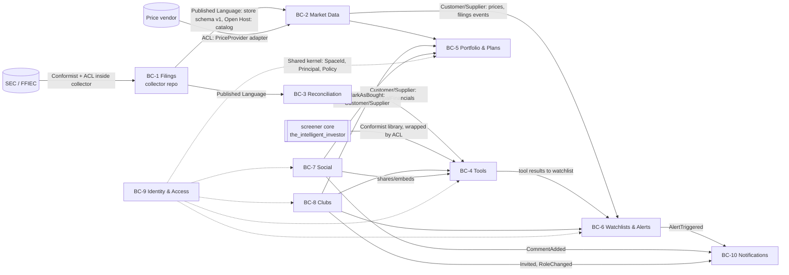

# 01 — Domain model

Strategic and tactical DDD for Intelligent Investor Pro V1. Invariants link to BR ids. Terms in **bold** are the ubiquitous language; code, tables and UI use these names (guideline G-05).

## 1. Ubiquitous language

| Term | Meaning |
|---|---|
| **Filer / Company** | An entity that files financial reports: SEC registrant (key `cik`) or bank reporting to FFIEC (key `rssd_id`). Key in the platform: `company_id = "sec:<cik>"` or `"ffiec:<rssd>"` (A-01) |
| **Instrument** | A tradable listing (ticker, exchange, currency) of a company. Positions and prices refer to instruments |
| **Filing** | One submitted report, identified by **accession number** (`adsh`) for SEC or `(rssd_id, report_date, source)` for FFIEC |
| **Form** | Filing type: 10-K, 10-Q, 20-F, 40-F, their amendments (/A), call report |
| **Fact** | One reported value: tag, version, period end (`ddate`), duration (`qtrs`), unit, segments, value, in one filing |
| **Tag** | XBRL concept name; **standard** (us-gaap/ifrs/dei…) or **extension** (filer-defined, `version = adsh`) |
| **Presentation line** | Where a fact appears: statement (BS/IS/CF/EQ/CI/…), report, line number, filer **label** |
| **Note** | Footnote content from the Notes data sets: numeric facts outside face statements and **text blocks** |
| **As-reported** | Exactly as the filer reported it (BR-02). Opposite: **standardized** |
| **Restatement** | A later filing reports a different value for the same company/tag/period/segment (FR-06) |
| **Collector** | Job that gathers data from one **source** (SEC bulk, SEC per-filing, FFIEC) |
| **Watcher** | Long-running collector instance that detects new filings for one **sector** (BR-15) |
| **Collector run** | One execution of a collector with start/end, status, counts, cursor (BR-05, FR-07) |
| **Provisional filing** | Loaded from per-filing XBRL before the bulk data set includes it; superseded later |
| **Standardized financials** | Per company/fiscal year values of the screener's fields (`AnnualFinancials`), derived with a **mapping** and **lineage** |
| **Space** | An ownership container: a user's **private space** or a **club space** |
| **Item** | Anything owned by a space: portfolio, plan, tool, watchlist, analysis, document |
| **Share** | A grant making an item visible (and for tools runnable) to the **community** or specific users (BR-07) |
| **Portfolio** | A user's record of **positions**; changes only through **portfolio changes** with a **reason** (BR-01) |
| **Investment plan** | Horizon, thesis and measurable **expectations**, at portfolio or company level (BR-12) |
| **Plan review** | Evaluation of a plan's expectations at/after horizon, producing an **accuracy** (FR-15) |
| **Watchlist / entry** | Companies to follow; entry has an **origin**: manual, tool, club |
| **Alert rule / alert** | User condition per watchlist company; **alert** = a triggered occurrence |
| **Tool** | Analysis definition (built-in or user-built **ToolSpec**), versioned; a **tool run** has inputs, outputs and data as-of |
| **Built-in tool** | Tool ported from `the_intelligent_investor` (rules, guardrail, PE watch, peers, targets, MA alerts) |
| **Tool builder session** | Conversation that produces/modifies a ToolSpec (FR-11) |
| **Post / Comment** | Social write-up (with **embeds**) and replies |
| **Club** | Investor Club (record-only); **super admin** (creator, exactly one), **admins**, **members** |
| **Mark as bought** | Member records a club watchlist company as bought into their own portfolio (BR-11) |

## 2. Subdomains

| Subdomain | Type | Why |
|---|---|---|
| As-reported financial data (collection, storage, restatements) | **Core** | The differentiating data asset; nobody else gives filer-exact statements with notes and restatement history cheaply |
| Analysis tools (built-in + conversational builder) | **Core** | Main value for users; reuses owner's IP |
| Portfolio & investment plans (reasons, plan accuracy) | **Core** | Product's long-term-investing discipline (BR-01, BR-12) |
| Investor Clubs | **Core** (social differentiator) | |
| Social (sharing, posts, comments, moderation) | Supporting | |
| Watchlists & alerts | Supporting | |
| Market prices / FX | Supporting (bought data) | |
| Reconciliation / standardization | Supporting | Required by tools, kept apart from storage (BR-02) |
| Identity & access | Generic | |
| Notifications | Generic | |

## 3. Bounded contexts

| # | Context | Responsibility | Owns data |
|---|---|---|---|
| BC-1 | **Filings** (collector, repo `financial-data-collector`) | Collect, store as-reported, detect restatements, run history | as-reported store (catalog + per-company files), raw archive |
| BC-2 | **Market Data** | Companies/instruments registry for the app, prices, FX, sector map, filing feed into the app | `market.db`: instruments, prices_daily, fx_rates |
| BC-3 | **Reconciliation** | Map as-reported facts → standardized financials with lineage | `market.db`: std_financials, std_lineage, mapping sets |
| BC-4 | **Tools** | Built-in and user tools, tool versions, builder sessions, runs, sandbox | `app.db`: tools, tool_versions, builder_sessions, tool_runs |
| BC-5 | **Portfolio & Plans** | Portfolios, changes with reasons, investment plans, reviews | `app.db` |
| BC-6 | **Watchlists & Alerts** | Watchlists, entries, alert rules, alert evaluation | `app.db` |
| BC-7 | **Social** | Shares, posts, comments, reports/moderation, profiles' public face | `app.db` |
| BC-8 | **Clubs** | Clubs, memberships, roles, invitations, club documents, mark-as-bought orchestration | `app.db` |
| BC-9 | **Identity & Access** | Accounts, sessions, consents, GDPR export/delete, spaces, authorization policies | `app.db` |
| BC-10 | **Notifications** | In-app inbox, email delivery, preferences | `app.db` |

The brief's "Portfolio & Plans" and "Tools" contexts are kept; "Watchlists & Alerts" and "Reconciliation" are split out because they have distinct models and change cadence. Space/policy code lives in Identity & Access as a shared kernel used by every user-facing context.

## 4. Context map

Relationships:
- **Filings → others: Published Language + Open Host.** The as-reported store schema (versioned, `store_schema_version` in catalog) and the `filing_event` table in the catalog are the only interface. The app never writes to the store.
- **SEC/FFIEC → Filings: Conformist** to SEC's FSDS model (we keep their columns, BR-02); FFIEC call reports are translated by an ACL into the same output contract (FR-04, BR-16).
- **Reconciliation: ACL** between the as-reported model and the screener's `AnnualFinancials`.
- **Screener core: Conformist** (we use its models and functions unchanged), wrapped by a Tools-side adapter.
- **Clubs → Portfolio: Customer/Supplier** through an application service (`MarkAsBought`), not by touching Portfolio tables.
- **Identity & Access: Shared kernel** (`Principal`, `SpaceId`, `Role`, `Policy` interfaces), small and stable.

## 5. Tactical model per context

Notation: **Aggregate** (root) · entity · *value object* · ⚑ invariant · ⇒ domain event · ▶ command · ↻ policy.

### 5.1 BC-1 Filings (collector)

Detail and schema in `05-data-collector.md`.
- **Filing** (root, key `source + filing_key`; SEC: `adsh`): *FilerRef(cik, name, sic, sector)*, *Form*, *Period(fy, fp, period_end)*, *AcceptedAt*, *Provenance(source, data_set, provisional)*; entities **Fact** (tag, version, ddate, qtrs, uom, *Segments*, coreg, value, footnote), **PresentationLine** (report, line, stmt, inpth, tag, version, plabel, negating), **TextFact** (notes).
  - ⚑ Facts are immutable once the filing is loaded; a reload of the same `adsh` replaces the whole filing atomically (A-04) — never single facts (BR-02, BR-03).
  - ⚑ Filing period within the configured history window (BR-04).
  - ⚑ Every row carries its `source` (BR-16).
  - ⇒ `FilingCollected(company_id, adsh, form, period, accepted_at, provisional)`; ⇒ `FilingSuperseded(adsh, by=bulk)`
- **FactRevision** (key company/tag/version/ddate/qtrs/uom/segments): first and later values with their `adsh`.
  - ↻ On load: compare each fact with the latest earlier filing's value for the same key; difference beyond tolerance → revision row ⇒ `RestatementDetected` (FR-06).
- **CollectorRun** (root): collector, scope (sector/quarter), started/finished, status, cursor, counts, errors.
  - ⚑ One active run per collector+scope (lock) (BR-05). ⚑ An item counted as collected only after its transaction commits (BR-05).
- **CollectedItem**: (source, item_key e.g. `fsds:2025q2` / `adsh:...`, checksum, collected_at, run_id).
  - ↻ Skip items already collected with the same checksum (BR-05).

### 5.2 BC-2 Market Data and BC-3 Reconciliation

- **Company** (root, `company_id`): name, cik/rssd, sic, *Sector*, fiscal year end, listed **Instruments** (ticker, exchange, currency, isin if known). Synced from the catalog + SEC ticker file.
- **PriceSeries** per instrument: *DailyClose(date, close, currency, source)*. ⚑ one close per instrument/date/source; latest shown (BR-13). ⇒ `PricesRefreshed(as_of, instruments)`.
- *FxRate(date, ccy, usd_rate)* from ECB.
- **MappingSet** (versioned): field → ordered candidate tags/derivations per framework and company kind (general/bank/insurer/REIT). ⚑ deterministic; version stored with every derived value.
- **StandardizedFinancials** (company_id, fiscal_year, mapping_version): screener `AnnualFinancials` fields + *Lineage(field → adsh, tag, ddate, qtrs, rule)* + coverage. ⚑ Derived only from as-reported store, never edited by hand; the store is never changed by this context (BR-02). Policy for amendments: latest filed value for the period (screener's rule), the earlier one remains visible in lineage/restatement views.

### 5.3 BC-4 Tools

- **Tool** (root): owner *SpaceId*, name, kind (`builtin` | `user`), current version, *Provenance(copied_from tool/version, club import)*.
  - **ToolVersion** (immutable): *ToolSpec* (DSL JSON, schema-validated), created_by, created_at, builder_session_id.
  - ⚑ A version is immutable; changes create a new version.
  - ⚑ Copy (BR-07 A-R9) or club import (BR-10) creates a **new Tool** in the target space with provenance; the original is unaffected.
  - ▶ `CreateTool`, `ReviseTool`, `CopyTool`, `ImportToolToClub` (FR-25), `RunTool`.
- **ToolRun**: tool version, caller principal, space, inputs, *DataAsOf(store snapshot, mapping version, prices date)*, status, result (table rows, metrics), resource usage. ⇒ `ToolRunCompleted`.
  - ↻ If ToolSpec output is `watchlist` → Watchlists applies `ApplyToolResult` (FR-12).
- **BuilderSession**: messages, proposed spec drafts, validation outcomes, tokens used. ⚑ Only a spec that validates and passes a dry run can be saved as a version (FR-11).
- **Built-in tools** are `Tool`s of kind `builtin` owned by the platform space, implemented by adapters around screener functions (`02-implementation.md` §9).

### 5.4 BC-5 Portfolio & Plans

- **Portfolio** (root): owner space (always a private space, A-07), name, base currency.
  - **PortfolioChange** (append-only entity): kind (`add` | `remove` | `adjust_quantity` | `adjust_price`), instrument, date, quantity, price, currency, *Reason* (non-blank text), recorded_at, origin (`manual` | `club_mark_as_bought:<club_id>`).
  - **Position** (derived from changes): instrument, shares, average cost.
  - ⚑ **BR-01**: every change has a non-empty reason; otherwise `ReasonRequired` error. Enforced in the aggregate and by DB `CHECK(length(trim(reason)) > 0)`.
  - ⚑ Cannot remove more shares than held.
  - ⇒ `PositionChanged`.
- **InvestmentPlan** (root): scope (`portfolio:<id>` | `company:<company_id>` within a portfolio or space), horizon (start, end), thesis, review date, list of *Expectation(metric, comparator, target, unit, evaluation)* where metric is either machine-measurable (`price`, `portfolio_return`, `std:<field>` e.g. revenue, EPS) or `manual` with a description.
  - ⚑ **BR-12**: at least one expectation; horizon end > start; each expectation has a target and comparator.
  - ⚑ Plan text editable until the horizon ends; after a review the reviewed version is frozen (new versions allowed).
  - ↻ At `review_date` the worker opens a **PlanReview** (FR-15).
- **PlanReview**: plan version, per-expectation *Outcome(met | not_met | not_evaluable, actual, evidence)*, *Accuracy* (A-06), notes, completed_at. ⇒ `PlanReviewed`.

### 5.5 BC-6 Watchlists & Alerts

- **Watchlist** (root): space, name; **WatchlistEntry**: company_id, *Origin(manual | tool:<tool_id>@<version>/<run_id> | club:<club_id>)*, added_at, note.
  - ⚑ Unique company per watchlist; tool-origin entries replaced only by the same tool's next run (FR-12, FR-16).
- **AlertRule** (root): owner principal, watchlist entry/company, *Condition*: `price_move(pct, window_days, direction)` | `value_signal(level)` (screener MA/margin-of-safety) | `new_filing(forms)` | `restatement`; channel prefs; state (last level / last fired).
  - ⚑ Fires only on state change (no repeat alerts at the same level; screener behaviour).
  - ↻ On `PricesRefreshed` evaluate price/value rules (NFR-05); on `FilingCollected` / `RestatementDetected` evaluate filing rules. ⇒ `AlertTriggered`.

### 5.6 BC-8 Clubs

- **Club** (root): name, description, *Membership(user_id, role ∈ {super_admin, admin, member}, joined_at)*, invitations/join requests, club space id.
  - ⚑ **BR-08** exactly one `super_admin`, the creator (FR-22); super admin cannot be ejected or demoted (ownership transfer is out of V1 scope — Q-10).
  - ⚑ Only super admin grants/revokes admin; only super admin ejects an admin.
  - ⚑ Admins (and super admin) invite, accept requests, eject members.
  - ⚑ Members: read everything in the club space, comment only (BR-09).
  - ▶ `CreateClub`, `Invite`, `RequestToJoin`, `Accept`, `Eject`, `GrantAdmin`, `RevokeAdmin`, `Leave`. ⇒ `MemberJoined`, `MemberEjected`, `AdminGranted`, `AdminRevoked`.
- Club documents are ordinary items owned by the **club space**: Watchlist (BC-6), InvestmentPlan (BC-5, company or club scope), **Analysis**/**Document** (rich text with embeds), Tools (BC-4).
- **MarkAsBought** (application service, BR-11 / FR-26), one transaction:
  1. Policy: caller is a member; entry is on the club watchlist.
  2. `Portfolio.record(add, instrument, date, shares, price, reason)` in the member's chosen portfolio (BR-01).
  3. Copy the club's plan and analyses for that company into the member's private space with provenance `copied_from` (editable copies, originals untouched).
  4. ⇒ `ClubCompanyMarkedBought`.

### 5.7 BC-7 Social

- **Share** (root per item+audience): item ref, audience (`community` | `user:<id>`), permissions (`read`, `run` for tools), created_by, revoked_at. ⚑ Only the owning space's owner (private) or club admins (club items) create/revoke shares (BR-07, FR-19).
- **Post** (root): author, title, body (Markdown), *Embed* refs, visibility (A-R11), status (`visible` | `hidden_by_operator`). **Comment**: author, body, status. ⚑ An embed renders only if the viewer may read the embedded item; otherwise a placeholder (BR-06).
- **ContentReport**: reporter, target, reason, status. ▶ `HideContent` by operator (FR-21).
- Comments on club items use the same Comment entity with `target = club item`.

### 5.8 BC-9 Identity & Access and BC-10 Notifications

- **Account** (root): email (unique, verified), password hash, display name, profile, consents (*Consent(kind, version, at)*), roles (`operator` optional), status (`active` | `pending_deletion` | `deleted`).
  - ▶ `SignUp`, `VerifyEmail`, `SignIn`, `SignOut`, `ExportMyData`, `DeleteAccount` (FR-27).
  - ↻ `DeleteAccount` → saga over contexts (06 §4.2).
- **Space**: id, kind (`private` | `club`), owner (account or club). Shared kernel *Principal*, *Policy*.
- **Notification**: recipient, kind, payload, read_at; **EmailDelivery**: status, attempts. **Preferences** per kind/channel (FR-18).

## 6. Domain events (catalogue)

| Event | Producer | Consumers |
|---|---|---|
| FilingCollected | Filings (catalog `filing_event`) | Market Data (company/filing index), Reconciliation (recompute), Alerts (new_filing) |
| RestatementDetected | Filings | Alerts (restatement), company page badge |
| PricesRefreshed | Market Data | Alerts, Tools (cache invalidation) |
| StandardizedFinancialsUpdated | Reconciliation | Tools (cache), Alerts (value_signal) |
| PositionChanged | Portfolio | Social (shared portfolio views), analytics |
| PlanReviewDue / PlanReviewed | Portfolio & Plans | Notifications |
| ToolRunCompleted | Tools | Watchlists (FR-12), Notifications |
| AlertTriggered | Alerts | Notifications |
| CommentAdded, PostPublished | Social | Notifications |
| MemberJoined/Ejected, AdminGranted/Revoked, Invited | Clubs | Notifications, Identity (policy cache) |
| ClubCompanyMarkedBought | Clubs | Notifications (optional to club) |
| AccountDeletionRequested | Identity | all contexts (deletion saga) |

In-process events are dispatched after commit via the outbox (`02-implementation.md` §7).
