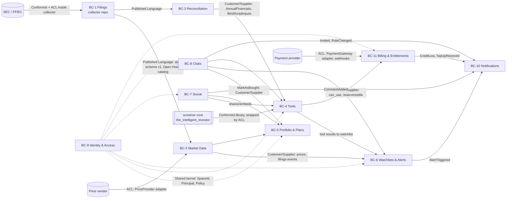

# 01 — Domain model

Strategic and tactical DDD for Intelligent Investor Pro V1 (v0.7: scripts, concept vocabulary and binder, BR-20..25/FR-31..34, see 08; v0.2: adds BC-11 Billing & Entitlements for BR-17/FR-29; storage names follow ADR-007: Postgres schemas `app` and `market`). Invariants link to BR ids. Terms in **bold** are the ubiquitous language; code, tables and UI use these names (guideline G-05).

## 1. Ubiquitous language

| Term | Meaning |
|---|---|
| **Filer / Company** | An entity that files financial reports: SEC registrant (key `cik`) or bank reporting to FFIEC (key `rssd_id`). Key in the platform: `company_id = "sec:<cik>"` or `"ffiec:<rssd>"` (A-01) |
| **Instrument** | A tradable listing (ticker, exchange, currency) of a company. Positions and prices refer to instruments |
| **Filing** | One submitted report, identified by **accession number** (`adsh`) for SEC or `(rssd_id, report_date, source)` for FFIEC |
| **Form** | Filing type: 10-K, 10-Q, 20-F, 40-F, their amendments (/A), call report |
| **Fact** | One reported value: tag, version, period end (`ddate`), duration (`qtrs`), unit, segments, value, in one filing |
| **Tag** | XBRL concept name; **standard** (us-gaap/ifrs/dei…) or **extension** (filer-defined, `version = adsh`) |
| **Presentation line** | Where a fact appears: statement (BS/IS/CF/EQ/CI/…), report, line number, filer **label** |
| **Note** | Footnote content from the Notes data sets: numeric facts outside face statements and **text blocks** |
| **As-reported** | Exactly as the filer reported it (BR-02). Opposite: **standardized** |
| **Restatement** | A later filing reports a different value for the same company/tag/period/segment (FR-06) |
| **Collector** | Job that gathers data from one **source** (SEC bulk, SEC per-filing, FFIEC) |
| **Filing watcher** | Long-running collector instance that detects new filings for one **sector** (BR-15, FR-03). Always qualified as "filing watcher" in docs, code and UI (v0.7). The owner's future analysis concept is proposed to be called **monitor** (08 §10) |
| **Collector run** | One execution of a collector with start/end, status, counts, cursor (BR-05, FR-07) |
| **Provisional filing** | Loaded from per-filing XBRL before the bulk data set includes it; superseded later |
| **Standardized financials** | Per company/fiscal year values of the screener's fields (`AnnualFinancials`), derived with a **mapping** and **lineage** |
| **Space** | An ownership container: a user's **private space**, a **club space**, or the single platform-wide **public space** (community) |
| **Item** | Anything owned by a space: portfolio, plan, tool, watchlist, analysis, document |
| **Share** | A grant making an item visible (and for tools runnable) to the **community** or specific users (BR-07) |
| **Portfolio** | A user's record of **positions**; changes only through **portfolio changes** with a **reason** (BR-01) |
| **Investment plan** | Horizon, thesis and measurable **expectations**, at portfolio or company level (BR-12) |
| **Plan review** | Evaluation of a plan's expectations at/after horizon, producing an **accuracy** (FR-15) |
| **Watchlist / entry** | Companies to follow; entry has an **origin**: manual, tool, club |
| **Alert rule / alert** | User condition per watchlist company; **alert** = a triggered occurrence |
| **Tool** | Analysis definition (built-in or user-built **ToolSpec**), versioned; a **tool run** has inputs, outputs and data as-of |
| **Built-in tool** | Tool ported from `the_intelligent_investor` (rules, guardrail, PE watch, peers, targets, MA alerts) |
| **Tool builder session** | Conversation that produces/modifies a ToolSpec (FR-11) |
| **Post / Comment** | Social write-up (with **embeds**) and replies; a post lives in the public space or a club space and is visible to that space's audience (BR-18) |
| **Visitor** | Not signed-in reader; may read public-space posts and their comments only (BR-18) |
| **Ownership transfer** | Super admin hands the super-admin role to another member (BR-08) |
| **Club** | Investor Club (record-only); **super admin** (initially the creator, exactly one, transferable), **admins**, **members** |
| **Mark as bought** | Member records a club watchlist company as bought into their own portfolio (BR-11) |
| **Premium** | Entitlement to use the conversational tool builder (BR-17); in V1 = a billing account with available credit (ADR-020) |
| **Credit** | Prepaid amount (EUR) on a user's **billing account**, spendable only on the platform's own metered LLM usage; not money held for investment (BR-14) |
| **Ledger entry** | Immutable record changing a credit balance: top-up, subscription grant, settlement, refund, adjustment, expiry |
| **Reservation** | Credit held for one LLM call before it runs (worst-case cost); later **settled** with actual usage or **released** |
| **Usage record** | Metered LLM call: tokens by type, model, price-table version, cost and charged amount, linked to a **builder session** and tool |
| **Price table** | Versioned per-model token prices + margin used to compute charges (FR-29) |
| **Script** | A named, versioned, pure calculation over typed inputs returning typed outputs and a status (BR-20, FR-31). **Built-in** (platform, may be Python) or **user** (formula) |
| **Script version** | Immutable published revision of a script, identified by `slug@n` and a content hash (BR-22) |
| **Formula** | The expression of a user script over its declared inputs and pinned dependencies (FR-33) |
| **Pin** | A reference from one script version to an exact version of another (`uses`) (BR-22) |
| **Closure** | A script version plus all its transitively pinned versions, vendored with the version (ADR-024) |
| **Concept** | A named financial or market quantity in the **concept vocabulary** (e.g. `total_debt`, `diluted_eps`, `price`), never a storage tag (BR-21) |
| **Basis** | Which value of a concept an input means for an as-of date: `at_date`, `latest`, `fy`, `fq`, `ttm`, or a series of these (BR-23) |
| **As-of date / as-known** | The date a script is evaluated for; **as-known** = only filings accepted by that date count (BR-03, FR-34) |
| **Binder** | Reconciliation service that resolves a script's inputs for a company and as-of date and normalises units, scale, splits and currency (BR-21, BR-24) |
| **Evaluation currency** | The single currency all money inputs of one run are bound in (BR-24) |
| **Script result** | Status `ok` / `undefined` (+ reason) / `missing_input` (+ parameters), outputs and **trace** (BR-25, FR-34) |
| **Script run** | Immutable record of one evaluation for a company and date, with its trace; citable in posts (FR-34) |

## 2. Subdomains

| Subdomain | Type | Why |
|---|---|---|
| As-reported financial data (collection, storage, restatements) | **Core** | The differentiating data asset; nobody else gives filer-exact statements with notes and restatement history cheaply |
| Analysis tools (built-in + conversational builder) | **Core** | Main value for users; reuses owner's IP |
| Portfolio & investment plans (reasons, plan accuracy) | **Core** | Product's long-term-investing discipline (BR-01, BR-12) |
| Investor Clubs | **Core** (social differentiator) | |
| Social (sharing, posts, comments, moderation) | Supporting | |
| Watchlists & alerts | Supporting | |
| Market prices / FX | Supporting (bought data) | |
| Reconciliation / standardization | Supporting | Required by tools, kept apart from storage (BR-02) |
| Billing & entitlements (credits, metering, payments) | Generic (supporting rules specific to BR-17) | standard ledger/metering patterns; payment execution bought from a provider |
| Identity & access | Generic | |
| Notifications | Generic | |

## 3. Bounded contexts

| # | Context | Responsibility | Owns data |
|---|---|---|---|
| BC-1 | **Filings** (collector, repo `financial-data-collector`) | Collect, store as-reported, detect restatements, run history | as-reported store (catalog + per-company files), raw archive |
| BC-2 | **Market Data** | Companies/instruments registry for the app, prices, FX, sector map, filing feed into the app | `market` schema: instruments, prices_daily, fx_rates |
| BC-3 | **Reconciliation** | Map as-reported facts → standardized financials with lineage; **concept vocabulary** and point-in-time **binder** for script inputs (v0.7) | `market` schema: std_financials, std_lineage, mapping sets, company_std_version; published per-company concept-fact files |
| BC-4 | **Tools** | Built-in and user tools and **scripts**, their versions, builder sessions, runs, sandbox | `app` schema: tools, tool_versions, scripts, script_versions, builder_sessions, tool_runs, script_runs |
| BC-5 | **Portfolio & Plans** | Portfolios, changes with reasons, investment plans, reviews | `app` schema |
| BC-6 | **Watchlists & Alerts** | Watchlists, entries, alert rules, alert evaluation | `app` schema |
| BC-7 | **Social** | Shares, posts, comments, reports/moderation, profiles' public face | `app` schema |
| BC-8 | **Clubs** | Clubs, memberships, roles, invitations, club documents, mark-as-bought orchestration | `app` schema |
| BC-9 | **Identity & Access** | Accounts, sessions, consents, GDPR export/delete, spaces, authorization policies | `app` schema |
| BC-10 | **Notifications** | In-app inbox, email delivery, preferences | `app` schema |
| BC-11 | **Billing & Entitlements** | Premium entitlement, prepaid credit ledger, reservations, LLM usage metering, price table, payment provider integration (checkout, webhooks, refunds) | `app` schema, prefix `bl_` |

The brief's "Portfolio & Plans" and "Tools" contexts are kept; "Watchlists & Alerts" and "Reconciliation" are split out because they have distinct models and change cadence. Space/policy code lives in Identity & Access as a shared kernel used by every user-facing context.

## 4. Context map

Relationships:
- **Filings → others: Published Language + Open Host.** The as-reported store schema (versioned, `store_schema_version` in catalog) and the `filing_event` table in the catalog are the only interface. The app never writes to the store.
- **SEC/FFIEC → Filings: Conformist** to SEC's FSDS model (we keep their columns, BR-02); FFIEC call reports are translated by an ACL into the same output contract (FR-04, BR-16).
- **Reconciliation: ACL** between the as-reported model and the screener's `AnnualFinancials`, and (v0.7) between the as-reported model and the **concept vocabulary** used by scripts. Tools asks for bound inputs through the `BindScriptInputs` facade (Customer/Supplier) and never reads tags.
- **Screener core: Conformist** (we use its models and functions unchanged), wrapped by a Tools-side adapter.
- **Clubs → Portfolio: Customer/Supplier** through an application service (`MarkAsBought`), not by touching Portfolio tables.
- **Tools → Billing: Customer/Supplier** via the `Entitlements`/`Metering` facade (ADR-020). Tools never reads ledger tables; Billing never sees conversation content (only session/tool ids and token counts).
- **Payment provider → Billing: ACL** (`PaymentGateway` port); provider events are translated into ledger commands once, idempotently.
- **Identity & Access: Shared kernel** (`Principal`, `SpaceId`, `Role`, `Policy` interfaces), small and stable.

## 5. Tactical model per context

Notation: **Aggregate** (root) · entity · *value object* · ⚑ invariant · ⇒ domain event · ▶ command · ↻ policy.

### 5.1 BC-1 Filings (collector)

Detail and schema in `05-data-collector.md`.
- **Filing** (root, key `source + filing_key`; SEC: `adsh`): *FilerRef(cik, name, sic, sector)*, *Form*, *Period(fy, fp, period_end)*, *AcceptedAt*, *Provenance(source, data_set, provisional)*; entities **Fact** (tag, version, ddate, qtrs, uom, *Segments*, coreg, value, footnote), **PresentationLine** (report, line, stmt, inpth, tag, version, plabel, negating), **TextFact** (notes).
  - ⚑ Facts are immutable once the filing is loaded; a reload of the same `adsh` replaces the whole filing atomically (A-04) — never single facts (BR-02, BR-03).
  - ⚑ Filing period within the configured history window (BR-04).
  - ⚑ Every row carries its `source` (BR-16).
  - ⇒ `FilingCollected(company_id, adsh, form, period, accepted_at, provisional)`; ⇒ `FilingSuperseded(adsh, by=bulk)`
- **FactRevision** (key company/tag/version/ddate/qtrs/uom/segments): first and later values with their `adsh`.
  - ↻ On load: compare each fact with the latest earlier filing's value for the same key; difference beyond tolerance → revision row ⇒ `RestatementDetected` (FR-06).
- **CollectorRun** (root): collector, scope (sector/quarter), started/finished, status, cursor, counts, errors.
  - ⚑ One active run per collector+scope (lock) (BR-05). ⚑ An item counted as collected only after its transaction commits (BR-05).
- **CollectedItem**: (source, item_key e.g. `fsds:2025q2` / `adsh:...`, checksum, collected_at, run_id).
  - ↻ Skip items already collected with the same checksum (BR-05).

### 5.2 BC-2 Market Data and BC-3 Reconciliation

- **Company** (root, `company_id`): name, cik/rssd, sic, *Sector*, fiscal year end, listed **Instruments** (ticker, exchange, currency, isin if known). Synced from the catalog + SEC ticker file.
- **PriceSeries** per instrument: *DailyClose(date, close, currency, source)*. ⚑ one close per instrument/date/source; latest shown (BR-13). ⇒ `PricesRefreshed(as_of, instruments)`.
- *FxRate(date, ccy, usd_rate)* from ECB.
- **MappingSet** (versioned): field → ordered candidate tags/derivations per framework and company kind (general/bank/insurer/REIT). ⚑ deterministic; version stored with every derived value.
- **StandardizedFinancials** (company_id, fiscal_year, mapping_version): screener `AnnualFinancials` fields + *Lineage(field → adsh, tag, ddate, qtrs, rule)* + coverage. ⚑ Derived only from as-reported store, never edited by hand; the store is never changed by this context (BR-02). Policy for amendments: latest filed value for the period (screener's rule), the earlier one remains visible in lineage/restatement views.

### 5.3 BC-4 Tools

- **Tool** (root): owner *SpaceId*, name, kind (`builtin` | `user`), current version, *Provenance(copied_from tool/version, club import)*.
  - **ToolVersion** (immutable): *ToolSpec* (DSL JSON, schema-validated), created_by, created_at, builder_session_id.
  - ⚑ A version is immutable; changes create a new version.
  - ⚑ Copy (BR-07 A-R9) or club import (BR-10) creates a **new Tool** in the target space with provenance; the original is unaffected.
  - ▶ `CreateTool`, `ReviseTool`, `CopyTool`, `ImportToolToClub` (FR-25), `RunTool`.
- **ToolRun**: tool version, caller principal, space, inputs, *DataAsOf(store snapshot, mapping version, prices date)*, status, result (table rows, metrics), resource usage. ⇒ `ToolRunCompleted`.
  - ↻ If ToolSpec output is `watchlist` → Watchlists applies `ApplyToolResult` (FR-12).
- **BuilderSession**: owner principal, target space, messages, proposed spec drafts, validation outcomes, tokens used, charged total (from Billing). ⚑ Only a spec that validates and passes a dry run can be saved as a version (FR-11). ⚑ **BR-17**: a session can be started and each LLM call made only after `Entitlements.can_use(principal, tool_builder)` and a successful `Metering.reserve`; running tools has no such check. A builder session in a club space is billed to the acting admin's own account (A-25).
- **Built-in tools** are `Tool`s of kind `builtin` owned by the platform space, implemented by adapters around screener functions (`02-implementation.md` §9).
- **BuilderSession** (v0.7) has `artefact ∈ {tool, script}`; the same premium gate and metering apply (BR-17, FR-33).

#### 5.3a Scripts (v0.7, BR-20..25, FR-31..34, 08)
- **Script** (root): owner *SpaceId*, slug (unique in space), kind (`builtin` | `user`), description, *Provenance(copied_from script/version)*, latest version number.
  - **ScriptVersion** (immutable entity): number, *ScriptSpec* (inputs, uses, outputs, undefined_when, formula **or** built-in implementation ref), author, *ContentHash*, *Closure* (vendored pinned specs + hashes), builder_session_id, created_at.
  - *InputDecl*: name, (*ConceptRef*(concept, basis, series length) | parameter), *ValueType* (money, per_share_money, share_count, ratio, number), currency variable/ISO, default, optional.
  - *OutputDecl*: name, *ValueType*. *UndefinedRule*: condition, reason. *Pin*: alias, script ref, version.
  - ⚑ **BR-20** a spec has no construct for data access, storage, dates, clock or network; a user script is a formula only (ADR-022).
  - ⚑ **BR-21** every non-parameter input names a concept of the vocabulary; storage tags are rejected.
  - ⚑ **BR-22** a published version is immutable; every pin is an exact published version; the closure is acyclic (depth ≤ 8, size ≤ 32); a new version never changes a dependent (vendored closure).
  - ⚑ **BR-23** a series input declares its basis and length.
  - ⚑ **BR-24** inputs and outputs are typed; formulas type-check dimensionally; money inputs share one currency variable unless fixed.
  - ⚑ **FR-33** pinning another space's script requires `copy` permission (A-50); copies are new Scripts with provenance (BR-07).
  - ▶ `PublishScriptVersion` (from a validated draft), `CopyScript`, `ImportScriptToClub`, `RunScript`. ⇒ `ScriptVersionPublished`.
- **ScriptRun** (root, immutable): caller principal, caller space, script ref + content hash, company_id, as_of, basis (`as_known` | `latest`), evaluation currency, *ScriptResult* (status, outputs, reason, missing, *Trace*), data versions, engine version, created_at.
  - ⚑ **BR-25** status ∈ {`ok`, `undefined` + reason, `missing_input` + parameters}; `ok` only with finite values for every output; never an exception.
  - ⇒ `ScriptRunCompleted`. Cited runs are retained while cited (A-51).
- **Script kernel** (domain service, pure): `evaluate(closure, bound_inputs) → ScriptResult`. Built-in closures run in-process; closures with user scripts run in the sandboxed runner (NFR-09).

#### 5.3b Binder (BC-3 Reconciliation, v0.7, ADR-023)
- **ConceptVocabulary** (versioned config): concept → type, nature (flow/stock/market/meta), allowed bases, aliases, description.
- **ConceptFact** (per company, every vintage): concept, period (instant/duration, fiscal period), value, uom, currency, filing_key, accepted_at, mapping version, rule, source tags.
- **InputBinder** (domain service): `bind(requirements, facts, market, as_of, basis, currency) → Bindings | Missing[]`.
  - ⚑ **BR-03** `as_known`: only facts with `accepted_at ≤ as_of`; latest-accepted vintage wins; prior values kept and flagged `restated`.
  - ⚑ **BR-23** a series is contiguous and of the declared length, else `missing` with the gap; TTM = 4 discrete quarters newer than the last FY, else FY.
  - ⚑ **BR-24** one evaluation currency per run; every converted value records rate/date/source; minor units and scale normalised; per-share and share counts split-adjusted to as_of.
  - ⚑ **BR-21/G-13** the binder never computes analytics (ratios, averages, market cap) and never modifies as-reported data.

### 5.4 BC-5 Portfolio & Plans

- **Portfolio** (root): owner space (always a private space, A-07), name, base currency.
  - **PortfolioChange** (append-only entity): kind (`add` | `remove` | `adjust_quantity` | `adjust_price`), instrument, date, quantity, price, currency, *Reason* (non-blank text), recorded_at, origin (`manual` | `club_mark_as_bought:<club_id>`).
  - **Position** (derived from changes): instrument, shares, average cost.
  - ⚑ **BR-01**: every change has a non-empty reason; otherwise `ReasonRequired` error. Enforced in the aggregate and by DB `CHECK(length(trim(reason)) > 0)`.
  - ⚑ Cannot remove more shares than held.
  - ⇒ `PositionChanged`.
- **InvestmentPlan** (root): scope (`portfolio:<id>` | `company:<company_id>` within a portfolio or space), horizon (start, end), thesis, review date, list of *Expectation(metric, comparator, target, unit, evaluation)* where metric is either machine-measurable (`price`, `portfolio_return`, `std:<field>` e.g. revenue, EPS) or `manual` with a description; v0.7 adds `script:<ref>@<version>/<output>`, evaluated as of the evaluation date with basis as-known (08 §6.3).
  - ⚑ **BR-12**: at least one expectation; horizon end > start; each expectation has a target and comparator.
  - ⚑ Plan text editable until the horizon ends; after a review the reviewed version is frozen (new versions allowed).
  - ↻ At `review_date` the worker opens a **PlanReview** (FR-15).
- **PlanReview**: plan version, per-expectation *Outcome(met | not_met | not_evaluable, actual, evidence)*, *Accuracy* (A-06), notes, completed_at. ⇒ `PlanReviewed`.

### 5.5 BC-6 Watchlists & Alerts

- **Watchlist** (root): space, name; **WatchlistEntry**: company_id, *Origin(manual | tool:<tool_id>@<version>/<run_id> | club:<club_id>)*, added_at, note.
  - ⚑ Unique company per watchlist; tool-origin entries replaced only by the same tool's next run (FR-12, FR-16).
- **AlertRule** (root): owner principal, watchlist entry/company, *Condition*: `price_move(pct, window_days, direction)` | `value_signal(level)` (screener MA/margin-of-safety) | `new_filing(forms)` | `restatement`; channel prefs; state (last level / last fired).
  - ⚑ Fires only on state change (no repeat alerts at the same level; screener behaviour).
  - ↻ On `PricesRefreshed` evaluate price/value rules (NFR-05); on `FilingCollected` / `RestatementDetected` evaluate filing rules. ⇒ `AlertTriggered`.

### 5.6 BC-8 Clubs

- **Club** (root): name, description, *Membership(user_id, role ∈ {super_admin, admin, member}, joined_at)*, invitations/join requests, club space id.
  - ⚑ **BR-08** exactly one `super_admin`: the creator at creation (FR-22), afterwards whoever received an ownership transfer. Nobody can eject or demote the super admin.
  - ⚑ **BR-08 (v0.3)** `TransferOwnership(to)` only by the super admin, only to another **current member** (any role). In one step the target becomes `super_admin` and the former super admin becomes `member` (A-33: immediate, with notification).
  - ⚑ **BR-08** `Leave` by the super admin is rejected (`OwnershipDecisionRequired`). They must first transfer ownership or `DeleteClub`.
  - ⚑ `DeleteClub` only by the super admin. The club becomes `deleted` and its space items and posts are removed by a job; copies in members' private spaces stay (A-34).
  - ⚑ Only super admin grants/revokes admin; only super admin ejects an admin.
  - ⚑ Admins (and super admin) invite, accept requests, eject members.
  - ⚑ Members: read everything in the club space, comment only (BR-09).
  - ▶ `CreateClub`, `Invite`, `RequestToJoin`, `Accept`, `Eject`, `GrantAdmin`, `RevokeAdmin`, `TransferOwnership`, `Leave`, `DeleteClub`. ⇒ `MemberJoined`, `MemberEjected`, `AdminGranted`, `AdminRevoked`, `OwnershipTransferred`, `ClubDeleted`.
  - Query `clubs_owned_by(account)` → used by Identity's `DeleteAccount` precondition (FR-27).
- Club documents are ordinary items owned by the **club space**: Watchlist (BC-6), InvestmentPlan (BC-5, company or club scope), **Analysis**/**Document** (rich text with embeds), Tools (BC-4).
- **MarkAsBought** (application service, BR-11 / FR-26), one transaction:
  1. Policy: caller is a member; entry is on the club watchlist.
  2. `Portfolio.record(add, instrument, date, shares, price, reason)` in the member's chosen portfolio (BR-01).
  3. Copy the club's plan and analyses for that company into the member's private space with provenance `copied_from` (editable copies, originals untouched).
  4. ⇒ `ClubCompanyMarkedBought`.

### 5.7 BC-7 Social

- **Share** (root per item+audience): item ref, audience (`community` | `user:<id>`), permissions (`read`, `run` for tools), created_by, revoked_at. ⚑ Only the owning space's owner (private) or club admins (club items) create/revoke shares (BR-07, FR-19).
- **Post** (root): author, **space** (`public` | `club:<id>`), title, body (Markdown), *Embed* refs, status (`visible` | `hidden_by_operator`). **Comment**: author, body, status.
  - ⚑ **BR-18** visibility = the post's space. There is no per-post visibility field, and the space never changes after creation. Public-space posts are readable by everyone, including visitors; club-space posts only by that club's members.
  - ⚑ Posts are created in the public space by any signed-in user, and in a club space by its admins or super admin (A-32). Signed-in users who can read a post may comment, so visitors cannot comment.
  - ⚑ An embed renders only if the viewer may read the embedded item; otherwise a placeholder is shown (BR-06, A-31).
  - ⚑ **FR-30** `DeleteAllMyContent(confirmation)`, available to the author at any time, hard-deletes **all** of their posts and comments created at or before the cut-off `requested_at`. That covers the public space, every club they are in, and clubs they have left (A-43). Rules:
    - It runs only with an explicit confirmation token issued by the confirmation screen. The screen states what will be deleted and that it cannot be undone.
    - Only the author can run it, for themselves; the operator cannot run it on someone's behalf.
    - Content = posts and comments only (A-38). Club documents stay (A-39). Shares of the user's private items are revoked, but the items stay (A-40).
    - Under a deleted post, other people's comments stay readable under a "post deleted" placeholder (A-41). The post becomes a body-less **tombstone** row with no author, so the thread survives.
    - The account and private space are untouched.
    - Implemented as a **ContentPurge** (entity: `account_id`, `requested_at` = cut-off, status `pending` → `running` → `done`, counts). Only one purge can be active per account. Rerunning finds nothing left to delete.
    - ⇒ `ContentPurgeRequested`, `ContentPurged(counts)`. Each deleted item raises `PostDeleted` / `CommentDeleted`, which remove notifications and search entries.
  - ⚑ **BR-19** On account deletion, posts and comments that remain (not deleted with FR-30) are **not** removed. `AnonymiseAuthor(account)` replaces `author_id` with the single platform principal `deleted_user` (A-36). Space, body and timestamps are unchanged and stay visible to the same audience (BR-18). No mapping to the former account is kept, and edit/delete rights pass to nobody. The operator can still hide content (FR-21).
- **ContentReport**: reporter, target, reason, status. ▶ `HideContent` by operator (FR-21).
- Comments on club items use the same Comment entity with `target = club item`.

### 5.8 BC-9 Identity & Access and BC-10 Notifications

- **Account** (root): email (unique, verified), password hash, display name, profile, consents (*Consent(kind, version, at)*), roles (`operator` optional), status (`active` | `pending_deletion` | `deleted`).
  - ▶ `SignUp`, `VerifyEmail`, `SignIn` (password), `RequestMagicLink`, `SignInWithMagicLink`, `ResetPassword`, `SignOut`, `ExportMyData`, `DeleteAccount` (FR-27, ADR-016).
  - ⚑ **BR-19** the deletion saga deletes private-space items and anonymises posts and comments; it does not delete them.
  - ⚑ **FR-27/BR-08** `DeleteAccount(decisions)` is rejected with `OwnershipDecisionRequired(club_ids)` unless every club where the account is super admin has a decision: `transfer_to:<member>` or `delete`. The saga executes those decisions first.
  - ↻ `DeleteAccount` → saga over contexts (06 §4.2).
- **Space**: id, kind (`private` | `club` | `public`), owner (account, club, or platform for the single public space). Shared kernel *Principal* (incl. `anonymous` for visitors), *Policy*.
- **Notification**: recipient, kind, payload, read_at; **EmailDelivery**: status, attempts. **Preferences** per kind/channel (FR-18).

### 5.9 BC-11 Billing & Entitlements (BR-17, FR-29, ADR-020)

- **BillingAccount** (root, one per user account): currency EUR, status (`active` | `suspended` | `closed`), provider customer ref, balance = Σ ledger entries, available = balance − open reservations.
  - **LedgerEntry** (append-only): kind (`top_up` | `subscription_grant` | `settlement` | `refund` | `adjustment` | `expiry`), amount (EUR, integer micros), ref (provider event id / reservation id / operator note), at.
  - ⚑ **BR-17** available balance never goes below zero: a reservation is accepted only if `amount ≤ available` (row lock on the account; Postgres, ADR-007).
  - ⚑ Ledger entries are immutable; corrections are new `adjustment` entries with an operator reason (screener rule 4 spirit, G-21).
  - ⚑ A `top_up` is created only from a verified provider event, at most once per provider event id (idempotent).
  - ⚑ Credit is not transferable between accounts and never paid out except as a provider refund (BR-14; ADR-020 §6).
- **Reservation**: account, builder session, amount, status (`open` → `settled` | `released` | `expired`), expires_at (15 min).
  - ⚑ Settlement amount ≤ reserved amount (reservation is worst case); difference released. ⚑ One terminal transition only.
- **UsageRecord** (immutable): account, builder session, tool id, model, input/output/cache-write/cache-read tokens, vendor request id, price-table version, cost USD, FX rate, margin, charged EUR.
- **PriceTable** (versioned config): per model token prices (USD/Mtok by token type), margin %, minimum charge per call; ⚑ the version used is stored with every usage record.
- **Entitlement**: `tool_builder` granted when the account is active and premium per plan model (P1: available credit ≥ `session_min_credit`; P2: active subscription + credit).
- **PaymentIntent**: product (top-up amount / plan), provider checkout id, status; idempotency key.
- ▶ `StartTopUp`, `HandleProviderEvent`, `Reserve`, `Settle`, `Release`, `ExpireReservations`, `Refund`, `Adjust` (operator), `CloseAccount` (deletion saga: pseudonymise, A-27).
- ⇒ `CreditToppedUp`, `CreditLow` (below threshold), `CreditExhausted`, `UsageCharged`, `RefundIssued`.
- ↻ `CreditExhausted` → builder sessions paused (Tools); `CreditLow` → notification (BC-10).

## 6. Domain events (catalogue)

| Event | Producer | Consumers |
|---|---|---|
| FilingCollected | Filings (catalog `filing_event`) | Market Data (company/filing index), Reconciliation (recompute), Alerts (new_filing) |
| RestatementDetected | Filings | Alerts (restatement), company page badge |
| PricesRefreshed | Market Data | Alerts, Tools (cache invalidation) |
| StandardizedFinancialsUpdated | Reconciliation | Tools (cache; binding memo key changes via `std_seq`), Alerts (value_signal) |
| PositionChanged | Portfolio | Social (shared portfolio views), analytics |
| PlanReviewDue / PlanReviewed | Portfolio & Plans | Notifications |
| ToolRunCompleted | Tools | Watchlists (FR-12), Notifications |
| ScriptVersionPublished | Tools | catalogue read model, "newer version available" hints |
| ScriptRunCompleted | Tools | Plan reviews (evidence, FR-15), later monitors/dashboards |
| AlertTriggered | Alerts | Notifications |
| CommentAdded, PostPublished | Social | Notifications |
| MemberJoined/Ejected, AdminGranted/Revoked, Invited, OwnershipTransferred, ClubDeleted | Clubs | Notifications, Identity (policy cache), Social (club posts removed on ClubDeleted) |
| ClubCompanyMarkedBought | Clubs | Notifications (optional to club) |
| CreditToppedUp, CreditLow, CreditExhausted, UsageCharged, RefundIssued | Billing | Notifications, Tools (resume/pause builder sessions), operator metrics |
| ContentPurgeRequested, ContentPurged, PostDeleted, CommentDeleted | Social | Notifications (remove items about deleted content, confirm purge to user), Social (shares revoked), audit log |
| AccountDeletionRequested | Identity | all contexts (deletion saga; Billing pseudonymises) |

In-process events are dispatched after commit via the outbox (`02-implementation.md` §7).
