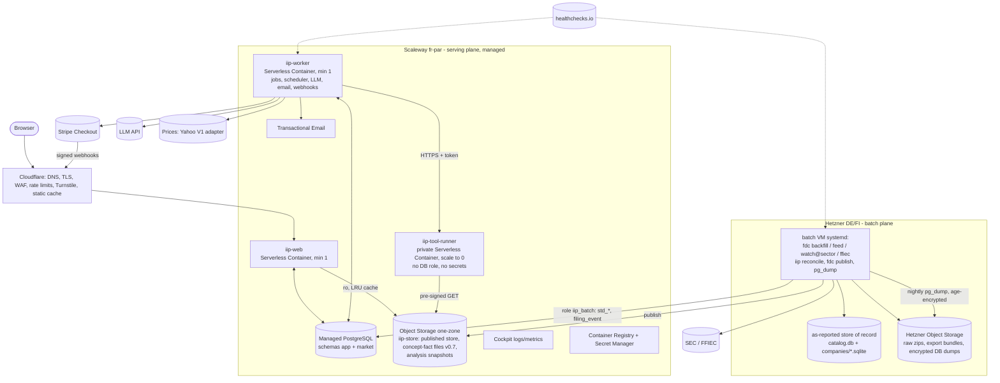

# 03 — Deployment, infrastructure and operations (input for the devops skill)

Version: **v0.5 (2026-11-06)**: managed Postgres standby node accepted (NFR-06, +€9.9). v0.3: option A **accepted** by the owner; V1 prices from Yahoo (ADR-012, €0); Stripe as payment provider (ADR-020); AWS costed as option E. Earlier: v0.1 used a single EU VPS. v0.2 applies the owner's answer to Q-02: €50–200/month excluding LLM, managed cloud preferred, Hetzner for heavy batch work (NFR-10). Decisions: ADR-015 (hosting), ADR-007 (managed Postgres), ADR-013 (queue), ADR-018/ADR-019 (object storage, store publication), ADR-012 (price vendor), ADR-017 (email), ADR-020 (payments).

Serves NFR-01, NFR-02, NFR-04..NFR-08, NFR-10, NFR-12, FR-07, FR-29.

## 1. Deployment components

Two planes. The **serving plane** (Scaleway, managed, EU) holds all personal data and user traffic. The **batch plane** (Hetzner, EU) holds the collector and other heavy, public-data jobs. They share only Postgres (least-privilege roles) and object storage.

## 2. Environments

| Env | Where | Data | Purpose |
|---|---|---|---|
| dev | developer machine / Claude Code sandbox; Postgres via `testcontainers` or local | `fdc export` seed bundle (~50 companies), synthetic users | development, unit/integration tests |
| ci | GitHub Actions + Postgres service container | fixtures only; **no SEC/vendor calls** (C-8) | lint, types, tests, e2e on seed |
| staging | Scaleway namespace `iip-staging` (containers min-scale 0), database `iip_staging` on the prod instance (A-20), bucket prefix `staging/`, `staging.<domain>` behind Cloudflare Access (owner only); fake payment provider sandbox | seed bundle + published snapshot | release rehearsal, migration tests, e2e smoke |
| prod | Scaleway `iip-prod` + Hetzner batch VM | full store, real users | V1 private beta |

The existing 1 GB screener server stays separate (A-11). The batch VM is new.

## 3. Compute choice (ADR-015)

| Component | Where | Size (beta) | Why |
|---|---|---|---|
| `iip-web` | Scaleway Serverless Container, min 1, max 3 | 0.5 vCPU / 1 GB | managed restarts and scaling; no OS to patch (NFR-12) |
| `iip-worker` | Serverless Container, min 1, max 2 (advisory-lock scheduler) | 0.5 vCPU / 1 GB | always-on jobs (ADR-013) |
| `iip-tool-runner` | **private** Serverless Container, min 0, max 4, request timeout 30 s | 1 vCPU / 1 GB | isolation (NFR-09, 06 §3.3); pay per run |
| Postgres | Scaleway Managed PostgreSQL DB-DEV-S | 2 vCPU / 2 GB, 20 GB block | ADR-007 |
| Batch VM | Hetzner CX43 (8/16/160) if orderable, else CPX32 (4/8/160), else AX41 dedicated (6c/64 GB/2×512 GB) | final size from M0 | heavy streaming loads, Arelle, store on local NVMe (C-5 relaxed: 1 GB limit no longer binding, but loaders keep streaming) |

Spike **S-1** (start of M3) verifies the unverified points before provisioning prod: always-on worker behaviour and cost of min-scale instances, cold start p95, ephemeral disk size for the store cache, private-container auth, DB IP allow-list for the Hetzner box, provider backup retention/PITR, registry and secret prices. **Fallback (ADR-015 option C):** web, worker and runner on one Scaleway instance with systemd (v0.1 units). DB, storage and batch stay as designed.

## 4. Networking, scalability, latency

- Cloudflare (free plan) proxies `app.<domain>` to the web container's HTTPS endpoint: DNS, TLS, WAF managed rules, rate limits on `/auth/*`, `/api/*` and `/billing/webhook`, Turnstile on sign-up/sign-in. Static assets are hashed and cached at Cloudflare; HTML is not cached.
- The **runner** is a private container. Its endpoint needs a Scaleway-issued token held only by the worker (Secret Manager). It has no DB credentials and no secrets; it gets one pre-signed URL per run.
- **Postgres** access is restricted by the instance ACL to the Scaleway serving plane and the Hetzner batch VM's static IPv4; TLS is required. Private Network for containers is used if S-1 confirms it, otherwise ACL + TLS.
- **Batch → Scaleway:** HTTPS to Object Storage (scoped key: write `iip-store/*` only) and Postgres role `iip_batch` (writes `market.std_*` and `market.filing_event` and `market.company_store_version`; nothing in `app`).
- **Scalability path (NFR-01):** ≤100 users: as §3. ~10k users (≤ 50 req/s peak, A-21): web max 6, worker max 3, DB node DB-DEV-L/GP-XS plus a read replica for read models. No re-architecture.
- Load levelling: tool runs, LLM calls, emails, plan reviews, alert evaluation and webhook processing are jobs (ADR-013).
- Latency: SQLAlchemy connection pool per container (size 5); company files from the LRU disk cache (ADR-019); read models in `market`.

## 5. Availability (NFR-06: 99 % monthly ≈ 7.3 h downtime budget)

- Managed containers restart on failure. Health endpoint `/health` checks DB, object storage, last price refresh < 36 h on trading days, published snapshot age and queue age. A Cloudflare health check and healthchecks.io alert the operator by email/Telegram.
- Postgres: **main node + standby node** (owner-accepted, NFR-06). The standby is a hot replica with automatic failover in the same region, on a different rack (Scaleway FAQ). A node failure loses no committed data, and the app reconnects through the pool with retry. The standby does not protect against logical errors, which replicate; backups/PITR cover those (03 §6, R-14).
- A batch-plane outage does not stop serving: the last snapshot serves and new filings wait (NFR-04 allows 24 h). Collectors are resumable (BR-05).
- Deploys: new container revision, rolling. Rollback = previous image tag.

## 6. Backups and disaster recovery (A-08)

| Data | Method | RPO | RTO |
|---|---|---|---|
| Postgres `app` (personal data, billing ledger) | Scaleway automated backups (retention/PITR verified in S-1) + nightly `pg_dump -Fc` from the batch VM, `age`-encrypted, to Hetzner Object Storage (35 days); weekly restore test into `iip_restore_test` | provider PITR if available, else ≤ 24 h (R-14) | ≤ 2 h restore to a new instance |
| Postgres `market` | same dumps; rebuildable from vendor + store | 24 h | 4 h |
| as-reported store | raw zips in Hetzner Object Storage (source of truth) + weekly `fdc export --all` bundle + published copy on Scaleway | 24 h | ≤ 2 days rebuild from raw, hours from bundle |
| config/secrets | Scaleway Secret Manager / batch `/etc/fdc/fdc.env`; offline encrypted copy held by owner | — | — |

Restore drill quarterly (RB-05). Never in GitHub. Backups age out within 35 days (stated in the privacy notice); the billing ledger is retained per A-27.

## 7. Observability and troubleshooting

- **Logs:** structlog JSON to stdout → Scaleway Cockpit (included retention for Scaleway products: 1 week logs, 1 month metrics; [Scaleway](https://scaleway.com/en/pricing/managed-services)). Batch VM: journald 30 days + optional shipping to Cockpit (€0.35/GB, low volume). Correlation ids: `request_id`, `job_id`, `run_id`, `tool_run_id`, `script_run_id`, `collector_run_id`, `builder_session_id`, `reservation_id`.
- **Metrics:** request latency per route, queue depth/age, tool run durations, script runs (count by status ok/undefined/missing_input, evaluation location, memo hit rate, runner p95), **LLM tokens and charged EUR per hour**, open reservations, webhook failures, email failures, price refresh age, snapshot age, collector counters. `/ops` page for the operator.
- **SLIs/SLOs:** availability 99 %; page p95 < 2 s (NFR-03); filings visible < 24 h (NFR-04); prices by 08:00 CET next trading day (NFR-05); metering reconciliation gap ≤ 1 % per month (FR-29).
- **Alerts:** health fail > 5 min; price refresh missed; snapshot older than 36 h; queue age > 15 min; batch disk > 80 %; dump missing; webhook signature failures; reservations open > 15 min; script `internal evaluation error` > 0 per hour or runner script p95 > 1 s; LLM token rate > safety limit (`llm_kill_switch`).
- **Runbooks** (`deploy/runbooks/`): RB-01 SEC 403/429 · RB-02 backfill crashed / disk full · RB-03 price refresh failed · RB-04 Postgres slow queries / connections exhausted (v0.1 "SQLite locked" replaced) · RB-05 restore Postgres from provider backup or dump; restore store from bundle · RB-06 runner saturation · RB-07 LLM vendor outage or kill switch: builder paused, reservations released · RB-08 GDPR request · **RB-09 monthly billing reconciliation** (usage records vs LLM vendor invoice vs payment provider payouts) · **RB-10 webhook backlog / missed webhook** (replay from provider dashboard; idempotent inbox).

## 8. CI/CD

- **CI (GitHub Actions, per PR):** `uv sync` → ruff + format → mypy → import-linter → unit → integration (Postgres service container) → contract → e2e (Playwright, seed bundle, fake LLM/payment/price adapters) → `pip-audit` → container build (no push on PRs).
- **Collector repo CI:** lint/type/tests on fixture zips; never downloads from SEC (C-8).
- **CD (owner-triggered):** tag `vX.Y.Z` → workflow builds the image and pushes it to Scaleway Container Registry. The push-only registry token is a GitHub environment secret; the `prod` environment requires owner approval. Then: `alembic upgrade head` against staging as a one-off container job → smoke e2e → prod migration → deploy the new revision. The Scaleway API key used by CD is scoped to the containers namespace + registry. Application secrets never go to GitHub; containers read them from Secret Manager. Data jobs still never run in CI (C-8).
- **Batch VM:** `deploy/batch/install.sh vX.Y.Z` on the box (v0.1 operating model).
- **Migrations:** expand/contract so the previous revision runs on the new schema.
- **IaC:** OpenTofu/Terraform with the Scaleway and Hetzner providers (`deploy/infra/`): namespaces, containers, DB instance, users/ACLs, buckets and lifecycle rules, TEM domain, Hetzner VM, firewall, buckets. State is encrypted in Scaleway Object Storage. Two providers make IaC worth having from the start (v0.1 deferred it).

## 9. Collector operations (batch VM)

| Unit | Schedule | Notes |
|---|---|---|
| `fdc-backfill.service` | manual start (initial), then a quarterly timer | for the initial 12-year backfill, temporarily rescale the VM (hourly billing) or run on the AX box; `Nice=10`, `IOSchedulingClass=idle` |
| `fdc-feed.timer` | every 15 min (+ 06:00 daily-index reconcile) | one SEC request per poll |
| `fdc-watch@<sector>.service` | long-running per sector (BR-15) | shared host-wide limiter (NFR-07) |
| `fdc-ffiec.timer` | quarterly + monthly amendment check | |
| `iip-reconcile.service` | triggered after loads (path unit on catalog seq) | writes `market.std_*` |
| `fdc-publish.service` | after each load/reconcile | ADR-019 |
| `fdc-export.timer` | weekly | bundles to Hetzner Object Storage |
| `iip-pgdump.timer` | nightly 02:30 | encrypted dump to Hetzner Object Storage |

## 10. Cost (NFR-10: €50–200/month, excl. LLM; prices checked 2026-11-06, EUR excl. VAT)

### 10.1 Accepted: option A (managed serving + Hetzner batch)

| Item | Basis | EUR/month | Verified |
|---|---|---|---|
| `iip-web` container, always 1 × 0.5 vCPU/1 GB | 1.314 M vCPU-s × €0.00001 + 2.628 M GB-s × €0.000002, minus free tier 200k vCPU-s / 400k GB-s | ≈ 15.6 | rates yes ([Scaleway serverless](https://www.scaleway.com/en/pricing/serverless/)); min-scale billing behaviour **not verified** (S-1) |
| `iip-worker` container, same size (free tier used up) | 1.314 M vCPU-s + 2.628 M GB-s | ≈ 18.4 | as above |
| `iip-tool-runner`, scale to zero | est. 150k vCPU-s + 150k GB-s/month (100 users × 5 runs/day × 10 s) | ≈ 1.8 | rates yes; usage ASSUMPTION |
| Managed PostgreSQL DB-DEV-S + 20 GB | €0.0156/h × 730 + 20 × €0.0993 | ≈ 13.4 | yes ([Scaleway DB](https://www.scaleway.com/en/pricing/managed-databases)) |
| Object Storage one-zone (store copy + snapshots ≈ 50–100 GB) | €0.00752/GB; 75 GB egress free | ≈ 1 | yes ([Scaleway storage](https://www.scaleway.com/en/pricing/storage/)) |
| Transactional Email (≤ 5k/month) | 300 free, €0.25/1,000 | ≈ 1 | yes ([Scaleway managed services](https://scaleway.com/en/pricing/managed-services)) |
| Cockpit, Container Registry, Secret Manager | Scaleway product data included; registry/secrets small | ≈ 0–3 | Cockpit yes; registry/secrets **not verified** |
| Hetzner batch VM | CX43 €16.49 / CPX32 €35.99 / AX41 €59 (no setup fee) | 16.5–59 (plan: 36) | prices yes; CX/CPX "currently unavailable" on 2026-11-06 ([Hetzner cloud](https://www.hetzner.com/cloud/regular-performance/), [AX](https://www.hetzner.com/dedicated-rootserver/matrix-ax/)) |
| Hetzner Object Storage (raw zips, bundles, dumps ≤ 1 TB) | flat incl. 1 TB + 1 TB egress | 6.49 | yes ([Hetzner OS](https://hetzner.com/storage/object-storage)) |
| Cloudflare free, healthchecks.io free | | 0 | not re-verified |
| Domain | ≈ €12/year | ≈ 1 | **not verified** (owner may own one) |
| **Price vendor: Yahoo (V1, owner risk acceptance)** | no fee; licensed replacement marketstack Professional $49.99 ≈ €43 when switched (ADR-012) | 0 (43 later) | Yahoo terms: no licence for this use |
| **Postgres standby node** (owner-accepted, NFR-06) | €0.0136/h × 730 (additional node DB-DEV-S) | ≈ 9.9 | yes ([Scaleway DB](https://www.scaleway.com/en/pricing/managed-databases)); whether the standby also bills storage is **not verified** |
| **Total (V1, Yahoo)** | | **≈ 88 (CX43) / 108 (CPX32, plan) / 131 (AX41)** | with marketstack later: 131 / 151 / 174 |
| One-off: backfill rescale (e.g. a few days on a larger VM) | hourly | ≈ 5–15 once | estimate |

USD→EUR at the ECB reference rate 1.1537 (16-Sep-2026, [Banca d'Italia](https://www.bancaditalia.it/compiti/operazioni-cambi/cambio/cambi_rif_20260916)).

### 10.2 Alternatives (detail in ADR-015; totals include marketstack ≈ €43 — subtract it while on Yahoo)

| Option | Monthly incl. price vendor | Note |
|---|---|---|
| B. All on one Hetzner VM (v0.1) | ≈ 88 (CPX32) – 111 (AX41) | cheapest; no managed services; leaves room for marketstack Business or Tiingo partially |
| C. Scaleway DEV1-L VM (€30.66) + managed Postgres + Hetzner batch | ≈ 114–160 (plan 134; IPv4/block storage extra, not verified) | S-1 fallback; IPv4/block prices not verified |
| D. All Scaleway (batch on DEV1-L + 200 GB block) | ≈ 145–165 | most managed; less batch capacity per euro than Hetzner |
| E. AWS eu-central-1, same shape (Fargate + ALB, RDS, S3, SES, CloudWatch) | ≈ 180–200 (**coordinator estimate**, not priced line by line) | ≈ €40–60 more than A, mainly ALB (≈ $19.7/month fixed in Frankfurt), public IPv4 ($0.005/h each) and CloudWatch Logs ([cloudburn.io, 2026-09](https://cloudburn.io/blog/aws-elastic-load-balancing-pricing)) |

### 10.3 What is outside NFR-10
LLM tokens are paid by premium users (BR-17, ADR-010/020). Payment provider fees (Stripe processing; optional Stripe Tax 0.5 %, ADR-020) are deducted from top-up revenue (A-26).

### 10.4 Budget sensitivities
- **Switching from Yahoo to a licensed vendor** (ADR-012, owner date open): marketstack Professional ≈ €43 → A ≈ €151 incl. standby (fits). If marketstack declines display: Tiingo Start-up Redistribution $250 ≈ €217. Option A becomes ≈ €325, option B ≈ €262: **above €200 in every option** → owner decision Q-03b.
- **marketstack Business** ($149.99 ≈ €130) if Professional's quota or licence is insufficient: A ≈ €218–238 incl. standby (over), B ≈ €175 (fits).

## 11. DevOps handoff checklist

1. Run spike S-1 (§3) and record results here; confirm option A or switch to C.
2. Accounts: Scaleway org (project `iip`, fr-par), Hetzner project; billing alerts at €150 and €190/month on both.
3. IaC in `deploy/infra/` (OpenTofu): Scaleway namespaces `iip-prod`/`iip-staging`, containers (§3 sizes, min/max scale, private runner), registry, Secret Manager entries, Managed PostgreSQL (DB-DEV-S, backups on, ACL = containers + batch VM IP, TLS), databases `iip`, `iip_staging`, roles `iip_web`, `iip_worker`, `iip_batch`, `iip_ro` (ADR-007), buckets `iip-store` (one-zone, lifecycle 30 days for superseded keys), TEM domain (SPF/DKIM/DMARC); Hetzner VM (size per M0), firewall (SSH from owner IPs only), Object Storage buckets `fdc-raw`, `fdc-bundles`, `iip-dumps` (35-day lifecycle).
4. Batch VM: Debian 12, unattended upgrades, users `fdc` and `iip-batch`, `/srv/fdc/{store,staging,raw}`, uv + Python 3.12, sqlite3, `age`, `pg_dump` (client version = server); `deploy/batch/install.sh`; env `/etc/fdc/fdc.env` (incl. `EDGAR_USER_AGENT`, bucket keys, `iip_batch` DSN).
5. systemd units on the batch VM per §9, all wrapped with healthchecks.io pings.
6. Cloudflare: zone, proxied DNS to the web container, WAF managed rules, rate limits (`/auth/*`, `/api/*`, `/billing/webhook`), Turnstile keys, Access policy for `staging.` and `/ops`.
7. Container images: `Dockerfile` (python:3.12-slim, uv, non-root user); separate minimal image for the runner (only `iip.tools.dsl`, `iip.tools.expr`, `iip.tools.scripts` kernel + built-ins, the screener's pure modules, readers; no DB drivers, no SDKs).
8. CD workflow per §8 with the `prod` environment requiring owner approval; scoped Scaleway API keys.
9. Postgres standby node enabled (NFR-06) and a failover test done. Backups: verify provider backup retention/PITR; nightly encrypted dump; pre-migration snapshot; weekly restore test; RB-05 drill once before beta.
10. Observability: Cockpit dashboards (latency, queue, tokens/charges, snapshot age, price age), alerts per §7, `/health` wired to the Cloudflare health check.
11. Stripe account (test mode first): Products/Prices for top-up amounts, Checkout, webhook endpoint `/billing/webhook` for `checkout.session.completed`, `checkout.session.async_payment_succeeded`/`_failed`, `charge.refunded`, `charge.dispute.created`; webhook signing secret and restricted API key in Secret Manager; live mode only after gate M5b.
12. Runbooks RB-01..RB-10 in `deploy/runbooks/`.
13. Record actual monthly cost in §10 after the first full month.
14. (v0.7) `iip reconcile` publishes per-company concept-fact files under `iip-store/std/` (same lifecycle as store keys); `market.company_std_version` table; measure file sizes and rebuild time on a full sector (R-19) and record here.
15. (v0.7) Deploy step `iip scripts load-builtins` (idempotent by content hash; fails the release if a published built-in version's hash would change, G-29).
