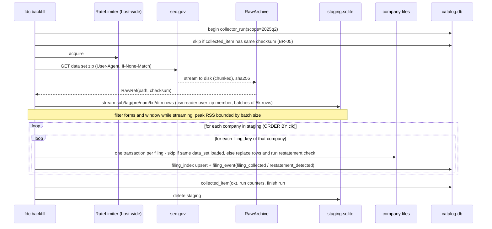

# 05 — Financial data collector and as-reported store (topics T2, T3, T9)

Bounded context BC-1 **Filings**. Lives in repo `dsastriques/financial-data-collector` (private from v0.4, C-7), Python package `fdc` (ADR-002). Serves BR-02..05, BR-15, BR-16, FR-01..08, NFR-02, NFR-04, NFR-07.

## 1. Responsibilities and non-responsibilities

**Does:** download SEC (and FFIEC) data; store it as reported; keep every filing incl. amendments; detect restatements; track runs and collected items; watch for new filings per sector; export portable file sets; publish a read-only client library and a filing event feed.
**Does not:** standardize or rename tags (that is BC-3 Reconciliation, BR-02); know about users; write to app databases.

## 2. Hexagonal layout and source contract (FR-04)

```
financial-data-collector/
  pyproject.toml                 # uv, python>=3.12, ruff, mypy strict, pytest (same conventions as the screener)
  src/fdc/
    domain/                      # Filing, Fact, PresentationLine, TextFact, FactKey, Revision, CollectorRun, CollectedItem
      restatement.py             # pure comparison logic (FR-06)
      sectors.py                 # SIC -> sector mapping value objects (BR-15)
    application/
      ports.py                   # SourceCollector, StoreWriter, StoreReader, RunLog, RawArchive, RateLimiter, Clock
      backfill.py                # use case: backfill window of data sets (FR-01, FR-02)
      watch.py                   # use case: watch one sector (FR-03)
      collect_ffiec.py           # use case: FFIEC call reports (BR-16)
      export.py                  # use case: export/import file sets (FR-05)
      status.py                  # use case: run history/health (FR-07)
    adapters/
      in_cli/                    # `fdc` CLI (typer/argparse): backfill, watch, collect, export, import, status, verify
      out_sec_bulk/              # FSDS and FSN zip streaming readers (SecFsdsSource, SecFsnSource)
      out_sec_filing/            # per-filing XBRL -> records (Arelle) + EDGAR feeds/daily index/submissions
      out_ffiec/                 # Call Report bulk reader + MDRM dictionary (FfiecCallReportSource)
      out_store_sqlite/          # catalog.db + per-company SQLite writer, staging DB
      out_archive/               # raw zip archive: local cache + S3-compatible object storage (ADR-018)
      out_ratelimit/             # host-wide token bucket (file lock), NFR-07
    store_client/                # PUBLISHED read-only client (Open Host): schema version, statement queries (FR-08)
  sql/store_schema_v1.sql        # Published Language: the store schema
  config/collector.yaml          # history_years: 12, forms, sectors map, rate limit, poll intervals, tolerances
  deploy/systemd/                # fdc-backfill.service, fdc-watch@.service/.timer, fdc-ffiec.timer, fdc-reconcile.timer
  tests/fixtures/                # tiny synthetic FSDS/FSN zips, XBRL instance, call report extract
```

**Output contract** (every `SourceCollector` yields these records; streaming iterators, never whole lists):

| Record | Fields (as reported) |
|---|---|
| `FilingRecord` | source, filing_key (`adsh`), company_id, cik/rssd, name, sic, countryba, form, period, fy, fp, filed, accepted, prevrpt, detail, instance, nciks, aciks, data_set, provisional |
| `TagRecord` | tag, version, custom, abstract, datatype, iord, crdr, tlabel, doc |
| `FactRecord` | filing_key, tag, version, ddate, qtrs, uom, segments (text as published) and/or dimh, coreg, value, footnote, iprx |
| `PresentationRecord` | filing_key, report, line, stmt, inpth, rfile, tag, version, plabel, negating |
| `TextRecord` (notes) | filing_key, tag, version, ddate, qtrs, iprx, lang, dcml, durp, datp, dimh, value (text), escaped, srclen, txtlen, footnote, context |
| `DimensionRecord` (FSN) | dimhash, segments, segt |

Field names follow SEC's data set readme (Conformist, BR-02). FFIEC data is translated by its adapter into the same records (tag = MDRM item code, version = `ffiec-callreport-<series>`, uom/scale as reported, presentation = schedule + line from the MDRM dictionary) and keeps `source = ffiec` (BR-16). Exact columns are verified against the current SEC readme in M0 (the FSDS `segments` column exists since the Dec-2024 reprocess per the 2026-11-03 research).

```python
class SourceCollector(Protocol):
    source: str                                   # "sec-fsds" | "sec-fsn" | "sec-filing" | "ffiec-cdr"
    def list_items(self, since: date) -> Iterable[ItemRef]: ...      # data sets / filings available
    def fetch(self, item: ItemRef) -> RawRef: ...                    # download to archive (checksum, etag)
    def read(self, raw: RawRef) -> Iterator[Record]: ...             # stream records, bounded memory
```

## 3. As-reported store (T3, ADR-003)

**Decision:** a **catalog DB + one SQLite file per company**, all on the server's data volume.

```
$FDC_STORE/                                   # e.g. /srv/fdc/store
  catalog.db                                  # cross-company index + run tracking + event feed
  companies/sec/0000320193.sqlite             # one file per SEC filer (CIK, 10 digits)
  companies/ffiec/0000480228.sqlite           # one file per FFIEC filer (RSSD id)
  MANIFEST.json                               # store_schema_version, built_at, counts, checksums
$FDC_STAGING/                                 # temp staging DBs per data set, deleted after commit
$FDC_RAW/                                     # local raw cache (zips), mirrored to object storage
```

Why (vs one big DB, and vs the app DB):
- **Portability (FR-05):** a company or sector is a set of files; seeding a test DB = copying files.
- **Memory/disk friendly:** writes touch one small file at a time; no single multi-GB B-tree that must be vacuumed; a corrupt file affects one company and is rebuildable from raw.
- **Read latency (NFR-03):** company pages read one small file (all its filings), typical query < 50 ms.
- **Separation:** the app's transactional DB stays small and backup-friendly; the store is a derived, rebuildable asset with its own backup policy (ADR-018).
- Cross-company analysis is never done on raw facts; it runs on Reconciliation's standardized table in Postgres schema `market` (BC-3; written by `iip reconcile` on the batch plane, v0.2), built incrementally from `filing_event`.
- One-big-DB remains a fallback if M0 shows per-file overhead is excessive (e.g. > 30 % size overhead or > 50k files); the `StoreWriter`/`store_client` ports hide the layout.

### 3.1 Catalog schema (`catalog.db`)

```sql
store_meta(key PRIMARY KEY, value)                         -- store_schema_version = 1, history_years = 12
company(company_id PRIMARY KEY, source, cik, rssd_id, name, sic, sector, fye, countryba,
        first_filing, last_filing, file_path, updated_at)
filing_index(source, filing_key, company_id, form, period, fy, fp, filed, accepted,
             data_set, provisional, superseded_by, loaded_at, PRIMARY KEY(source, filing_key))
collector_run(run_id INTEGER PRIMARY KEY, collector, scope, started_at, finished_at,
              status CHECK(status IN ('running','ok','partial','failed')), cursor, items_ok,
              items_skipped, items_failed, filings_loaded, facts_loaded, revisions_found,
              requests_made, error, host, version)
collected_item(source, item_key, checksum, etag, size_bytes, collected_at, run_id,
               status CHECK(status IN ('ok','failed','superseded')), note, PRIMARY KEY(source, item_key))
filing_inbox(source, filing_key, cik, sic, sector, form, accepted, discovered_at,
             claimed_by, claimed_at, status, attempts, PRIMARY KEY(source, filing_key))
filing_event(seq INTEGER PRIMARY KEY AUTOINCREMENT, kind CHECK(kind IN
             ('filing_collected','filing_superseded','restatement_detected')),
             company_id, filing_key, form, period, payload_json, created_at)   -- Open Host feed
std_tag(tag, version, custom, abstract, datatype, iord, crdr, tlabel, doc, PRIMARY KEY(tag, version))
```

### 3.2 Per-company schema (`companies/<source>/<id>.sqlite`)

```sql
filing(filing_key PRIMARY KEY, form, period, fy, fp, filed, accepted, prevrpt, amendment_of,
       data_set, provisional, source, sub_json)               -- full sub row kept verbatim
fact(filing_key, tag, version, ddate, qtrs, uom, segments, coreg, value, footnote, dimh, iprx,
     source, PRIMARY KEY(filing_key, tag, version, ddate, qtrs, uom, segments, coreg))
pre(filing_key, report, line, stmt, inpth, rfile, tag, version, plabel, negating,
    PRIMARY KEY(filing_key, report, line))
ext_tag(tag, version, custom, abstract, datatype, iord, crdr, tlabel, doc, PRIMARY KEY(tag, version))
txt(filing_key, tag, version, ddate, qtrs, iprx, lang, dimh, value, ... , PRIMARY KEY(...))  -- notes text
dim(dimhash PRIMARY KEY, segments, segt)
fact_revision(company_key, tag, ddate, qtrs, uom, segments, coreg,
              prior_filing_key, prior_value, new_filing_key, new_value, delta, detected_at,
              PRIMARY KEY(company_key, tag, ddate, qtrs, uom, segments, coreg, new_filing_key))
-- indexes: fact(tag, ddate, qtrs), pre(filing_key, stmt, report, line)
```

- No `UPDATE` of facts across filings: each filing's facts live under its own `filing_key` (BR-03). The only replacement is a reload of the **same** `adsh` (republished data set or provisional→bulk), done by `DELETE ... WHERE filing_key = ?` + insert in one transaction (A-04).
- `value` stored as text-preserving decimal (SQLite `TEXT` for exact representation + generated `REAL` column `value_num` for queries) so nothing is lost to float rounding (BR-02).

## 4. Backfill (FR-01, FR-02, BR-04)

### 4.1 Sources
- **SEC Financial Statement and Notes data sets (FSN)** — face statements **and** notes (numeric + text + dimensions). Expected to be a superset of FSDS. Published quarterly for older periods and monthly for recent ones (verify in M0).
- **SEC Financial Statement Data Sets (FSDS)** — face statements only, smaller.
- **Decision (ADR-004):** implement both readers behind `SourceCollector`. Default backfill source = **FSN** (one pass gives FR-01 and FR-02) **if** M0 shows (a) FSN reproduces FSDS face-statement facts for the sample and (b) the 12-year projection fits the disk budget. Otherwise: FSDS for the full window + FSN for the most recent N years or on demand per company (owner decision with M0 numbers).
- Forms kept: 10-K, 10-K/A, 10-Q, 10-Q/A, 20-F, 20-F/A, 40-F, 40-F/A (config). Other forms in the data sets are skipped at stream time.
- Window: data sets whose submissions fall within the last `history_years = 12` years (BR-04). Comparative prior-period values inside those filings are kept as reported.

### 4.2 Streaming load (1 GB-RAM safe, C-5)



- Memory: rows are processed in fixed-size batches; staging uses SQLite on disk (`cache_size` capped, `temp_store=FILE`). Target peak RSS ≤ 512 MB (measured in M0).
- Order: data sets loaded **oldest → newest**, so restatement detection compares each filing with what was filed before (FR-06).
- Resumable: a crash leaves at most one company transaction uncommitted; a rerun skips filings already present with the same `data_set` (idempotent by `adsh`, BR-05).

## 5. Restatement detection (FR-06, BR-03)

- Comparison key: `(company, tag, ddate, qtrs, uom, segments, coreg)`; for **extension tags** the version (= the filer's own `adsh`) is ignored and the tag name is compared within the same company.
- On loading filing F, for each fact key: find the latest earlier filing (by `accepted`) of the same company that reported the key. If `|new − old| > max(abs_tol, rel_tol × |old|)` → insert `fact_revision` and emit one `restatement_detected` event per filing (payload: number of changed facts, top changed tags).
- Defaults `abs_tol = 0.5` (rounding to units) and `rel_tol = 0` are **ASSUMPTIONS** to tune after M0 (scaling differences such as thousands vs millions appear as rounding deltas).
- Amendments (`/A`) are loaded like any other filing; `amendment_of` links them when `prevrpt` or EDGAR metadata identifies the original.

## 6. Incremental runs, run history, rate limiting (BR-05, FR-07, NFR-07, ADR-005)

1. **Collected items:** every data set (`sec-fsn:2025_09`), per-filing load (`sec-filing:<adsh>`) and FFIEC period (`ffiec:2025-06-30`) is a `collected_item` with checksum/ETag. A rerun lists available items, skips `ok` items with an unchanged checksum, retries `failed` ones, and reloads changed ones (republished data sets).
2. **Run tracking:** each process writes a `collector_run` row (started/finished, status, counters, cursor, requests made). `fdc status` prints the last successful run per collector/scope, items collected, failures; `fdc status --json` feeds the app's `/ops` page and health check. A run older than its threshold (e.g. watcher > 2 h, backfill > 100 days, FFIEC > 100 days) marks the health check `stale`.
3. **Locks:** one active run per collector+scope (row lock via `collector_run` status + PID file); concurrent duplicate starts exit with "already running".
4. **SEC fair access:** all `fdc` processes acquire tokens from a **host-wide token bucket** (file-locked state under `/run/fdc/`), default **8 req/s** (headroom under 10). `EDGAR_USER_AGENT` is mandatory (process refuses to start without it). 403/429 → exponential backoff and a run note. Bulk downloads count as one request each.
5. **Health pings:** systemd units wrap runs in `run-job.sh` (healthchecks.io start/success/fail), the pattern already used by the screener.

## 7. Per-sector filing watchers and gap fill (FR-03, BR-15, NFR-04, ADR-006)

Naming (v0.7): the collector's watchers are always called **filing watchers** in docs, code and UI, so they cannot be confused with the owner's future analysis concept (proposed name **monitor**, 08 §10). Unit names `fdc-watch@<sector>` stay.

- **Sectors:** SIC code → ~11 economic sectors via `config/sectors.yaml` (A-02). Company SIC comes from the data sets / EDGAR submissions.
- **Discovery (shared, cheap):** `fdc-feed` polls the EDGAR "latest filings" feed for the configured forms every 15 min (configurable) and reads the nightly **daily index** as a reconcile pass, writing candidates to `catalog.filing_inbox` with their sector (one SEC request per poll for all sectors, NFR-07).
- **Watchers:** `fdc-watch@<sector>.service` (systemd template, one instance per sector, BR-15) claims inbox rows of its sector, fetches each filing's XBRL (instance + presentation linkbase) and converts it with **Arelle** into the output contract, loading it as `provisional = 1`. Concurrency 1 per watcher; all share the rate limiter.
- **Supersede:** when the next bulk data set contains the same `adsh`, the bulk version replaces the provisional one (`filing_superseded` event) — bulk data is the reference representation (BR-02).
- **Latency:** feed poll 15 min + processing → typically < 1 h; the nightly daily-index reconcile guarantees **< 24 h** (NFR-04) even if the feed misses items.
- **Risk R-02:** Arelle output may differ from SEC's data set conventions (segments text, `plabel`, line order). M2 spike compares Arelle output with FSN for ~20 filings and defines the provisional-data caveat shown in UI.

## 8. FFIEC call reports (BR-16, FR-04)

- `FfiecCallReportSource` reads the FFIEC CDR bulk "Call Reports – Single Period" files (one zip of tab-delimited schedules per quarter) and the MDRM data dictionary for labels.
- Company key `ffiec:<RSSD_ID>`; `filing_key = ffiec:<rssd>:<report_date>:<file_version>`; amended call reports are new filings (BR-03).
- Scope (ASSUMPTION A-13): banks **without** an SEC-filing parent are collected; the link bank → SEC holding company (when present) comes from FFIEC NIC relationship data. If the CDR bulk download cannot be automated (it is a web form; the CDR web service requires a free account), the collector supports a manually dropped zip in `$FDC_RAW/ffiec/inbox/` — decided in the M2 spike.
- Runs quarterly (`fdc-ffiec.timer`), same run tracking.

## 9. Export and seeding (FR-05)

- `fdc export --all | --sector X | --companies ciks.txt --out bundle/` → copies company files with SQLite's online backup API, writes a filtered `catalog.db` and `MANIFEST.json` (schema version, checksums, counts), packs as `tar.zst`.
- `fdc import bundle.tar.zst --into $FDC_STORE` verifies checksums and schema version.
- Used for: dev/staging seeds (e.g. 50 companies across sectors), test fixtures, disaster recovery (alongside raw zips), and a future production move.

## 10. Read side for the app (FR-08, Open Host)

v0.2: the store of record lives on the Hetzner batch VM; the serving plane reads **published immutable copies** from object storage via the same `store_client` API (`fdc publish`, ADR-019).

`fdc.store_client` (shipped in the collector package, pinned by tag in the app) offers:
- `statement(company_id, filing_key, stmt)` → lines ordered by `report, line` with `plabel`, values per period column (statement as presented).
- `statements(company_id, annual_only=True, consolidated_only=True, stmt=...)` — annual = 10-K/20-F/40-F filings and `qtrs ∈ {0, 4}`; consolidated = `segments` empty and `coreg` empty (FR-08).
- `notes(company_id, filing_key)` — text and numeric notes.
- `revisions(company_id)` — restatement history.
- `events(after_seq)` — the `filing_event` feed.
Opens files read-only (`file:...?mode=ro`); checks `store_schema_version` and refuses unknown majors.

## 11. Sizing test — milestone M0 (NFR-02)

Goal: measured numbers before committing to full history, storage layout and server size.

| Step | Action | Measured |
|---|---|---|
| 1 | Download one recent FSDS quarter and the FSN data for the same period (monthly files covering that quarter) | zip sizes, download time, request count |
| 2 | Stream-load FSDS quarter into the per-company store | wall time, peak RSS (`/usr/bin/time -v`), staging peak disk, final store bytes, rows per table, number of company files, file-size distribution (p50/p95/max) |
| 3 | Same for FSN (incl. txt/dim) into a separate store | same + notes share of bytes |
| 4 | Superset check: for 20 sample companies (large-cap industrial, bank, insurer, REIT, 20-F and 40-F filers, a company with segments) compare FSDS face-statement facts with FSN facts | % FSDS facts reproduced, differences |
| 5 | Load the previous quarter too, oldest first; then rerun both loads | revisions found (plausibility), rerun loads 0 new rows (idempotency, BR-05) |
| 6 | Same load with a one-big-DB layout (single SQLite) | size and query time vs per-company |
| 7 | Extrapolate to 12 years (×48 quarters, with a growth factor from comparing an old and a recent quarter) | projected store size and backfill duration |

**Go / no-go thresholds (proposed, owner may adjust):** peak RSS ≤ 512 MB; one quarter loads in ≤ 2 h on the target batch VM; projected 12-year store fits the batch VM disk + ≤ 1 TB object storage within NFR-10 (03 §10); idempotent rerun adds 0 rows; FSN reproduces ≥ 99 % of FSDS face-statement facts (else use FSDS for face statements).
Output: `docs/sizing/M0-report.md` in the collector repo, and ADR-003/ADR-004 updated with the numbers.
