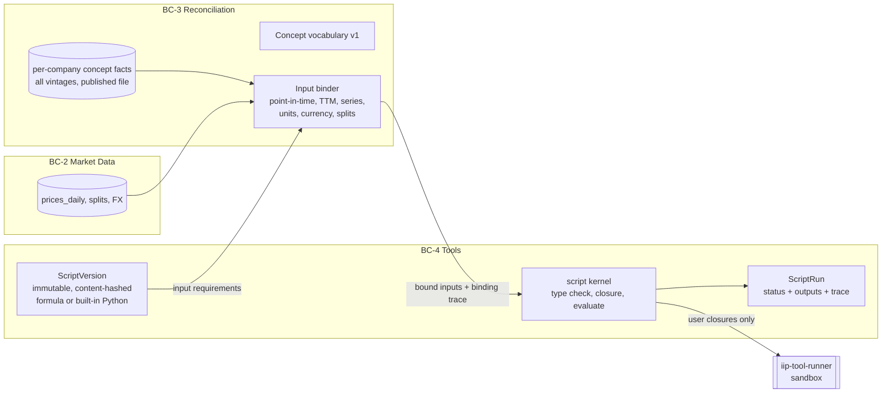
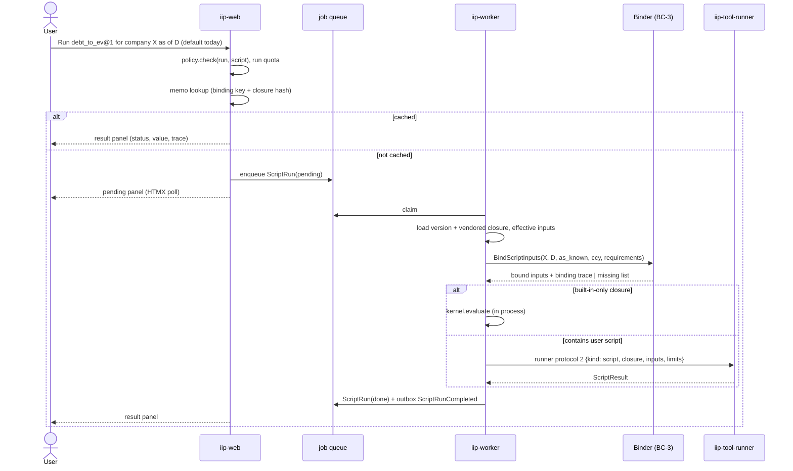

# 08 — Scripts: pure, versioned calculations (topics S1–S7)

Status: **design v0.7 (2026-11-07)**. Input: requirements **v0.6** (BR-20..BR-25, FR-31..FR-34) and brief `claude/04-architect-brief-scripts.md`. Owner definition (2026-11-07): *a script is a modular, reusable operation or calculation performed using specific figures in a company report and price information available at the moment of execution (e.g. Debt-to-EV, P/E). It does not know how data is stored or how much is saved; it takes parameters and returns the result of a calculation.* Owner-confirmed defaults: (1) scripts call scripts with pinned versions, (2) inputs may be series, (3) the binder normalises units/currency and scripts reject mixed currencies, (4) user scripts are formulas over declared parameters run by a safe evaluator, built-ins may be Python under the same contract.

Tools, analysis monitors (owner's "analysis watchers", naming in §10) and dashboards are designed later. This document only makes sure they can be built on top of scripts.

Decisions: **ADR-021** (scripts as an artefact, contract, result model), **ADR-022** (formula language and safe evaluator), **ADR-023** (concept vocabulary and point-in-time binder), **ADR-024** (versioning and composition).

## 1. Overview



Three parts with one rule each:
- A **script** knows only its declared inputs: no data access, no storage, no history depth, no current date, no network (BR-20).
- The **binder** knows where the figures are, but calculates nothing analytical. It only standardises: it selects facts, assembles periods, and normalises units, scale, splits and currency (BR-21, BR-24).
- The **kernel** evaluates a pinned closure of script versions over bound inputs. It always returns a status and a trace (BR-22, BR-25).

## 2. Script contract (S1, FR-31, ADR-021)

### 2.1 ScriptSpec v1 (JSON, schema-validated)

```json
{
  "script_spec": 1,
  "name": "debt_to_ev",
  "description": "Total debt as a share of enterprise value.",
  "inputs": [
    {"name": "total_debt", "concept": "total_debt", "basis": "latest", "type": "money", "currency": "C"}
  ],
  "uses": [
    {"as": "ev", "script": "builtin/enterprise_value", "version": 1}
  ],
  "outputs": [ {"name": "result", "type": "ratio"} ],
  "undefined_when": [
    {"if": "ev <= 0", "reason": "enterprise value is zero or negative"}
  ],
  "formula": { "result": "total_debt / ev" }
}
```

Assigned at publish, not written by the author: `id`, `version` (1, 2, …), `author` (account or `platform`), `space_id`, `content_hash`, `created_at`, `closure` (§5). FR-31 fields map as follows:

| FR-31 field | Spec field | Notes |
|---|---|---|
| name | `name` | slug `[a-z][a-z0-9_]{0,47}`, unique per space |
| version | assigned | integer, immutable once published (BR-22) |
| description | `description` | plain text ≤ 1,000 chars, shown in catalogue and trace |
| author | assigned | account id, or `platform` for built-ins |
| typed inputs | `inputs[]` | `name`, **either** `concept` + `basis` (bound by the binder) **or** `parameter: true` (supplied by the caller, e.g. a WACC), `type`, `currency` (currency variable, default `C`, or a fixed ISO code), `default` (optional), `optional` (no default, may be absent; only usable through `coalesce`/`is_missing`), `series` (`{"basis": "fy", "length": 10}`) |
| typed outputs | `outputs[]` | `name`, `type`, `currency` (for money types). Default: one output `result` |
| the calculation | `formula` (user and built-in formula scripts) **or** `implementation` (built-in Python only: `{"kind": "python", "entrypoint": "iip.tools.scripts.builtins.valuation:graham_number", "code_version": "1"}`) | §3 |
| undefined-result rules | `undefined_when[]` | ordered `{if, reason}`; first true rule wins. Runtime rules are implicit (§3.4) |
| (dependencies) | `uses[]` | `{as, script, version}`; exact version, never "latest" (BR-22) |

### 2.2 Types (BR-24)

| Type | Dimension | Unit / currency | Examples |
|---|---|---|---|
| `money` | money | currency variable `C` or fixed ISO code; units, never thousands | total_debt, revenue, ev |
| `per_share_money` | money / share | `C` per share | price, diluted_eps, dividends_per_share |
| `share_count` | shares | shares | shares_outstanding, diluted_shares |
| `ratio` | dimensionless | fraction (0.135 = 13.5 %) | debt_to_ev, gross_margin, wacc |
| `number` | dimensionless | plain | P/E multiple, years count, Piotroski points |

`ratio` and `number` are both dimensionless. They differ only in display (percent or plain) and in documentation. The type checker (§3.3) applies dimensional algebra: `money / share_count → per_share_money`, `per_share_money / per_share_money → dimensionless`, `money ± money` only with the same currency variable, and so on. A script that adds money to shares is rejected at save time, not at run time.

Currency: every money input of one evaluation carries a currency tag. With the default variable `C`, all money inputs in a closure must have the same currency. If they don't, the result is `undefined` with reason "mixed currencies: …" (BR-24; status choice ASSUMPTION A-45). The binder always converts to one **evaluation currency** (§4.5), so mixed currencies indicate a binder defect or caller-supplied inputs. The check is a safety net, never a conversion.

### 2.3 Result model (BR-25, FR-34, ADR-021)

```json
{
  "status": "ok | undefined | missing_input",
  "outputs": {"result": {"value": "0.2068965517241379310344827586206897", "type": "ratio", "status": "ok"}},
  "reason": null,
  "missing": [],
  "trace": {
    "script": {"ref": "builtin/debt_to_ev@1", "content_hash": "sha256:…"},
    "closure": [{"ref": "builtin/enterprise_value@1", "content_hash": "…"}, {"ref": "builtin/market_cap@1", "content_hash": "…"}],
    "context": {"company_id": "sec:…", "as_of": "2026-06-30", "basis": "as_known", "evaluation_currency": "USD"},
    "inputs": [ "…one entry per bound input, §4.6…" ],
    "intermediate": [{"ref": "builtin/enterprise_value@1", "outputs": {"result": "58000000000"}, "status": "ok"}],
    "data_versions": {"vocabulary": 1, "mapping": 1, "std_seq": 4711, "prices_through": "2026-06-30", "fx_date": null},
    "engine": {"kernel": "1.0.0", "spec": 1, "evaluated_in": "worker | runner"}
  }
}
```

- `status` is the overall status. It is `missing_input` when any required input could not be bound; then no output is computed and `missing` lists **every** missing parameter with the binder's reason (A-44). It is `undefined` when any output is undefined; `reason` holds the first reason and each output carries its own status. It is `ok` only when all outputs are `ok`.
- Values are decimal strings (exact `Decimal`, §3.5). No NaN, no infinity, no `null` value with status `ok` (G-30).
- The trace is self-contained, so a cited run can be shown later without re-binding (FR-34).

## 3. Formula language and safe evaluator (S2, FR-33, NFR-09, ADR-022)

### 3.1 Grammar (one expression core shared with the ToolSpec DSL)

```ebnf
expr     = or ;
or       = and { "or" and } ;
and      = not { "and" not } ;
not      = "not" not | cmp ;
cmp      = sum [ ("<" | "<=" | ">" | ">=" | "==" | "!=") sum ] ;
sum      = term { ("+" | "-") term } ;
term     = unary { ("*" | "/") unary } ;
unary    = ("-" | "+") unary | power ;
power    = atom [ "^" unary ] ;
atom     = NUMBER | NAME [ "." NAME ] | call | "(" expr ")" ;
call     = FUNC "(" [ arg { "," arg } ] ")" ;
arg      = expr | STRING ;                       (* STRING only as a reason literal *)
NAME     = declared input | dependency alias | output name defined earlier ;
```

Parsed with Lark (LALR, already chosen for the ToolSpec, 06 §3.2) into a typed AST. There is no `eval`, `exec`, attribute access, indexing syntax, comprehension, lambda, assignment, loop or user-defined function (G-16). Strings appear only as `undefined("…")` reasons.

### 3.2 Functions (fixed whitelist, each O(n) or O(1))

| Group | Functions | Semantics |
|---|---|---|
| Control | `if(c, a, b)`, `undefined("reason")`, `coalesce(a, b, …)`, `is_missing(x)` | `if` and `coalesce` are lazy; `and`/`or` short-circuit; `is_missing` only on `optional` inputs |
| Scalar math | `abs`, `sqrt`, `ln`, `exp`, `min(a, b, …)`, `max(a, b, …)`, `^` | `sqrt`/`ln` of a non-positive value → undefined; exponent limited to \|y\| ≤ 1,000 |
| Series aggregate | `sum`, `avg`, `median`, `min(s)`, `max(s)`, `stdev`, `count`, `count_if(bool_series)`, `streak(bool_series)` | `streak` = number of most recent consecutive true values (screener `consecutive_positive_years`) |
| Series access | `first(s)`, `last(s)`, `at(s, i)` (0 = oldest, −1 = newest), `window(s, n)` (newest n) | index out of range → type error at save when static, undefined at run time otherwise |
| Element-wise | `+ − * /`, comparisons between equal-length series of the same basis, or series and scalar | `ni / equity` over 10 years gives a 10-value series |

Series values are ordered oldest → newest. Every series carries its period labels (FY2016…FY2025) in the trace.

### 3.3 Static validation at save (feeds the builder's repair loop)

1. JSON Schema of ScriptSpec v1.
2. Parse every formula and `undefined_when` condition; enforce size limits (§3.6).
3. Name resolution: identifiers are declared inputs, dependency aliases (`ev`, or `ev.output` when a dependency has several outputs) and earlier outputs only. Concept names are checked against the vocabulary (§4.1). A storage tag (`us-gaap:…`, `ifrs-full:…`, `dei:…`) is rejected with "use a concept, not a tag" (BR-21).
4. Type and dimension check (§2.2), scalar/series use (a series must be aggregated or accessed before mixing with scalars, except element-wise), declared output types match the inferred ones, and booleans never appear as outputs.
5. Closure resolution (§5): every `uses` entry points to an existing published version the author may copy; the result is acyclic, depth ≤ 8 and size ≤ 32; inputs unify by concept (§5.2).
6. Dry run (builder only, §8): evaluate on a small sample of companies as of today and show the statuses.

### 3.4 Evaluation semantics (BR-25)

Order for one closure evaluation:
1. **Missing inputs.** Any required input that the binder could not bind → `missing_input`, listing all of them. Defaults fill absent values and are flagged `default_used` in the trace.
2. **Undefined rules.** The `undefined_when` rules of each script are evaluated in order before its formula, with dependencies evaluated first (topological order).
3. **Formula.** Implicit runtime rules: division by zero → `undefined("division by zero in <sub-expression>")`; `sqrt`/`ln` of a non-positive value; decimal overflow or underflow; a step-limit hit → `undefined("calculation limit exceeded")`; mixed currencies → `undefined("mixed currencies: …")`.
4. **Propagation.** If a dependency output is undefined, the caller's output is undefined with reason `"<alias>: <reason>"` (e.g. `"ev: …"`). There is no catch construct; a script decides undefinedness only through its own rules.
5. **Never crash.** The kernel catches every internal error and returns `undefined("internal evaluation error <ref>")`, logged with the run id and alerted (G-30). No exception crosses the kernel boundary.

### 3.5 Numbers

`decimal.Decimal` with one fixed context: precision 34, `ROUND_HALF_EVEN`, exponent range ±99. It is deterministic on every platform (libmpdec is a software implementation), money stays exact (G-11), and exponents beyond ±99 trap as overflow, which also caps memory. Built-in Python scripts that reuse screener functions compute in `float` internally (the screener's type). Their outputs are converted with `Decimal(repr(x))` and compared with golden screener values at relative tolerance 1e-9 (§7.3). Display rounding is by type: ratio as percent with 1 dp, number 2 dp, money with scale suffix (bn/m), per share 2 dp.

### 3.6 Limits (config, defaults ASSUMPTION A-54)

| Limit | Default | Why |
|---|---|---|
| formula source per output | 4 KB | parser cost, readability |
| AST nodes per script | 512 | evaluation cost bound |
| nesting depth | 32 | recursion bound (the evaluator uses an explicit stack) |
| inputs / outputs per script | 32 / 8 | |
| series length | 1,300 values (≈ 5 years of trading days) | price series for MA; financial series rarely > 48 |
| closure size / depth | 32 scripts / 8 levels | composition bound |
| evaluation steps per closure | 100,000 AST node visits | CPU bound; at ~1 µs per visit ≈ 0.1 s worst case |
| decimal exponent | ±99 | overflow and memory bound |
| runner wall time per request | 2 s (scripts), 20 s (tools) | 06 §3.3 |

### 3.7 Where evaluation runs (NFR-09)

| Closure contains | Evaluated in | Why |
|---|---|---|
| only built-in scripts (platform-authored, reviewed code) | the calling process (worker; web for synchronous key-ratio panels) | trusted code, no runner round trip, fits NFR-03 |
| any user script (own, shared, copied) | `iip-tool-runner` (private container, no DB role, no secrets, no data access) | NFR-09: user-built scripts run isolated and resource-limited |

The runner receives the closure specs and the already-bound inputs, so it needs no data and no snapshot for a script run (runner protocol 2, 02 §10). Its image contains the expression core, the script kernel, the built-in scripts and the screener's pure modules. It contains no DB driver, SDK or secrets (G-25).

## 4. Concept vocabulary and the binder (S3, BR-21, BR-23, BR-24, FR-34, ADR-023)

### 4.1 Concept vocabulary v1

A versioned catalogue owned by BC-3 Reconciliation (`config/concepts/v1.yaml`, published with each reconcile run). Each **concept** has a name, type, nature (`flow` | `stock` | `market` | `meta`), the bases it supports, a description, aliases, and a mapping in the MappingSet (ordered candidate tags per framework and sector kind, plus standardising derivations). Concept names follow the ubiquitous language; storage tags appear **only** in MappingSets (G-28).

| Concept | Type | Nature | Bases | Mapping v1 (starts from screener `CONCEPTS`, ADR-008) |
|---|---|---|---|---|
| `price` | per_share_money | market | `at_date`, series `trading_day` | `market.prices_daily.close`, split-adjusted to as-of share basis (§4.4) |
| `shares_outstanding` | share_count | stock | `latest` | dei `EntityCommonStockSharesOutstanding` (cover page), split-adjusted |
| `diluted_shares` | share_count | flow (weighted average) | `fy`, `fq`, series | `WeightedAverageNumberOfDilutedSharesOutstanding` |
| `diluted_eps` | per_share_money | flow | `fy`, `fq`, `ttm`, series | `EarningsPerShareDiluted`; TTM = sum of 4 quarters (A-48) |
| `revenue`, `cogs`, `gross_profit`, `sga`, `ebit`, `ebitda`, `depreciation`, `interest_expense`, `interest_income`, `income_tax`, `pretax_income`, `nonoperating_income`, `net_income`, `net_income_continuing`, `cfo`, `capex`, `lease_principal_paid`, `interest_paid`, `interest_paid_in_financing`, `cash_taxes_paid`, `acquisitions`, `debt_issued`, `equity_issued`, `ffo`, `gross_written_premiums` | money | flow | `fy`, `fq`, `ttm`, series | screener aliases; `capex` sign-normalised to "positive = cash spent"; `interest_paid_in_financing` = interest paid when classified in financing (IAS 7), else 0 |
| `dividends_per_share` | per_share_money | flow | `fy`, `ttm`, series | screener aliases |
| `total_assets`, `current_assets`, `cash_and_equivalents`, `short_term_investments`, `lt_investments`, `equity_method_investments`, `receivables`, `inventory`, `other_current_assets`, `ppe_net`, `ppe_gross`, `goodwill`, `intangibles`, `total_liabilities`, `current_liabilities`, `accounts_payable`, `short_term_debt`, `long_term_debt`, `lease_liabilities`, `total_equity`, `retained_earnings`, `preferred_equity`, `minority_interest` | money | stock | `latest`, `fy`, `fq`, series | screener aliases; `minority_interest` new (`MinorityInterest`); `cash_and_equivalents` = screener `cash` |
| `total_debt` | money | stock | `latest`, `fy`, `fq`, series | **standardising derivation** = short_term_debt + long_term_debt + lease_liabilities (screener `metrics.total_debt`, leases included). Definition is owner question **Q-20** |
| `cet1_ratio`, `solvency_ratio` | ratio | stock | `latest`, `fy` | sector-specific (banks, insurers) |

Aliases let the owner's names work as written: `diluted_eps_ttm` = `diluted_eps` with basis `ttm`; `<flow>_fy`, `<flow>_ttm`, `<stock>_latest` likewise. The vocabulary is extended by a reviewed PR (new version). It is never extended by users; a missing concept is a feature request.

**Line between binder and script.** Standardisation lives in the binder: choosing among tags, summing reported components into a standard concept (total_debt), sign conventions, period assembly (TTM, Q4), and unit, scale, split and currency normalisation. Everything analytical lives in scripts: ratios, averages, growth, scores and fallbacks such as "EPS, else net income / shares". Market cap is a **built-in script** (`market_cap@1 = price × shares_outstanding`), not a concept, so the binder never multiplies price by shares.

### 4.2 Bases (what "the value" means for an as-of date)

| Basis | For | Value bound |
|---|---|---|
| `at_date` | price | close on the last trading day ≤ as_of, within 5 trading days, else missing (A-49) |
| `latest` | stocks | the most recent balance-sheet date known at as_of (10-K, 10-Q, 20-F, 40-F, or an FFIEC report) |
| `fy` | flows, stocks | the latest fiscal year whose annual report is known at as_of |
| `fq` | flows, stocks | the latest discrete fiscal quarter known at as_of (Q4 derived, below) |
| `ttm` | flows | sum of the 4 latest discrete quarters known at as_of, if the newest of them ends after the latest FY end; otherwise the latest FY value. The trace states which (A-48) |
| series `{basis, length}` | any of `fy`, `fq`, `ttm`, `trading_day` | the newest `length` contiguous periods ending at the scalar basis' period, oldest first. Fewer or non-contiguous periods → `missing_input` "need 10 fy values, found 7 (gap FY2019)" (BR-23) |

Discrete quarters come from 10-Q three-month facts (`qtrs = 1`). When a filer reports only year-to-date figures, they are differenced (Q2 = H1 − Q1, Q3 = 9M − H1). **Q4 = FY − 9M YTD**. For per-share flows the same differencing is an approximation, flagged `derived_q4_per_share` in the trace. 20-F and 40-F filers have no quarters, so `fq` is missing and `ttm` falls back to FY.

### 4.3 Point-in-time and restatements (BR-03)

Default basis **`as_known`** (owner question **Q-16**): only facts from filings with `accepted_at ≤ as_of` (EDGAR acceptance timestamp, end of the as-of day in New York) are eligible. Among eligible facts for the same concept and period, the one from the latest-accepted filing wins: an amendment or a later report's restated comparative. Earlier values are never overwritten, because the concept-fact store keeps every vintage (BR-03), and the trace marks `restated: true` with the prior value and filing. Alternative basis **`latest`** uses every filing known today, applied to the periods that were current at as_of. It is offered as an option and recorded in the run context.

Consequences: a run for a past date is stable. A later restatement does not change an `as_known` run for an earlier date; only late backfill or a mapping-version change can, and both are recorded in `data_versions`. The same script therefore evaluates for any past date (BR-20) and supports plan reviews (FR-15) and later back-tests.

### 4.4 Shares, splits and listings

Per-share and share-count inputs are restated to the share basis valid at as_of: split ratios between the period end and as_of come from `market.corporate_action` (from the price provider). Price is the per-ordinary-share close: the ADS ratio comes from `market.instrument.shares_per_unit` when known, otherwise from the screener's `prices.listing_scale` heuristic. If neither explains a mismatch, `price` is **missing** with reason "listing ratio unknown" rather than guessed (R-18).

### 4.5 Units, scale and currency (BR-24)

1. Unit check: `uom` must match the concept type (`USD` → money, `USD/shares` → per_share_money, `shares` → share_count, `pure` → ratio); otherwise the fact is skipped and the next mapping candidate is tried.
2. Scale: values are stored in units (SEC data sets are in units); FFIEC thousands are multiplied out.
3. Minor currency units (GBX, ZAC, ILA) → major units (screener `normalise_quote`).
4. **Evaluation currency** (default: the company's reporting currency, A-46; the caller may pick another ISO code). Financial figures already in that currency are untouched. Otherwise ECB reference rates convert stocks at the period-end rate, flows at the period-average rate, and price at the price-date rate (screener `fx.py` rules). Every converted value records rate, date and source in the trace. A currency without an ECB rate → that input is `missing` ("no FX rate XXX→USD").
5. Every bound money value carries its currency tag, so the kernel's mixed-currency check (§2.2) can verify it.

### 4.6 Binding trace (one entry per input)

```json
{"param": "diluted_eps_ttm", "concept": "diluted_eps", "basis": "ttm", "type": "per_share_money", "currency": "USD",
 "value": "2.38", "default_used": false,
 "periods": [
   {"label": "Q2 2025", "period_end": "2025-06-30", "value": "0.55", "filing_key": "0000000000-25-000002", "form": "10-Q", "accepted_at": "2025-08-01T16:05:00-04:00", "tag": "us-gaap:EarningsPerShareDiluted", "rule": "mapping v1 diluted_eps[0]"},
   "… Q3 2025 …",
   {"label": "Q4 2025", "period_end": "2025-12-31", "value": "0.60", "derivation": "FY2025 − 9M2025", "filing_keys": ["0000000000-26-000001", "0000000000-25-000003"], "flags": ["derived_q4_per_share"]},
   "… Q1 2026 …"
 ],
 "fx": null, "split_factor": "1", "restated": false}
```

### 4.7 Where the binder lives and what it reads

- **Domain logic** (`iip.reconciliation.domain.binding`): pure selection and assembly rules over concept facts. It is unit-tested without I/O and importable by the runner if tools later bind inside the sandbox.
- **Application service** `BindScriptInputs(company_id, as_of, basis, evaluation_currency, requirements) → Bindings | missing list` with ports `ConceptFactSource` (per company) and `MarketDataReader` (prices, splits, FX, instrument: a BC-2 facade). It runs in the worker (and in web for built-in-only synchronous panels).
- **Concept facts store** (ADR-023): `iip reconcile` on the batch plane writes, per company, a published immutable SQLite file `std/<company_id>/<content-hash>.sqlite` with every concept fact and vintage. It uses the same publication mechanism as ADR-019 (pointer `market.company_std_version`). Postgres keeps only the existing `market.std_financials` latest-annual view for universe screens, derived in the same reconcile run. This keeps the managed DB small: vintages × quarters × concepts is estimated at roughly 4–10k rows per company, **not measured** (R-19, measured in M3).

```sql
-- std/<company_id>/<hash>.sqlite (written by iip reconcile, read-only to the serving plane)
concept_fact(concept, period_kind CHECK(period_kind IN ('instant','duration')), period_start, period_end,
             fiscal_year, fiscal_period CHECK(fiscal_period IN ('FY','Q1','Q2','Q3','Q4','H1','9M')),
             value TEXT, uom, currency, filing_key, form, accepted_at, mapping_version, rule, source_tags_json,
             derived_from_json, PRIMARY KEY(concept, period_end, fiscal_period, filing_key))
company_meta(key PRIMARY KEY, value)   -- reporting_currency, fiscal_year_end, sector_kind, framework, vocabulary_version
-- index: concept_fact(concept, period_end, accepted_at)
```

## 5. Versioning and composition (S4, BR-22, BR-07, ADR-024)

### 5.1 Versions

- A **Script** (aggregate) has a slug unique in its space and an ordered list of **ScriptVersions**. A version is published from a validated draft. Publishing assigns the next integer and a `content_hash` = SHA-256 of the canonical JSON of the spec, the resolved closure hashes and, for built-ins, the implementation entrypoint, `code_version` and the screener package version.
- Published versions are **immutable** (no update path in the repository; DB trigger rejects `UPDATE` on `tl_script_version`). A change is a new version. Results of existing dependents never change, because they pin versions and keep their closure (BR-22).
- Drafts live only inside a builder session (or the built-in catalogue PR). They cannot be run outside the dry run and cannot be pinned.
- Built-ins live in the repo (`src/iip/tools/scripts/builtins/catalogue/*.json` + Python modules). A deploy step loads them idempotently by content hash. A changed spec or implementation for an existing version fails the deploy and CI (golden fixtures per version, G-29).

### 5.2 Composition

- `uses: [{as, script, version}]` pins an exact version. The dependency's outputs are referenced by alias (`ev`, or `ev.output`).
- **Input unification by concept.** The closure's effective inputs are the union of all scripts' inputs, unified by `(concept, basis, series)`. In `debt_to_ev`, `total_debt` is bound once and used both in the numerator and inside `enterprise_value`. Two declarations of the same concept with incompatible type, basis or series length is a save-time error. Parameters (`parameter: true`) unify by name and are prefixed by the dependency alias when they would clash.
- **Cycle detection.** A version can pin only versions that are already published, so the version graph is a DAG by construction. The validator still runs a DFS (self-reference, depth ≤ 8, size ≤ 32) as defence in depth.
- **Vendored closure.** On publish, the full closure (pinned spec JSON + hashes) is stored with the dependent version (`closure_json`). The dependent therefore keeps working when the source script is later unshared, deleted, or its author deletes the account (GDPR saga, 06 §4.2). This is the same copy semantics as copied tools (BR-07, A-R9).
- **Who may pin what.** Built-ins: everyone. Own scripts and scripts in a club space where the author is admin: yes. Another user's shared script: only with the `copy` permission, because pinning vendors its formula (A-50).
- **New dependency version.** The UI shows "enterprise_value v2 available". Upgrading means publishing a new version of the dependent. Nothing changes silently.

### 5.3 Sharing and copying (BR-06, BR-07, FR-19)

Scripts are items owned by a space (private by default, BR-06). They are shared per item and audience with `read` (see the spec) and `run` permissions, and copied with `copy` (A-R9), exactly like tools (06 §2.2: item type `script` added to the tool rows). A copy is a new Script in the target space whose version 1 equals the source version (same closure), with `copied_from` provenance. Revoking a share stops further runs and copies by the recipient; their copies and their dependents' vendored closures stay.

## 6. Runs, results and caching (S5, FR-34, NFR-03)

### 6.1 Run flow



- `missing_input` is decided after binding and before evaluation, so nothing is sent to the runner.
- The **ScriptRun** (BC-4) is immutable: run id, space of the caller, principal, script ref and `content_hash`, company, as_of, basis, evaluation currency, result JSON (§2.3) incl. trace, data versions, engine version, created_at. It is retained like tool runs (90 days, A-14), except runs **cited in posts**, which are kept while cited (A-51).
- **Citable (FR-34, FR-20):** a post embeds `script_run:<id>`. The embed shows the frozen result and input trace (public filing data and prices). Whether the script's formula is shown depends on the viewer's read permission on the script (owner question **Q-17**).

### 6.2 Caching (NFR-03)

Scripts are pure, so memoisation is exact and needs no invalidation. Keys are content-addressed:
- **Binding memo** key = `(company_id, as_of, basis, evaluation_currency, requirements_hash, std_seq, prices_through, mapping_version, vocabulary_version)`. A new filing, price or mapping changes the key.
- **Evaluation memo** key = `(closure_content_hash, canonical_inputs_hash)` → outputs. In-process LRU in worker and web (V1); a Postgres table only if measurements show repeated cross-process misses.
- Budget: binding reads one cached per-company std file (< 50 ms warm, one object download cold, ADR-019) plus one indexed price query. Evaluation of a built-in closure takes < 5 ms. The runner round trip is about 100 ms warm, and cold start is measured in S-1. Pages render immediately with the result panel loaded by HTMX, so a cold runner never blocks page load (p95 < 2 s, NFR-03).

### 6.3 Plan reviews (FR-15)

An `Expectation.metric` may be `script:<ref>@<version>/<output>`. The plan review job evaluates it with the FR-34 machinery for the plan's company, with `as_of` = evaluation date and basis `as_known`, and stores the ScriptRun id as evidence. `missing_input`/`undefined` → outcome `not_evaluable` with the reason (A-06 unchanged). This is a design option enabled by scripts; it adds no requirement.

### 6.4 Foundation for tools, monitors and dashboards (not designed here)

- ToolSpec (ADR-009) gains in `dsl_version: 2` a metric form `{"script": "<ref>", "version": n, "output": "result"}` evaluated per company of the universe. Inline `expr` stays.
- Universe tools at "now" bind from the analysis snapshot (ADR-019), extended with the latest as-known concept values. Point-in-time universe runs (back-tests) are a later decision.
- Peer medians, percentiles and ranks are universe operations of tools, not scripts. A script may take a peer statistic as a `parameter` input (e.g. `industry_de_median` in the leverage rule) (A-56).
- Monitors and dashboards can schedule or display ScriptRuns. The pure contract, the memo and the `ScriptRunCompleted` event are their building blocks.

## 7. Port plan from `the_intelligent_investor` (S6, FR-10, FR-32)

### 7.1 Principle

**Hybrid (recommended):**
- FR-10 built-in **tools** stay wrappers around the screener's composite functions (rules, guardrail, ranking, PE watch, peers, alerts) over `CompanyData` (02 §9.2, ADR-008 unchanged), so their results match the screener's golden outputs.
- The **built-in script catalogue** exposes the screener's per-company calculations as scripts under the BR-20..25 contract. Where the screener has a function, the built-in Python script **calls it** (it builds a minimal `AnnualFinancials`/`CompanyData` from the bound inputs, with no copy of logic). Where the calculation is a one-line formula, it is a formula script, with golden parity tests against the screener function.
- Tools are re-expressed on top of scripts with the tool design (next owner session). Until then, each built-in tool result links its key figures to the matching catalogue script, so a user can open "P/E 21.0" as a `pe_ratio@1` run with its trace.

Re-implementing the tools as script compositions now would lose parity with the screener (two EV definitions, `inf` interest cover, industry-median gap filling) and is not required by FR-10. See owner question **Q-18**.

### 7.2 Built-in catalogue v1 (FR-32)

| Script (v1) | Kind | Inputs (concept@basis) | Formula / screener code | Undefined rules |
|---|---|---|---|---|
| `market_cap` | formula | price@at_date, shares_outstanding@latest | `price * shares_outstanding` | — |
| **`enterprise_value`** (owner example) | formula | uses market_cap; total_debt@latest, preferred_equity@latest (default 0), minority_interest@latest (default 0), cash_and_equivalents@latest | `market_cap + total_debt + preferred_equity + minority_interest - cash_and_equivalents` | — |
| **`debt_to_ev`** (owner example) | formula | total_debt@latest; uses enterprise_value as `ev` | `total_debt / ev` | `ev <= 0` → "enterprise value is zero or negative" |
| **`pe_ratio`** (owner example) | formula | price@at_date, diluted_eps_ttm | `price / diluted_eps_ttm` | `diluted_eps_ttm <= 0` → "negative earnings" |
| `eps_or_derived` | formula | diluted_eps@fy (optional), net_income@fy, diluted_shares@fy | `coalesce(diluted_eps, net_income / diluted_shares)` (screener `rules._eps`) | — |
| `pe_normalised` | formula | price@at_date, diluted_eps series fy×5 | `price / avg(eps)` (screener rule 1 `pe_norm`, `norm_years` = 5) | `avg(eps) <= 0` → "average earnings not positive" |
| `net_income_ttm_or_continuing` (`ni`) | formula | net_income_continuing (optional), net_income | `coalesce(net_income_continuing, net_income)` (screener `metrics.ni`) | — |
| `net_debt` | formula | total_debt, cash_and_equivalents, short_term_investments (default 0) | `total_debt - cash_and_equivalents - short_term_investments` (screener `net_debt`/`cash_like`) | — |
| `ebitda` | formula | ebitda (optional), ebit, depreciation | `coalesce(ebitda_reported, ebit + depreciation)` | — |
| `owner_earnings` | formula | uses ni; depreciation (default 0), capex | `ni + depreciation - abs(capex)` (screener, owner decision 2026-10-29) | — |
| `cfo_adjusted`, `free_cash_flow` | formula | cfo, lease_principal_paid (default 0), interest_paid_in_financing (default 0), capex | `cfo - lease_principal_paid - interest_paid_in_financing`; `cfo_adjusted - abs(capex)` (screener `cfo_adj`/`fcf`: framework handled by binder defaults) | — |
| `gross_margin` | formula | gross_profit (optional), revenue, cogs | `coalesce(gross_profit, revenue - cogs) / revenue` | revenue ≤ 0 → "no revenue" |
| `debt_to_equity` | formula | total_debt, total_equity | `total_debt / total_equity` | equity ≤ 0 → "equity not positive" (screener returns None) |
| `interest_cover` | formula | ebit, interest_expense | `ebit / abs(interest_expense)` | interest = 0 → "no interest expense" (screener returns `inf`; Q-18) |
| `profit_streak` | formula | ni series fy×N (parameter N, default 10) | `streak(ni > 0)` | — |
| `roic` | Python → `rules._roic` | ebit, income_tax, ni, total_equity, total_debt, cash, st investments (fy) | screener (tax fallback 25 %) | invested capital ≤ 0 |
| `roic_median_10y`, `roe_median_10y` | formula over series | per-year inputs fy×10 | `median(...)`, element-wise | fewer years → missing |
| `ev_ebit_yield` (screener EV: + net debt + preferred) | formula | ebit series fy×3, market cap, net_debt, preferred_equity | `avg(ebit) / (market_cap + net_debt + preferred_equity)` | EV ≤ 0 → "enterprise value ≤ 0" |
| `fcf_yield` | formula | free_cash_flow series fy×3, market_cap | `avg(fcf) / market_cap` | |
| `graham_number` | formula | eps series fy×7, total_equity@fy, shares_outstanding | `sqrt(22.5 * avg(eps) * total_equity / shares_outstanding)` | eps or book ≤ 0 |
| `earnings_power_value` | formula | ebit series fy×7, net_debt, shares_outstanding; parameters wacc (0.08), tax (0.25) | `max(0, (avg(ebit) * (1 - tax) / wacc - net_debt) / shares_outstanding)` (screener `intrinsic_value`) | |
| `intrinsic_value` | Python → `prices.intrinsic_value` | as screener (general and bank branch selected by the tool) | min(Graham, EPV) / justified P/B | "no data" → undefined |
| `margin_of_safety` | formula | price, uses intrinsic_value | `1 - price / iv` | iv ≤ 0 |
| `sma`, `ma_discount` | formula | price series trading_day×N (parameter) | `avg(window(price, n))`, `last(price) / sma - 1` (screener `prices.sma`) | |
| `beneish_m`, `sloan_accruals`, `montier_c`, `piotroski_f` | Python → `guardrail.scores.*` | series fy×2 of the needed concepts | screener | screener `None` → undefined "insufficient data for <score>" |
| `altman_z_manufacturing`, `altman_z_non_manufacturing` | Python → `guardrail.scores.altman` | fy concepts + market_cap | screener (two variants, no boolean input type) | |
| `p_ffo` (REITs) | formula | price, ffo@fy, shares_outstanding | `price / (ffo / shares_outstanding)` | FFO ≤ 0 |
| `dilution_cagr`, `graham_eps_growth`, `current_ratio` | formula | series | screener rule 6/10 sub-metrics | |

Cross-company parts (peers `build_peers`, `ranking.score_universe`, `pe_watch.select_pe_watch`, percentiles), guardrail event checks (they read event records and today's date), and the stateful MA-alert level machine (state across runs) are **not** scripts. They remain built-in tool code that consumes script results later (A-56).

### 7.3 Golden parity (FR-10)

For each seed company (04 §2), `tests/contract/test_builtin_scripts_parity.py` binds the catalogue scripts as of the seed date with the annual-only basis and compares each output with the corresponding screener intermediate (`RuleResult.details`, `Valuation`, score functions) at relative tolerance 1e-9. Intentional differences are listed in the catalogue (`enterprise_value` vs screener EV, `interest_cover` undefined vs `inf`). Bumping the screener pin regenerates golden files in a reviewed PR (ADR-008). If a built-in version's outputs change, CI fails; the fix is a new script version.

## 8. Conversational script builder and billing (S7, FR-33, FR-29, BR-17)

- Same **BuilderSession** as tools (06 §3.5) with `artefact = script`. The LLM gets the ScriptSpec JSON Schema as structured output, the vocabulary (names, types, bases, descriptions), the function list and the built-in catalogue in the cached system prompt, plus the user's conversation and current draft. It never sees other users' scripts unless the user has `copy` permission and pins them.
- Loop: propose spec → static validation §3.3 (errors back to the LLM, at most 3 repairs, Sonnet-class for repairs, ADR-010) → **dry run** on 5 sample companies (the user's watchlist companies if any, else seed sample) as of today, in the runner. The dry run is not metered (it is a run, not an LLM call). The UI shows a plain-English summary ("P/E = price ÷ last-twelve-months diluted EPS; undefined when EPS ≤ 0"), each sample's status and value, and the trace. The user publishes to create the next version.
- **Billing** (ASSUMPTION in FR-33, aligned with BR-17): every LLM call in a script builder session goes through `Entitlements.can_use(tool_builder)` + `Metering.reserve/settle` exactly as for tools. `UsageRecord.tool_id` is generalised to `artefact_ref` (`tool:<id>` | `script:<id>`); the usage page groups by session and artefact. No ledger, price-table or Stripe change (ADR-020 unchanged). **Running scripts is free**: no entitlement check, only the run quota (default 500 script runs per user per day, config, A-52).
- Club space: a club admin may build scripts in the club space, billed to the admin's own account (A-25 applies unchanged).

## 9. Worked examples end to end (acceptance)

The values are **illustrative and fictional** ("Example Corp", placeholder accession numbers), chosen only to show the mechanics. They are not data about any real company.

**Data known about Example Corp** (US filer, reporting currency USD, fiscal year = calendar year):

| Concept fact | Period | Value | Filing (form, accepted) |
|---|---|---|---|
| diluted_eps | Q2 2025 (3 months) | 0.55 | 0000000000-25-000002 (10-Q, 2025-08-01) |
| diluted_eps | Q3 2025 (3 months) | 0.58 | 0000000000-25-000003 (10-Q, 2025-10-31) |
| diluted_eps | 9M 2025 YTD | 1.70 | 0000000000-25-000003 (10-Q, 2025-10-31) |
| diluted_eps | FY 2025 | 2.30 | 0000000000-26-000001 (10-K, 2026-02-20) |
| diluted_eps | Q1 2026 (3 months) | 0.65 | 0000000000-26-000002 (10-Q, 2026-05-01) |
| diluted_eps | Q1 2026 (3 months), restated | 0.62 | 0000000000-26-000003 (10-Q/A, 2026-07-15) |
| short_term_debt / long_term_debt / lease_liabilities | 2026-03-31 | 2.0 bn / 9.0 bn / 1.0 bn | 0000000000-26-000002 |
| cash_and_equivalents | 2026-03-31 | 4.0 bn | 0000000000-26-000002 |
| preferred_equity, minority_interest | — | not reported | — |
| shares_outstanding (dei cover) | 2026-04-25 | 1,000,000,000 | 0000000000-26-000002 |
| price close (USD, no split since) | 2026-06-30 | 50.00 | `market.prices_daily`, source yahoo |

### 9.1 Definitions

```json
{"script_spec":1,"name":"market_cap","inputs":[
   {"name":"price","concept":"price","basis":"at_date","type":"per_share_money"},
   {"name":"shares_outstanding","concept":"shares_outstanding","basis":"latest","type":"share_count"}],
 "outputs":[{"name":"result","type":"money"}],"formula":{"result":"price * shares_outstanding"}}

{"script_spec":1,"name":"enterprise_value","inputs":[
   {"name":"total_debt","concept":"total_debt","basis":"latest","type":"money"},
   {"name":"preferred_equity","concept":"preferred_equity","basis":"latest","type":"money","default":"0"},
   {"name":"minority_interest","concept":"minority_interest","basis":"latest","type":"money","default":"0"},
   {"name":"cash_and_equivalents","concept":"cash_and_equivalents","basis":"latest","type":"money"}],
 "uses":[{"as":"market_cap","script":"builtin/market_cap","version":1}],
 "outputs":[{"name":"result","type":"money"}],
 "formula":{"result":"market_cap + total_debt + preferred_equity + minority_interest - cash_and_equivalents"}}

{"script_spec":1,"name":"debt_to_ev","inputs":[
   {"name":"total_debt","concept":"total_debt","basis":"latest","type":"money"}],
 "uses":[{"as":"ev","script":"builtin/enterprise_value","version":1}],
 "outputs":[{"name":"result","type":"ratio"}],
 "undefined_when":[{"if":"ev <= 0","reason":"enterprise value is zero or negative"}],
 "formula":{"result":"total_debt / ev"}}

{"script_spec":1,"name":"pe_ratio","inputs":[
   {"name":"price","concept":"price","basis":"at_date","type":"per_share_money"},
   {"name":"diluted_eps_ttm","concept":"diluted_eps","basis":"ttm","type":"per_share_money"}],
 "outputs":[{"name":"result","type":"number"}],
 "undefined_when":[{"if":"diluted_eps_ttm <= 0","reason":"negative earnings"}],
 "formula":{"result":"price / diluted_eps_ttm"}}
```

Type check: `per_share_money × share_count → money` (market_cap); `money + money − money` with one currency variable (EV); `money / money → dimensionless` declared `ratio` (debt_to_ev); `per_share_money / per_share_money → dimensionless` declared `number` (P/E). `0` in `ev <= 0` unifies with money.

### 9.2 Binding for Example Corp as of 2026-06-30, basis as_known, currency USD

Effective inputs of `debt_to_ev@1` after unification: price, shares_outstanding, total_debt, preferred_equity, minority_interest, cash_and_equivalents. `total_debt` is bound once and shared by `debt_to_ev` and `enterprise_value`.

| Param | Bound value | Trace |
|---|---|---|
| price | 50.00 USD | close 2026-06-30, yahoo, split factor 1 |
| shares_outstanding | 1,000,000,000 | dei cover 2026-04-25, filing …26-000002 |
| total_debt | 12,000,000,000 USD | derivation ST 2.0 bn + LT 9.0 bn + leases 1.0 bn at 2026-03-31, filing …26-000002, tags per mapping v1 |
| preferred_equity | 0 | not reported → **default used** |
| minority_interest | 0 | not reported → **default used** |
| cash_and_equivalents | 4,000,000,000 USD | 2026-03-31, filing …26-000002 |
| diluted_eps_ttm (pe_ratio) | 2.38 USD | Q2 2025 0.55 + Q3 2025 0.58 + Q4 2025 0.60 (FY 2.30 − 9M 1.70, flag `derived_q4_per_share`) + Q1 2026 0.65 (10-Q accepted 2026-05-01; the 10-Q/A of 2026-07-15 is not yet known at as_of) |

### 9.3 Results

| Script | Status | Value | Intermediate |
|---|---|---|---|
| `market_cap@1` | ok | 50,000,000,000 USD | — |
| `enterprise_value@1` | ok | 58,000,000,000 USD | market_cap 50 bn |
| `debt_to_ev@1` | ok | 0.2069 (20.7 %) | ev 58 bn (ok) |
| `pe_ratio@1` | ok | 21.01 | — |

Further cases with the same definitions:
- **Restatement (BR-03).** `pe_ratio@1` as of 2026-08-03 (the Q2 2026 10-Q is assumed not yet filed): the 10-Q/A is known, Q1 2026 = 0.62 (`restated: true`, prior 0.65 from …26-000002), TTM 2.35. With a close of 50.00 that day, P/E = 21.28. The 2026-06-30 run stays 21.01.
- **Undefined (BR-25).** If TTM EPS were −0.40: `undefined`, reason "negative earnings", trace shows the four quarters. If cash exceeded market cap + debt so that EV ≤ 0: `debt_to_ev` is `undefined` "enterprise value is zero or negative", while `enterprise_value` itself is `ok` (negative EV is a meaningful number).
- **Missing input (BR-23/25).** Suppose Example Corp listed in 2025 and its first filing in the store is the Q1 2025 10-Q. As of 2025-09-30 only Q1 and Q2 2025 are known and there is no FY report: `missing_input`, `missing: [{"param": "diluted_eps_ttm", "reason": "need 4 quarters after FY end, found 2 (Q1–Q2 2025); FY fallback unavailable"}]`. No output is computed.
- **Mixed currency (BR-24).** Only possible with a defective binding or caller-supplied inputs: `undefined` "mixed currencies: price EUR, total_debt USD".

## 10. Naming: two kinds of watcher (constraint in the brief)

| Option | Collector (FR-03, BR-15) | Owner's future analysis concept | For | Against |
|---|---|---|---|---|
| A | **filing watcher** (always qualified) | **analysis watcher** (always qualified) | keeps the owner's word | "watcher" next to "watchlist" in the UI; bare "watcher" will slip into code and docs |
| **B (recommended)** | **filing watcher** | **monitor** (e.g. "P/E monitor"; domain class `Monitor`) | distinct word in UI and code; no clash with `watchlist` or the collector's `fdc-watch@<sector>` units | the owner's term changes in the next requirements round |
| C | **sector collector** | analysis watcher | | renames an established requirement term (not allowed by the brief) |

The design docs already use "filing watcher" for the collector from v0.7 (01 §1). Requirement texts are unchanged.

## 11. Assumptions, risks, questions

Listed centrally in `00-overview.md` §6–§8 (A-44..A-56, R-18..R-23) and `07-roadmap.md` (Q-16..Q-21).
